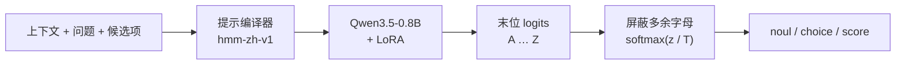

<div align="center">

# Chinese Decision

**中文概率决策模型：一次前向，直接输出候选项概率**

[](https://huggingface.co/Qwen/Qwen3.5-0.8B)
[](https://huggingface.co/datasets/bbldCVer-hf/CJ-Dataset)
[](https://huggingface.co/datasets/bbldCVer-hf/CJ-Bench)
[](https://github.com/n4ze3m/hmm)

中文 | [English](README_EN.md)

</div>

---

## 简介

**Chinese Decision** 是一个面向中文场景的轻量级**决策模型**。它不聊天、不生成文本，只做一件事：给定上下文和一组固定候选项，返回每个候选项的概率。

很多 AI 调用本质上是在有限选项中做判断——意图识别、工单分流、内容审核、数据打标、给模型输出打分、智能体的下一步动作选择等。用生成式大模型回答这类问题又慢又贵，且输出需要再解析。决策模型直接返回结构化的概率分布，程序拿到即可按阈值使用。

本项目基于 [Qwen3.5-0.8B](https://huggingface.co/Qwen/Qwen3.5-0.8B)，在 1,300 万条中文决策数据 [CJ-Dataset](https://huggingface.co/datasets/bbldCVer-hf/CJ-Dataset) 上进行 LoRA 微调，方法改编自 [n4ze3m/hmm](https://github.com/n4ze3m/hmm)，并在 [Chinese-Jev](https://arxiv.org/abs/2609.36965) 提出的 CJ-Bench 上与其论文结果对比。

**主要特点**

- ⚡ **一次前向，零输出 token**：读取最后位置上候选字母 `A`–`Z` 的 logits，softmax 后即为概率；不做自回归生成，也没有思维链。
- 🧩 **三种题型**：`noul`（是/否）、`choice`（单选）、`score`（有序等级，返回期望分值）。
- 🏆 **对标 Chinese-Jev**：CJ-Bench 通用领域准确率 **70.90%**，高于闭源 Jev（68.35%）和 Chinese-Jev General（69.20%）；**单一模型**在医疗、法律、金融上的准确率均超过 Chinese-Jev 的三个领域专用模型，平均 **74.14%**（Chinese-Jev-S 为 70.82%），其中医疗 **87.89%** 为对比模型中最高。
- 📏 **概率可用**：未经温度校准，CJ-Bench 整体 ECE 为 **0.84%**；专业领域平均 ECE 为 **1.49%**，是对比模型中最低的。
- 🪶 **轻量部署**：0.8B 参数，单卡 A800 单条中位延迟约 70 ms，批量吞吐约 133 条/秒，峰值显存 6.7 GB。
- 🔌 **兼容 hmm / System One 接口**：提供开箱即用的 HTTP 服务。

## 最新动态

- **2026-10-14**：完成 step 5000 checkpoint 在 CJ-Bench 全量测试集（307,900 条）上的评测，并与 Chinese-Jev 论文的 Table 1、Table 2 对比。
- **进行中**：4 卡 DDP 单 epoch 全量训练（13,048,000 条决策）。训练结束后将自动完成温度校准与权重合并，届时更新结果。

## 模型

| 模型 | 基础模型 | 参数量 | 最大输入 | 候选数 | 状态 |
|---|---|---:|---:|---:|---|
| `chinese-decision-0.8b` | Qwen3.5-0.8B | 0.8B | 16,384 tokens | 2–26 | 训练中（step 5000 已评测） |

## 工作原理



每个问题被编译成如下提示，套用 Qwen 聊天模板（关闭 thinking）：

```text
待判断的上下文：
{state}

问题：
{instructions}

候选项：
A: {key₁} — {描述₁}
B: {key₂} — {描述₂}
...
只返回候选项对应的字母。
```

训练、评测和服务共用同一个提示编译器，保证三者输入完全一致。

### 题型说明

| 类型 | `criteria` 格式 | 返回字段 |
|---|---|---|
| `noul` | 可选，`{"false": "...", "true": "..."}`，默认“否 / 是” | `noul`：判断为真的概率 |
| `choice` | 对象 `{键: 描述}` | `choice`：概率最大的键 |
| `score` | 列表，按等级从低到高排列 | `score`：等级下标的概率加权期望（0 到 K−1）；`legend`：下标到描述的映射 |

所有题型都会返回完整的 `probabilities` 和 `confidence`。其中 `confidence = (K·p_max − 1) / (K − 1)` 衡量分布的尖锐程度：均匀分布为 0，确定为 1。它**不等于**经验准确率。

## 评测结果

### 与 Chinese-Jev 论文对比

[Chinese-Jev](https://arxiv.org/abs/2609.36965)（Wang et al., 2026）提出了 CJ-Dataset 与 CJ-Bench。下表中的基线数字均**直接引自该论文**的 Table 1 和 Table 2，本项目未复现。本项目结果为 **step 5000 checkpoint**（按验证集分布 NLL 选出的 best adapter，约训练 1 个 epoch 的 50%），未做温度校准。每列最优结果**加粗**。

**通用领域（对应论文 Table 1）**

| 模型 | ACC (%) ↑ | ECE (%) ↓ | 延迟 (ms) ↓ |
|---|---:|---:|---:|
| Qwen3.5-2B | 32.95 | 43.68 | 280 |
| Open-Jev | 52.33 | 10.54 | 60 |
| SemIF | 44.21 | 27.27 | 57 |
| Laya Multilingual | 40.22 | 23.04 | **14** |
| Jev † | 68.35 | 11.45 | 284 |
| Chinese-Jev General | 69.20 | 3.78 | **14** |
| **Chinese Decision（本项目）** | **70.90** | **3.05** | 70 ‡ |

**专业领域（对应论文 Table 2）**

| 模型 | 医疗 ACC ↑ | 医疗 ECE ↓ | 法律 ACC ↑ | 法律 ECE ↓ | 金融 ACC ↑ | 金融 ECE ↓ | 平均 ACC ↑ | 平均 ECE ↓ | 平均延迟 (ms) ↓ |
|---|---:|---:|---:|---:|---:|---:|---:|---:|---:|
| Qwen3.5-2B | 53.88 | 28.71 | 31.53 | 44.82 | 38.11 | 49.12 | 41.17 | 40.88 | 322.33 |
| Open-Jev | 73.08 | 2.88 | 44.07 | 23.15 | 48.11 | 10.19 | 55.09 | 12.07 | 78.67 |
| SemIF | 62.17 | 10.39 | 43.07 | 19.99 | 47.89 | 18.45 | 51.04 | 16.28 | 51.33 |
| Laya | 24.55 | 43.05 | 34.72 | 31.49 | 38.31 | 26.18 | 32.53 | 33.57 | **15.00** |
| Jev † | 84.29 | 5.70 | **68.35** | 8.03 | **78.39** | 2.98 | **77.01** | 5.57 | 256.33 |
| Chinese-Jev-G | 39.77 | 17.33 | 38.76 | 15.37 | 35.39 | 14.43 | 37.97 | 15.71 | **15.00** |
| Chinese-Jev-S（3 个领域专用模型） | 87.65 | 7.25 | 60.10 | 17.45 | 64.72 | 11.55 | 70.82 | 12.08 | **15.00** |
| **Chinese Decision（单一模型）** | **87.89** | **0.30** | 63.37 | **2.30** | 71.17 | **1.89** | 74.14 | **1.49** | 70 ‡ |

> † Jev 为托管 API，延迟包含网络往返时间。
> ‡ 本项目延迟在单张 A800 上测得，且为四个领域的整体中位数；论文中其余模型在 H200 上测得，两者不能直接比较。
> “平均”为医疗、法律、金融三个领域指标的等权平均，与论文口径一致。

**主要结论**

- **通用领域**：准确率与 ECE 均为表中最优，准确率比 Jev 高 2.55 个百分点，比 Chinese-Jev General 高 1.70 个百分点。
- **专业领域**：医疗、法律、金融三个领域的准确率**均超过 Chinese-Jev-S**（分别高 0.24、3.27、6.45 个百分点），平均准确率达到 Jev 的 96.3%。医疗比 Jev 高 3.60 个百分点，为表中最高；法律与金融仍落后于 Jev（分别低 4.98 和 7.22 个百分点）。
- **校准**：未做任何温度校准，所有领域的 ECE 均低于 3.1%，专业领域平均 ECE 不到 Chinese-Jev-S 的 1/8。
- **单一模型**：Chinese-Jev-S 是三个分别微调的领域专用模型，本项目用**一个模型**覆盖全部四个领域。
- **延迟**：本模型参数量约为 Chinese-Jev（约 322M）的 2.5 倍，单条延迟更高。

**对比口径**

- 测试集相同：CJ-Bench 全量，通用 100,000、医疗 200,000、法律 4,300、金融 3,600 条。
- 指标定义相同：ACC 与 ECE 仅在单标签样本上计算（含硬标签 `score`），软标签样本不计入；ECE 使用 15 个等宽分箱；不在测试集上做任何校准。
- 候选项保持原始顺序，无过滤、无截断。

**与 Chinese-Jev 的方法差异**

| | Chinese-Jev | Chinese Decision（本项目） |
|---|---|---|
| 骨干网络 | mmBERT-base 编码器 + 决策 Transformer（约 322M） | Qwen3.5-0.8B 解码器 + LoRA |
| 候选打分 | 在候选标记位置上用共享 MLP 打分 | 读取末位候选字母的 logits |
| 训练目标 | 交叉熵 + RLCD 策略梯度项 | 候选分布交叉熵 |
| 训练方式 | 先做通用预训练，再分别微调三个领域专用模型 | 四个领域混合训练，单一模型 |

### 完整结果

<details>
<summary><b>CJ-Bench 分领域 / 分题型明细</b></summary>

> step 5000，未校准（T = 1），单卡 A800 80GB，BF16。ACC 与 ECE 仅计硬标签；NLL 与 Brier 覆盖全部样本（含软标签）。

**分领域**

| 领域 | 样本数 | ACC ↑ | ECE ↓ | NLL ↓ | Brier ↓ |
|---|---:|---:|---:|---:|---:|
| 通用 General | 100,000 | 70.90 | 3.05 | 0.767 | 0.376 |
| 医疗 Medical | 200,000 | 87.89 | 0.30 | 0.317 | 0.164 |
| 法律 Legal | 4,300 | 63.37 | 2.30 | 0.787 | 0.453 |
| 金融 Finance | 3,600 | 71.17 | 1.89 | 0.674 | 0.382 |
| **整体（micro）** | **307,900** | **81.95** | **0.84** | **0.474** | **0.240** |
| **四领域等权平均（macro）** | — | **73.33** | — | **0.636** | — |

> 医疗样本占测试集的 65%，整体 micro 指标主要反映医疗领域。跨领域比较时建议参考 macro 平均。

**分题型**

| 题型 | 样本数 | ACC ↑ | ECE ↓ | NLL ↓ | 期望等级 MAE ↓ |
|---|---:|---:|---:|---:|---:|
| `noul` | 134,577 | 94.58 | 0.79 | 0.129 | — |
| `choice` | 134,577 | 76.32 | 0.70 | 0.659 | — |
| `score` | 38,746 | 55.53 | 2.72 | 1.029 | 0.593 |

**领域 × 题型准确率（%）**

| 领域 | `noul` | `choice` | `score` |
|---|---:|---:|---:|
| 通用 | 86.83 | 70.23 | 54.08 |
| 医疗 | 97.64 | 78.82 | 65.09 |
| 法律 | 80.07 | 58.13 | 50.15 |
| 金融 | 76.67 | 62.08 | 74.75 |

</details>

<details>
<summary><b>微调前后对比（验证集）</b></summary>

在官方验证集的分层子集（4 个领域 × 3 种题型，每组 100 条，共 1,200 条）上，对比基础模型零样本与 step 5000 的结果：

| 领域 | Qwen3.5-0.8B ACC | **Chinese Decision ACC** | Qwen3.5-0.8B ECE | **Chinese Decision ECE** |
|---|---:|---:|---:|---:|
| 通用 | 36.64 | **74.32** | 28.25 | **5.05** |
| 医疗 | 16.67 | **82.00** | 43.40 | **4.09** |
| 法律 | 40.67 | **63.33** | 24.03 | **5.98** |
| 金融 | 44.33 | **69.67** | 16.77 | **6.24** |
| **整体** | 34.56 | **72.32** | 27.45 | **3.77** |

</details>

### 推理效率

| 指标 | 数值 |
|---|---:|
| 单条延迟（batch = 1，预热后中位数） | 70.1 ms |
| 批量吞吐 | 133 条决策/秒 |
| 批量评测峰值显存 | 6.7 GB |
| CJ-Bench 平均输入长度 | 223 tokens |

> 硬件为单张 A800 80GB PCIe，BF16。延迟包含本地输入编码、前向计算和概率输出，不含 HTTP 和网络开销。

## 快速开始

### 安装

```bash
git clone https://github.com/yanqiangmiffy/chinese-decision.git
cd chinese-decision
pip install -e .
```

需要 Python ≥ 3.11 和 CUDA GPU。主要依赖：`torch>=2.8`、`transformers>=5.3`、`peft>=0.19`、`flash-linear-attention>=0.4`。如果环境里已经装好了 CUDA 版 PyTorch，不希望 pip 改动它，可以使用 `pip install -e . --no-deps`。

### 准备模型与数据

模型和数据均从本地目录加载。可以使用 Hugging Face CLI 下载（CJ 数据集目前需要申请访问，下载前先运行 `hf auth login`）：

```bash
hf download Qwen/Qwen3.5-0.8B --local-dir models/Qwen3.5-0.8B
```

```bash
hf download bbldCVer-hf/CJ-Dataset --repo-type dataset --local-dir datasets/CJ-Dataset
```

```bash
hf download bbldCVer-hf/CJ-Bench --repo-type dataset --local-dir datasets/CJ-Bench
```

### Python 调用

```python
import json
from pathlib import Path

import torch
from decision.model import forward_batch, letter_tokens, load_model, load_tokenizer
from decision.schema import compile_prompt, options_for

base = "models/chinese-decision-0.8b"  # 合并后的模型；也可用 load_model("models/Qwen3.5-0.8B", adapter="runs/cj-ddp/best")
tokenizer = load_tokenizer(base)
model = load_model(base).eval()
letters = letter_tokens(tokenizer, "cuda")
config = Path(base, "decision_config.json")
temperature = json.loads(config.read_text())["temperature"] if config.exists() else 1.0

state = "客户留言：付款后一直没有收到发票，我已经催了三次，今天必须拿到。"
question = {
    "type": "choice",
    "instructions": "应该由哪个部门处理？",
    "criteria": {"billing": "支付、发票及退款", "technical": "故障和系统问题", "sales": "购买咨询与升级"},
}

options = options_for(question)
prompt = compile_prompt(tokenizer, state, question["instructions"], options)
item = {"input_ids": tokenizer.encode(prompt, add_special_tokens=False), "target": [0.0] * len(options)}
with torch.inference_mode():
    logits, _ = forward_batch(model, tokenizer, letters, [item])
probs = (logits[0, :len(options)] / temperature).softmax(-1).tolist()
print({key: round(p, 4) for (key, _), p in zip(options, probs)})
```

### HTTP 服务

```bash
python scripts/serve.py --base models/chinese-decision-0.8b --port 8787
```

也可以直接加载基础模型和 adapter：`--base models/Qwen3.5-0.8B --adapter runs/cj-ddp/best`（此时温度为 1，即未校准）。

一个请求可以同时包含多个问题：

```bash
curl http://127.0.0.1:8787/v1/systemone \
  -H 'Content-Type: application/json' \
  --data-binary @examples/request.json
```

```json
{
  "state": "客户留言：付款后一直没有收到发票，我已经催了三次，今天必须拿到。",
  "questions": {
    "urgent": {"type": "noul", "instructions": "客户是否表达了紧迫性？"},
    "department": {"type": "choice", "instructions": "应该由哪个部门处理？",
                   "criteria": {"billing": "支付、发票及退款", "technical": "故障和系统问题", "sales": "购买咨询与升级"}},
    "frustration": {"type": "score", "instructions": "客户有多不满？",
                    "criteria": ["平静", "不满", "非常愤怒"]}
  }
}
```

返回格式如下（数值仅为格式示意）：

```json
{
  "model": "chinese-decision-0.8b",
  "answers": {
    "urgent": {"type": "noul", "probabilities": {"false": 0.04, "true": 0.96}, "confidence": 0.92, "noul": 0.96},
    "department": {"type": "choice", "probabilities": {"billing": 0.97, "technical": 0.02, "sales": 0.01},
                   "confidence": 0.955, "choice": "billing"},
    "frustration": {"type": "score", "probabilities": {"0": 0.02, "1": 0.38, "2": 0.60}, "confidence": 0.40,
                    "score": 1.58, "legend": {"0": "平静", "1": "不满", "2": "非常愤怒"}}
  },
  "usage": {"input_tokens": 242, "output_tokens": 0},
  "latency_ms": 85.3
}
```

| 接口 | 说明 |
|---|---|
| `POST /v1/systemone` | 决策接口 |
| `POST /api/alpha/decisions` | 同上，兼容 hmm 路由 |
| `GET /health` | 健康检查，返回当前温度及是否已校准 |

单个请求最多 64 个问题，每个问题 2–26 个候选项，单题输入不超过 16,384 tokens。超长输入**不会被截断**，非法请求返回 `422`。

检查一个正在运行的服务（两个路由、概率格式、非法请求处理）：

```bash
python scripts/verify_export.py --url http://127.0.0.1:8787
```

## 训练

### 训练配置

| 项目 | 设置 |
|---|---|
| 基础模型 | Qwen3.5-0.8B（文本主干） |
| 微调方式 | LoRA，r = 32，α = 64，dropout = 0.05 |
| LoRA 目标层 | 全注意力 `q/k/v/o_proj`、线性注意力 `in_proj_qkv/z/a/b`、`out_proj`、MLP `gate/up/down_proj` |
| 损失函数 | 候选分布交叉熵（软标签；硬标签为其 one-hot 特例） |
| 优化器 | AdamW，lr = 1e-4，前 100 步线性预热，之后余弦衰减至峰值的 10% |
| 全局 batch | 每步累积至少 1,024 条决策；每个 micro-batch 在 padding 后最多 262,144 tokens，长样本自动减小 micro-batch |
| 最大长度 | 16,384 tokens |
| 训练量 | 1 epoch，13,048,000 条决策（约 1 万步） |
| 精度 | BF16，gradient checkpointing |
| 模型选择 | 每 1,000 步在验证集上评估，以分布 NLL 选出 best |
| 硬件 | 4 × GPU，DDP |

### 数据与训练要点

- **软标签**：CJ 的 `gold` 是候选项上的概率分布，直接以分布交叉熵为目标。
- **候选项打乱**：`choice` 在训练时随机打乱候选顺序并同步重排目标，以减弱位置偏差；`score` 保留等级顺序；`noul` 固定为 false / true。
- **均衡混合**：先按领域、来源、题型重新分片，再按剩余样本量比例交错流式读取，避免原始文件中的任务顺序导致遗忘；全量数据不载入内存。
- **按长度分桶**：按 token 数组 batch。超过 16,384 tokens 的样本会被显式统计并过滤，从不截断上下文或问题。
- **校准不泄漏**：官方 validation 按母记录分组，80% 用于验证与模型选择，另外 20% 仅用于拟合温度。

### 训练流程

```bash
# 1. 校验数据文件的 SHA256，再按领域 / 来源 / 题型重新分片训练数据
python scripts/prepare_data.py --data datasets/CJ-Dataset --out datasets/CJ-mixed

# 2. LoRA 训练（示例为 4 卡；单卡直接运行 python scripts/train.py；断点续训追加 --resume）
torchrun --standalone --nproc_per_node=4 scripts/train.py --out runs/cj-ddp

# 3. 温度校准 + 合并权重 + 导出模型的 HTTP 接口检查
python scripts/finalize.py --run runs/cj-ddp --out models/chinese-decision-0.8b
```

`scripts/train.py` 的默认参数就是上表中的正式配置。`--resume` 会逐项比对 `config.json`，参数与原运行不一致时拒绝恢复；恢复时可以改变 GPU 数量。快速调试可以加上 `--debug-examples 512 --max-steps 12 --global-batch-size 8`。

训练目录中，`last/` 是断点恢复点，`best/` 是验证集上最优的 adapter，`final/` 是最后一步的 adapter。导出的模型目录包含合并权重、`decision_config.json`（校准温度等）、训练配置与摘要，以及基础模型的 `LICENSE`。

## 评测

```bash
# 1. 将验证集选出的 best adapter 复制到独立的快照目录
python scripts/snapshot_best.py --source-run runs/cj-ddp --out runs/cj-bench/my-eval

# 2. 先快评（每个领域 × 题型抽 1,000 条），再全量评测
python scripts/evaluate.py --snapshot-run runs/cj-bench/my-eval --data datasets/CJ-Bench
```

- 只做快评：追加 `--quick-only`。
- 评测合并后的部署模型（使用验证集上拟合的温度）：追加 `--model models/chinese-decision-0.8b`。
- 脚本不会覆盖已有结果，每次评测请使用新的快照目录。所有校准与模型选择都只使用验证集，不使用测试集标签。

## 项目结构

```text
chinese-decision/
├── decision/               # 核心库（pip install -e .）
│   ├── schema.py           #   题型解析、目标分布、提示编译器
│   ├── data.py             #   数据分片、流式混合、按 token 分 batch
│   ├── model.py            #   模型加载与候选字母 logits
│   ├── training.py         #   验证评估、LoRA 目标层、检查点工具
│   ├── metrics.py          #   验证集指标与 CJ-Bench 指标
│   ├── api.py              #   决策响应格式与校验
│   └── utils.py            #   日志、原子写入、SHA256
├── scripts/                # 命令行入口
│   ├── prepare_data.py     #   数据校验与重新分片
│   ├── train.py            #   LoRA 训练（单卡 / torchrun 多卡）
│   ├── finalize.py         #   温度校准、权重合并、导出检查
│   ├── verify_export.py    #   HTTP 接口端到端检查
│   ├── snapshot_best.py    #   冻结 best adapter 用于评测
│   ├── evaluate.py         #   CJ-Bench 评测
│   └── serve.py            #   HTTP 服务
├── tests/                  # 单元测试（不需要 GPU）
├── examples/request.json   # 请求示例
├── pyproject.toml
├── LICENSE
└── THIRD_PARTY_NOTICES.md
```

运行测试：

```bash
python -m unittest discover -s tests
```

## 局限性

- **训练尚未完成**：当前公开的结果来自 step 5000、未经温度校准的 adapter，训练结束后会更新。
- **法律与金融仍有差距**：两个领域的准确率仍比闭源 Jev 低 5–7 个百分点；`score` 题型整体偏弱（如法律 `score` 准确率 50.15%）。
- **延迟高于编码器方案**：0.8B 解码器的单条延迟高于约 322M 的 Chinese-Jev 编码器模型。
- **`confidence` 不是准确率**：它只反映分布的尖锐程度。若要按阈值自动执行，请先在自己的数据上验证校准效果。
- **标签含义来自上游任务**：例如医疗匹配类标签表示原任务中的匹配关系，并不代表医学正确性。请勿将模型输出作为医疗、法律或金融决策的唯一依据。
- **仅针对中文训练**，不适用于开放式生成。
- 本项目是 hmm 方法的中文适配，并不复现 Microsoft Decision、Jev 或 Chinese-Jev 的训练过程。

## 致谢

- [Chinese-Jev](https://arxiv.org/abs/2609.36965)：CJ-Dataset、CJ-Bench 以及本文对比所用的基线结果。
- [n4ze3m/hmm](https://github.com/n4ze3m/hmm)：选项字母决策目标、LoRA 流程、候选项格式与 System One 响应约定（MIT）。
- [Qwen3.5-0.8B](https://huggingface.co/Qwen/Qwen3.5-0.8B)：基础模型（Apache-2.0）。

## 许可证

- 本项目代码以 [MIT 许可证](LICENSE) 发布。
- 改编自 hmm 的部分同样遵循 MIT 许可证，原始版权声明见 [THIRD_PARTY_NOTICES](THIRD_PARTY_NOTICES.md)。
- 基础模型 Qwen3.5-0.8B 遵循 Apache-2.0，导出的模型目录会保留其原始 `LICENSE`。
- CJ-Dataset 与 CJ-Bench 的许可按数据来源分别适用（部分来源为非商业许可），本项目不授予任何额外的再分发权限。

## 引用

```bibtex
@misc{chinese-decision-2026,
  title        = {Chinese Decision: A Lightweight Chinese Probabilistic Decision Model},
  author       = {yanqiangmiffy},
  year         = {2026},
  howpublished = {\url{https://github.com/yanqiangmiffy/chinese-decision}}
}
```

如果使用了 CJ-Dataset 或 CJ-Bench，请同时引用 Chinese-Jev：

```bibtex
@misc{wang2026chinesejev,
  title         = {Chinese-Jev: Bringing System One Model to Chinese-Language Tasks},
  author        = {Wang, Zexiao and Zhang, Zihao and Wang, Xudong and Wang, Pan and Ye, Ziyi and Zhao, Haoyu and Wu, Zuxuan and Yan, Shuicheng},
  year          = {2026},
  eprint        = {2609.36965},
  archivePrefix = {arXiv},
  primaryClass  = {cs.CL}
}
```
