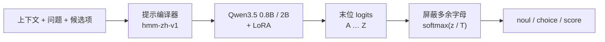

<div align="center">

# Chinese Decision

**中文概率决策模型：一次前向，直接输出候选项概率**

[](docs/MODELS.md)
[](https://huggingface.co/datasets/bbldCVer-hf/CJ-Dataset)
[](https://huggingface.co/datasets/bbldCVer-hf/CJ-Bench)
[](https://github.com/n4ze3m/hmm)
[](https://huggingface.co/quincyqiang/chinese-decision-0.8b)
[](https://modelscope.cn/models/quincyqiang/chinese-decision-0.8b)
[](https://huggingface.co/quincyqiang/chinese-decision-0.8b-gguf)
[](https://github.com/yanqiangmiffy/chinese-decision-studio)

中文 | [English](README_EN.md)

</div>

---

## 简介

**Chinese Decision** 是一个面向中文场景的轻量级**决策模型**。它不聊天、不生成文本，只做一件事：给定上下文和一组固定候选项，返回每个候选项的概率。

很多 AI 调用本质上是在有限选项中做判断——意图识别、工单分流、内容审核、数据打标、给模型输出打分、智能体的下一步动作选择等。用生成式大模型回答这类问题又慢又贵，且输出需要再解析。决策模型直接返回结构化的概率分布，程序拿到即可按阈值使用。

本项目提供 [Qwen3.5-0.8B](https://huggingface.co/Qwen/Qwen3.5-0.8B) 与 [Qwen3.5-2B](https://huggingface.co/Qwen/Qwen3.5-2B) 两个尺寸，在 1,300 万条中文决策数据 [CJ-Dataset](https://huggingface.co/datasets/bbldCVer-hf/CJ-Dataset) 上进行 LoRA 微调，方法改编自 [n4ze3m/hmm](https://github.com/n4ze3m/hmm)，并在 [Chinese-Jev](https://arxiv.org/abs/2609.36965) 提出的 CJ-Bench 上与其论文结果对比。

**主要特点**

- ⚡ **一次前向，零输出 token**：读取最后位置上候选字母 `A`–`Z` 的 logits，softmax 后即为概率；不做自回归生成，也没有思维链。
- 🧩 **三种题型**：`noul`（是/否）、`choice`（单选）、`score`（有序等级，返回期望分值）。
- 🏆 **两种模型尺寸**：2B 未校准 adapter 在 CJ-Bench 上整体 ACC **84.11%**，医法金等权平均 **78.19%**；0.8B 对应为 **83.11% / 76.98%**。法律判断与金融评分等部分任务仍是 0.8B 更好。
- 📏 **部署成绩单独报告**：2B BF16 合并交付版使用验证集温度，整体 ACC **84.11%**、ECE **0.64%**；未校准、合并及量化结果分别记录。
- 🪶 **GPU / CPU 部署**：两个尺寸均提供 BF16 与 Q8_0 GGUF。2B Q8_0 只有 **2.01 GB**（比 BF16 小约 46.5%），CJ-Bench 全量 ACC **84.11%**，与 BF16 交付版的首选项一致率 **99.00%**；CPU 上用 llama.cpp 运行，不需要 PyTorch。
- 🔌 **兼容 hmm / System One 接口**：提供开箱即用的 HTTP 服务。

## 最新动态

- **2026-10-17**：发布 2B 权重（[BF16](https://huggingface.co/quincyqiang/chinese-decision-2b) / [Q8_0 GGUF](https://huggingface.co/quincyqiang/chinese-decision-2b-gguf)，ModelScope 同步）。2B Q8_0（2.01 GB）完成 CJ-Bench 全量 307,900 条评测，ACC **84.1094%**、ECE **0.6534%**，相比 BF16 净少对 4 条；CPU / HTTP 检查见 [2B CPU 部署与检查记录](docs/CPU_2B.md)。
- **2026-10-17**：Qwen3.5-2B + LoRA + RLCD 完成训练与全量 CJ-Bench（13,048,000 条训练数据，best step 4994）。未校准整体 ACC **84.11%**、专业三领域平均 **78.19%**；校准 BF16 交付版整体 ECE **0.64%**。各阶段 checkpoint 全量结果见下文 [2B 训练阶段历史](#2b-训练阶段历史)，来源退化、评分题短板和部署说明见 [2B 训练与交付记录](docs/TRAINING_2B.md)。
- **2026-10-15**：开源决策模型测试平台 [Decision Studio](https://github.com/yanqiangmiffy/chinese-decision-studio)：决策实验台、8 个应用场景、鲁棒性实验室、评测中心和性能压测，`docker compose up` 一条命令启动；可以直接接 GPU 服务（`scripts/serve_gpu.py`），也可以接 CPU 上的 GGUF 服务（`scripts/serve.py`）。
- **2026-10-15**：完整训练结束（1 epoch，13,048,000 条决策，10,132 步）。验证集最优的 step 10000 在 CJ-Bench 上通用领域准确率 72.24%，专业领域平均 76.98%，与闭源 Jev 基本持平；已合并权重，并在验证集的独立划分上拟合温度 T = 1.108。
- **2026-10-14**：完成 step 5000 checkpoint 在 CJ-Bench 全量测试集（307,900 条）上的评测，并与 Chinese-Jev 论文的 Table 1、Table 2 对比。

## 模型

| 模型 | 基础模型 / 训练目标 | 格式 / 权重大小 | 默认温度 | 下载 | Model Card |
|---|---|---|---:|---|---|
| Chinese Decision 0.8B | Qwen3.5-0.8B / CE | BF16 / 1.50 GB | 1.108133 | [HF](https://huggingface.co/quincyqiang/chinese-decision-0.8b) · [ModelScope](https://modelscope.cn/models/quincyqiang/chinese-decision-0.8b) | [0.8B](docs/MODEL_CARD_0_8B.md) |
| Chinese Decision 0.8B Q8_0 | 同一 0.8B 合并权重 | GGUF / 0.812 GB | 1.108133 | [HF](https://huggingface.co/quincyqiang/chinese-decision-0.8b-gguf) · [ModelScope](https://modelscope.cn/models/quincyqiang/chinese-decision-0.8b-gguf) | [0.8B GGUF](docs/MODEL_CARD_0_8B_GGUF.md) |
| Chinese Decision 2B | Qwen3.5-2B / CE + RLCD | BF16 / 3.76 GB | 1.074872 | [HF](https://huggingface.co/quincyqiang/chinese-decision-2b) · [ModelScope](https://modelscope.cn/models/quincyqiang/chinese-decision-2b) | [2B](docs/MODEL_CARD_2B.md) |
| Chinese Decision 2B Q8_0 | 同一 2B 合并权重 | GGUF / 2.01 GB | 1.074872 | [HF](https://huggingface.co/quincyqiang/chinese-decision-2b-gguf) · [ModelScope](https://modelscope.cn/models/quincyqiang/chinese-decision-2b-gguf) | [2B GGUF](docs/MODEL_CARD_2B_GGUF.md) |

四个版本都已在 CJ-Bench 全量 307,900 条上完成评测（成绩见[评测结果](#评测结果)），全部支持 16384 tokens 与 2–26 个候选；大小为十进制 GB，不是运行内存。

**怎么选**：GPU 上优先 2B BF16（准确率最高）；CPU 或内存受限时用 Q8_0 GGUF，不需要 PyTorch；对延迟和资源最敏感、或主要处理法律判断 / 金融评分类任务时，0.8B 仍有优势。完整选型、分领域和外部基线见 [模型总览](docs/MODELS.md)。

代码：[本仓库](https://github.com/yanqiangmiffy/chinese-decision)。测试平台：[Decision Studio](https://github.com/yanqiangmiffy/chinese-decision-studio)。

## 应用案例

以下截图来自我们的测试平台 Decision Studio，后端运行 0.8B 的最终 step 10000 模型。这些场景采用同一种设计：**业务规则写在代码里，决策模型只负责给出概率**。

### 工单分诊台：一次请求，六个判断

每张工单在一次请求里同时问 6 个问题：类别（`choice`），严重程度和情绪（`score`），是否可复现、是否要求退款、是否有流失风险（`noul`）。不管后续用不用得上都一并提问，省去多次往返。路由规则写在代码里，根据这些概率决定工单派给哪个队列；类别置信度低于 0.5 时转人工复核。截图中 8 张工单 × 6 个问题共 48 次决策，用时 285 ms。


### LLM 护栏：带人工复核区间的安全检查

进出大模型的每句话都先过一道检查。输入侧检查提示注入 / 越狱、隐私信息、辱骂威胁、超出业务范围；输出侧检查泄露系统提示词、越权承诺、回复含隐私、不当内容。每项都是一个是 / 否概率，配两个阈值：低于复核阈值自动放行，高于拦截阈值自动拦截，中间交给人工，复核区间的宽度就是人工审核的预算。截图中的"开发者模式"越狱请求在输入侧就被拦截（85.2%），大模型不会被调用；8 项检查共用时 89.2 ms。


### 弹幕护卫：直播弹幕实时审核

每条弹幕一次请求，包含一个分类和一个是 / 否判断：辱骂和广告直接拦截，剧透折叠，观众提问高亮推给主播。截图中审核延迟 p50 为 82.2 ms。页面也记录了已知短板：剧透判断容易被"剧透"这个字眼本身带偏（例如"请勿剧透"），也分不清"猜测"和"剧透"。


### 智能体路由器：按风险分级的置信度门控

智能体收到每句话后，先由决策模型选择工具、判断信息是否完整、评估操作风险，再按风险等级套用不同的置信度门槛：只读操作（天气、搜索、闲聊）40%，写操作（日程、消息、家居）65%，资金操作（转账、支付）85%。截图中"帮我约王总下周二下午聊一下预算"被识别为日程管理（置信度 99%），但缺少关键信息的概率为 71%，超过 70% 的追问门槛，于是先追问"具体是哪天、几点、和谁"，用时 81.6 ms。


## 工作原理



每个问题被编译成如下提示，套用 Qwen 聊天模板（关闭 thinking）：

```text
待判断的上下文：
{state}

问题：
{instructions}

候选项：
A: {key₁} — {描述₁}
B: {key₂} — {描述₂}
...
只返回候选项对应的字母。
```

训练、评测和服务共用同一个提示编译器，保证三者输入完全一致。

### 题型说明

| 类型 | `criteria` 格式 | 返回字段 |
|---|---|---|
| `noul` | 可选，`{"false": "...", "true": "..."}`，默认“否 / 是” | `noul`：判断为真的概率 |
| `choice` | 对象 `{键: 描述}` | `choice`：概率最大的键 |
| `score` | 列表，按等级从低到高排列 | `score`：等级下标的概率加权期望（0 到 K−1）；`legend`：下标到描述的映射 |

所有题型都会返回完整的 `probabilities` 和 `confidence`。其中 `confidence = (K·p_max − 1) / (K − 1)` 衡量分布的尖锐程度：均匀分布为 0，确定为 1。它**不等于**经验准确率。

## 评测结果

### 模型系列与部署配置

以下结果均覆盖 CJ-Bench 全部 307,900 条（硬标签 304,822、软标签 3,078），无过滤、无截断；ACC/ECE 仅硬标签，15-bin ECE，NLL/Brier 包含软标签。Macro 为四领域等权平均。T=1 是未合并 adapter，部署行使用各自已有的验证集温度。

| 模型 | Micro ACC (%) ↑ | Macro ACC (%) ↑ | ECE (%) ↓ | NLL ↓ | Brier ↓ | Score MAE ↓ |
| --- | ---: | ---: | ---: | ---: | ---: | ---: |
| 0.8B adapter / T=1 | 83.1088 | 75.7970 | 1.0656 | 0.432327 | 0.224075 | 0.578770 |
| 2B adapter / T=1 | 84.1097 | 77.1313 | 1.4914 | 0.419089 | 0.213828 | 0.560682 |
| 0.8B BF16 / T=1.108133 | 83.1052 | 75.7376 | 0.2706 | 0.431318 | 0.223833 | 0.584427 |
| 0.8B Q8_0 / T=1.108133 | 83.1233 | 75.8092 | 0.2696 | 0.431293 | 0.223815 | 0.583973 |
| 2B BF16 / T=1.074872 | 84.1107 | 77.1750 | 0.6361 | 0.416520 | 0.213295 | 0.564216 |
| 2B Q8_0 / T=1.074872 | 84.1094 | 77.3282 | 0.6534 | 0.416288 | 0.213189 | 0.563738 |

**量化影响很小，但不是逐条无损。** 两个 Q8_0 都与同温度的 BF16 合并版逐条配对比较：2B 首选项一致率 **99.00%**（304,826 / 307,900），硬标签 1,105 条由对变错、1,101 条由错变对，净少对 4 条；NLL、Brier、Score MAE 略降，整体 ECE 略升（0.64% → 0.65%）。2B Q8_0 的 Macro 高出 0.15 个百分点，主要来自法律领域（4,300 条中净多对 28 条），不代表量化提升了能力。0.8B Q8_0 的一致率为 98.92%，量级相同。全量质量在 llama.cpp CUDA 上测量，CPU 只做接口与有限输入检查；分领域、逐条差异和 CPU 实测见 [2B GGUF 模型卡](docs/MODEL_CARD_2B_GGUF.md) 与 [0.8B GGUF 模型卡](docs/MODEL_CARD_0_8B_GGUF.md)。

### 与 Chinese-Jev 论文对比

外部模型取自 [Chinese-Jev v1 Table 1 / Table 2](https://arxiv.org/html/2609.36965v1)，2026-10-17 核对，均为作者报告值，本项目未复现。项目行分别是验证集选出的 **0.8B step10000 / 2B step4994 adapter，T=1**。下表单位均为 %；论文 H200/API 与本地 A800 的延迟口径不同，不作等价排名。

**通用领域（Table 1）**

| 模型 | ACC (%) ↑ | ECE (%) ↓ |
| --- | ---: | ---: |
| Qwen3.5-2B | 32.95 | 43.68 |
| Open-Jev | 52.33 | 10.54 |
| SemIF | 44.21 | 27.27 |
| Laya Multilingual | 40.22 | 23.04 |
| Jev (API) | 68.35 | 11.45 |
| Chinese-Jev General / Specialists | 69.20 | 3.78 |
| 0.8B adapter / T=1 | 72.24 | 3.03 |
| 2B adapter / T=1 | 73.95 | 3.01 |

**专业领域（Table 2）**

| 模型 | Medical ACC | Medical ECE | Legal ACC | Legal ECE | Finance ACC | Finance ECE | Avg. ACC | Avg. ECE |
| --- | ---: | ---: | ---: | ---: | ---: | ---: | ---: | ---: |
| Qwen3.5-2B | 53.88 | 28.71 | 31.53 | 44.82 | 38.11 | 49.12 | 41.17 | 40.88 |
| Open-Jev | 73.08 | 2.88 | 44.07 | 23.15 | 48.11 | 10.19 | 55.09 | 12.07 |
| SemIF | 62.17 | 10.39 | 43.07 | 19.99 | 47.89 | 18.45 | 51.04 | 16.28 |
| Laya Multilingual | 24.55 | 43.05 | 34.72 | 31.49 | 38.31 | 26.18 | 32.53 | 33.57 |
| Jev (API) | 84.29 | 5.70 | 68.35 | 8.03 | 78.39 | 2.98 | 77.01 | 5.57 |
| Chinese-Jev General | 39.77 | 17.33 | 38.76 | 15.37 | 35.39 | 14.43 | 37.97 | 15.71 |
| Chinese-Jev General / Specialists | 87.65 | 7.25 | 60.10 | 17.45 | 64.72 | 11.55 | 70.82 | 12.08 |
| 0.8B adapter / T=1 | 88.86 | 0.17 | 67.86 | 5.70 | 74.22 | 1.50 | 76.98 | 2.46 |
| 2B adapter / T=1 | 89.50 | 0.73 | 69.05 | 3.78 | 76.03 | 1.98 | 78.19 | 2.17 |

Chinese-Jev General 加三个 Specialist 是四个分别模型；本项目每个尺寸分别用一个模型覆盖四领域。Jev 是闭源 API。专业平均按医疗、法律、金融等权。2B 相比 0.8B 的 micro / 四领域 macro / 专业平均分别增加 1.0009 / 1.3344 / 1.2110 个百分点，但未校准整体 ECE 更高。模型规模、batch、RLCD 同时改变，不能当作 RLCD 的独立收益；金融仍低于 Jev 的作者报告值。[论文来源](https://arxiv.org/html/2609.36965v1)

**与 Chinese-Jev 的方法差异**

| | Chinese-Jev | Chinese Decision（本项目） |
|---|---|---|
| 骨干网络 | mmBERT-base 编码器 + 决策 Transformer（约 322M） | Qwen3.5-0.8B / 2B 解码器 + LoRA |
| 候选打分 | 在候选标记位置上用共享 MLP 打分 | 读取末位候选字母的 logits |
| 训练目标 | 交叉熵 + RLCD 策略梯度项 | 0.8B 使用候选分布交叉熵；2B 另加 RLCD（见交付记录） |
| 训练方式 | 先做通用预训练，再分别微调三个领域专用模型 | 四个领域混合训练，单一模型 |

### 0.8B 训练阶段历史

同一次训练中按验证集分布 NLL 先后选出的四个 best checkpoint，都在 CJ-Bench 全量测试集上以相同口径评测（未校准，307,900 条全覆盖）。最后两行引自 Chinese-Jev 论文，供参考。

| Checkpoint | 训练进度 | 验证集 NLL ↓ | 通用 ACC ↑ | 医疗 ACC ↑ | 法律 ACC ↑ | 金融 ACC ↑ | 专业平均 ACC ↑ | 专业平均 ECE ↓ | 整体 ECE ↓ |
|---|---:|---:|---:|---:|---:|---:|---:|---:|---:|
| step 2000 | 19.82% | 0.739 | 69.04 | 86.78 | 54.07 | 64.17 | 68.34 | 2.73 | 1.63 |
| step 3000 | 29.71% | 0.691 | 70.26 | 87.22 | 58.93 | 68.67 | 71.61 | 1.75 | 1.25 |
| step 5000 | 49.41% | 0.676 | 70.90 | 87.89 | 63.37 | 71.17 | 74.14 | 1.49 | 0.84 |
| **step 10000（最终）** | 98.71% | 0.600 | 72.24 | 88.86 | 67.86 | 74.22 | 76.98 | 2.46 | 1.07 |
| *参考：Chinese-Jev（G / S）* | — | — | 69.20 | 87.65 | 60.10 | 64.72 | 70.82 | 12.08 | — |
| *参考：Jev* | — | — | 68.35 | 84.29 | 68.35 | 78.39 | 77.01 | 5.57 | — |

> 进度按日志中的实际训练样本量计算：step2000 / 3000 / 5000 / 10000 为 2,586,624 / 3,876,160 / 6,447,104 / 12,879,232 条，即整轮的 19.82% / 29.71% / 49.41% / 98.71%。独立的 2B 全阶段结果见 [交付记录](docs/TRAINING_2B.md)。

- **四个领域持续提升**：从 step 2000 到 step 10000，法律提升 13.79 个百分点，金融提升 10.06，通用提升 3.20，医疗提升 2.08。
- **从 step 3000 起超过 Chinese-Jev-S**：专业领域平均准确率从 68.34% 提升到 76.98%，与 Jev（77.01%）的差距从 8.67 缩小到 0.03 个百分点。
- **校准没有随训练单调改善**：在不做温度校准的情况下，整体 ECE 从 1.63% 降到 step 5000 的 0.84%，最终为 1.07%；专业领域平均 ECE 在 step 5000 最低（1.49%），最终为 2.46%，主要来自法律领域（ECE 从 2.30% 升到 5.70%）。
- 验证集 NLL 持续下降（0.739 → 0.600），与测试集准确率的提升方向一致。

### 2B 训练阶段历史

2B（CE + RLCD）每 1000 步按验证集分布 NLL 选出的 best checkpoint，均在 CJ-Bench 全量 307,900 条上以相同口径评测（未合并 adapter，T = 1，无过滤、无截断）。最后一行是合并并校准后的交付版。

| Checkpoint | 训练进度 | 验证集 NLL ↓ | 通用 ACC ↑ | 医疗 ACC ↑ | 法律 ACC ↑ | 金融 ACC ↑ | 专业平均 ACC ↑ | 专业平均 ECE ↓ | 整体 ECE ↓ |
|---|---:|---:|---:|---:|---:|---:|---:|---:|---:|
| step 1000 | 20.08% | 0.694 | 70.55 | 87.69 | 55.67 | 66.94 | 70.10 | 3.71 | 2.03 |
| step 2000 | 40.13% | 0.630 | 72.56 | 88.54 | 62.67 | 71.44 | 74.22 | 2.28 | 1.27 |
| step 3000 | 60.11% | 0.603 | 71.87 | 88.99 | 65.56 | 74.31 | 76.28 | 1.63 | 1.63 |
| step 4000 | 80.18% | 0.592 | 73.77 | 89.42 | 68.40 | 76.03 | 77.95 | 1.74 | 0.85 |
| **step 4994（最终）** | 100.00% | 0.586 | 73.95 | 89.50 | 69.05 | 76.03 | 78.19 | 2.17 | 1.49 |
| *交付版（合并，T = 1.075）* | — | — | 73.96 | 89.50 | 68.74 | 76.50 | 78.25 | 1.92 | 0.64 |

> 进度按实际已训练样本计算：step 1000 / 2000 / 3000 / 4000 / 4994 为 2,619,904 / 5,236,736 / 7,842,752 / 10,461,952 / 13,048,000 条。2B 与 0.8B 的步数不能直接对照（全局 batch 分别约 2048 / 1024），应按样本进度比较。

- **法律、金融提升最多**：从 step 1000 到最终，法律提升 13.37 个百分点，金融提升 9.08，通用提升 3.39，医疗提升 1.81。
- **从 step 2000 起超过 Chinese-Jev（G / S）**，step 4000 起专业平均超过闭源 Jev（77.01%），最终领先 1.18 个百分点；金融单项仍低于 Jev。
- **step 3000 通用领域回落 0.69 个百分点**：主要来自商品分类来源（3,151 条）准确率从 75.06% 崩落到 30.05%，step 4000 恢复，详见 [2B 交付记录](docs/TRAINING_2B.md#来源退化与剩余短板)。
- **后段进入平台期**：step 4000 → 4994 整体准确率只再提高 0.12 个百分点，未校准整体 ECE 从 0.85% 回升到 1.49%；温度校准后的交付版为 0.64%。
- 同样约 20% 样本进度下，2B step 1000 的整体准确率比 0.8B step 2000 高 1.13 个百分点；模型规模、batch 与 RLCD 同时改变，不能归因于单一因素。

### 分领域 / 分题型明细

<details>
<summary><b>0.8B（step 10000）CJ-Bench 分领域 / 分题型明细</b></summary>

> step 10000，未校准（T = 1），单卡 A800 80GB，BF16。ACC 与 ECE 仅计硬标签；NLL 与 Brier 覆盖全部样本（含软标签）。

**分领域**

| 领域 | 样本数 | ACC ↑ | ECE ↓ | NLL ↓ | Brier ↓ |
|---|---:|---:|---:|---:|---:|
| 通用 General | 100,000 | 72.24 | 3.03 | 0.693 | 0.356 |
| 医疗 Medical | 200,000 | 88.86 | 0.17 | 0.293 | 0.152 |
| 法律 Legal | 4,300 | 67.86 | 5.70 | 0.728 | 0.414 |
| 金融 Finance | 3,600 | 74.22 | 1.50 | 0.593 | 0.336 |
| **整体（micro）** | **307,900** | **83.11** | **1.07** | **0.432** | **0.224** |
| **四领域等权平均（macro）** | — | **75.80** | — | **0.577** | — |

> 医疗样本占测试集的 65%，整体 micro 指标主要反映医疗领域。跨领域比较时建议参考 macro 平均。

**分题型**

| 题型 | 样本数 | ACC ↑ | ECE ↓ | NLL ↓ | 期望等级 MAE ↓ |
|---|---:|---:|---:|---:|---:|
| `noul` | 134,577 | 94.95 | 0.39 | 0.117 | — |
| `choice` | 134,577 | 78.33 | 1.48 | 0.588 | — |
| `score` | 38,746 | 56.47 | 2.35 | 0.987 | 0.579 |

**领域 × 题型准确率（%）**

| 领域 | `noul` | `choice` | `score` |
|---|---:|---:|---:|
| 通用 | 87.57 | 72.88 | 54.66 |
| 医疗 | 97.81 | 80.57 | 66.53 |
| 法律 | 85.80 | 64.13 | 51.46 |
| 金融 | 76.50 | 63.08 | 83.08 |

</details>

<details>
<summary><b>2B（step 4994）CJ-Bench 分领域 / 分题型明细</b></summary>

> step 4994，未合并 adapter，未校准（T = 1），单卡 A800 80GB，BF16，与上面 0.8B 明细同口径。合并交付版与 Q8_0 的分领域 / 分题型结果见 [2B 模型卡](docs/MODEL_CARD_2B.md#分领域与分题型) 和 [2B GGUF 模型卡](docs/MODEL_CARD_2B_GGUF.md#分领域与分题型)。

**分领域**

| 领域 | 样本数 | ACC ↑ | ECE ↓ | NLL ↓ | Brier ↓ |
|---|---:|---:|---:|---:|---:|
| 通用 General | 100,000 | 73.95 | 3.01 | 0.669 | 0.337 |
| 医疗 Medical | 200,000 | 89.50 | 0.73 | 0.285 | 0.146 |
| 法律 Legal | 4,300 | 69.05 | 3.78 | 0.705 | 0.407 |
| 金融 Finance | 3,600 | 76.03 | 1.98 | 0.579 | 0.324 |
| **整体（micro）** | **307,900** | **84.11** | **1.49** | **0.419** | **0.214** |
| **四领域等权平均（macro）** | — | **77.13** | — | **0.560** | — |

**分题型**

| 题型 | 样本数 | ACC ↑ | ECE ↓ | NLL ↓ | 期望等级 MAE ↓ |
|---|---:|---:|---:|---:|---:|
| `noul` | 134,577 | 95.09 | 0.62 | 0.115 | — |
| `choice` | 134,577 | 80.14 | 2.15 | 0.564 | — |
| `score` | 38,746 | 57.64 | 2.62 | 0.972 | 0.561 |

**领域 × 题型准确率（%）**

| 领域 | `noul` | `choice` | `score` |
|---|---:|---:|---:|
| 通用 | 87.94 | 76.22 | 56.03 |
| 医疗 | 97.87 | 81.83 | 66.22 |
| 法律 | 82.53 | 67.40 | 55.38 |
| 金融 | 81.42 | 66.83 | 79.83 |

> 相对 0.8B，12 个领域 × 题型组合中有 9 个提升；法律判断（`noul`，82.53 vs 85.80）和金融评分（`score`，79.83 vs 83.08）明显下降，医疗评分略降（66.22 vs 66.53），详见[局限性](#局限性)。

</details>

<details>
<summary><b>0.8B 微调前后对比（验证集）</b></summary>

在官方验证集的分层子集（4 个领域 × 3 种题型，每组 100 条，共 1,200 条）上，对比基础模型零样本与 step 10000 的结果：

| 领域 | Qwen3.5-0.8B ACC | **Chinese Decision ACC** | Qwen3.5-0.8B ECE | **Chinese Decision ECE** |
|---|---:|---:|---:|---:|
| 通用 | 36.64 | **75.34** | 28.25 | **3.76** |
| 医疗 | 16.67 | **82.00** | 43.40 | **3.25** |
| 法律 | 40.67 | **65.33** | 24.03 | **7.62** |
| 金融 | 44.33 | **71.33** | 16.77 | **3.41** |
| **整体** | 34.56 | **73.49** | 27.45 | **2.48** |

</details>

### 推理效率

| 指标 | 0.8B adapter | 2B adapter | 2B 合并交付版 |
|---|---:|---:|---:|
| 单条延迟（batch = 1，预热后 60 条中位数） | 70.1 ms | 69.0 ms | 44.7 ms |
| 全量评测批量吞吐 | 132 条/秒 | 82.5 条/秒 | 145.9 条/秒 |
| 批量评测峰值显存 | 6.7 GB | 10.6 GB | 9.3 GB |

> 单张 A800 80GB PCIe，BF16；CJ-Bench 平均输入长度 223 tokens。延迟包含本地输入编码、前向计算和概率输出，不含 HTTP 和网络开销。服务器为共享环境，各次运行使用不同物理 GPU，合并版省去了 LoRA 分支的额外计算；列间差异不是严格受控的速度实验。Q8_0 在 GPU / CPU 上的同组输入延迟见 [2B GGUF 模型卡](docs/MODEL_CARD_2B_GGUF.md#推理效率) 与 [0.8B GGUF 模型卡](docs/MODEL_CARD_0_8B_GGUF.md#推理效率)。

## 快速开始

### 安装

```bash
git clone https://github.com/yanqiangmiffy/chinese-decision.git
cd chinese-decision
pip install -e ".[train]"
```

需要 Python ≥ 3.11。上面的 `[train]` 安装 CUDA 训练/推理依赖；CPU GGUF 服务使用 `pip install -e ".[gguf]"`，不需要 PyTorch、PEFT 或 flash-linear-attention。只使用 Transformers 推理可安装 `.[torch]`。如果环境里已经装好了 CUDA 版 PyTorch，不希望 pip 改动它，可以使用 `pip install -e . --no-deps`。

### 准备模型与数据

只想使用模型、不训练的话，直接下载已发布的权重（四个版本的链接见[模型](#模型)）。按需选择一个即可：

```bash
# GPU：BF16 合并权重
hf download quincyqiang/chinese-decision-2b --local-dir models/chinese-decision-2b
hf download quincyqiang/chinese-decision-0.8b --local-dir models/chinese-decision-0.8b
# CPU：Q8_0 GGUF，不需要 PyTorch
hf download quincyqiang/chinese-decision-2b-gguf --local-dir models/chinese-decision-2b-gguf
hf download quincyqiang/chinese-decision-0.8b-gguf --local-dir models/chinese-decision-0.8b-gguf
# 国内网络也可以用 ModelScope，仓库名相同，例如
modelscope download --model quincyqiang/chinese-decision-2b --local_dir models/chinese-decision-2b
modelscope download --model quincyqiang/chinese-decision-2b-gguf --local_dir models/chinese-decision-2b-gguf
```

训练和评测所需的基础模型与数据均从本地目录加载。可以使用 Hugging Face CLI 下载（CJ 数据集目前需要申请访问，下载前先运行 `hf auth login`）：

```bash
hf download Qwen/Qwen3.5-0.8B --local-dir models/Qwen3.5-0.8B
hf download Qwen/Qwen3.5-2B --local-dir models/Qwen3.5-2B   # 训练 2B 时
```

```bash
hf download bbldCVer-hf/CJ-Dataset --repo-type dataset --local-dir datasets/CJ-Dataset
```

```bash
hf download bbldCVer-hf/CJ-Bench --repo-type dataset --local-dir datasets/CJ-Bench
```

### 启动 2B 服务

下载好对应模型目录后，在项目根运行。GPU BF16：

```bash
python scripts/serve_gpu.py --base models/chinese-decision-2b --host 127.0.0.1 --port 8789 --token-budget 16384 --max-batch 32
```

CPU Q8_0（安装 `[gguf]` 依赖）：

```bash
python scripts/serve.py --backend gguf --base models/chinese-decision-2b-gguf --gguf models/chinese-decision-2b-gguf/chinese-decision-2b-Q8_0.gguf --threads 8 --context-size 16384 --host 127.0.0.1 --port 8790
```

两者都读取 `decision_config.json` 中的校准温度，接口与下文 HTTP 服务一致。直接 Python 推理见 [2B BF16 模型卡](docs/MODEL_CARD_2B.md)，CPU 环境见 [2B Q8_0 模型卡](docs/MODEL_CARD_2B_GGUF.md)。下面的 Python 与 HTTP 示例以 0.8B 为例，把路径换成 2B 目录即可。

### Python 调用（0.8B 示例）

```python
import json
from pathlib import Path

import torch
from decision.model import forward_batch, letter_tokens, load_model, load_tokenizer
from decision.schema import compile_prompt, options_for

base = "models/chinese-decision-0.8b"  # 合并后的模型；也可用 load_model("models/Qwen3.5-0.8B", adapter="runs/cj-ddp/best")
tokenizer = load_tokenizer(base)
model = load_model(base).eval()
letters = letter_tokens(tokenizer, "cuda")
config = Path(base, "decision_config.json")
temperature = json.loads(config.read_text())["temperature"] if config.exists() else 1.0

state = "客户留言：付款后一直没有收到发票，我已经催了三次，今天必须拿到。"
question = {
    "type": "choice",
    "instructions": "应该由哪个部门处理？",
    "criteria": {"billing": "支付、发票及退款", "technical": "故障和系统问题", "sales": "购买咨询与升级"},
}

options = options_for(question)
prompt = compile_prompt(tokenizer, state, question["instructions"], options)
item = {"input_ids": tokenizer.encode(prompt, add_special_tokens=False), "target": [0.0] * len(options)}
with torch.inference_mode():
    logits, _ = forward_batch(model, tokenizer, letters, [item])
probs = (logits[0, :len(options)] / temperature).softmax(-1).tolist()
print({key: round(p, 4) for (key, _), p in zip(options, probs)})
```

### HTTP 服务

```bash
python scripts/serve.py --base models/chinese-decision-0.8b --port 8787
```

也可以直接加载基础模型和 adapter：`--base models/Qwen3.5-0.8B --adapter runs/cj-ddp/best`（此时温度为 1，即未校准）。

CPU 上使用 Q8_0 GGUF（转换步骤与验证说明见 [CPU 部署](docs/CPU.md)）：

```bash
python scripts/serve.py --backend gguf --base models/chinese-decision-0.8b-gguf --gguf models/chinese-decision-0.8b-gguf/chinese-decision-0.8b-Q8_0.gguf --threads 8 --context-size 16384 --port 8787
```

`--base` 提供分词器、提示模板和 `decision_config.json`，`--gguf` 提供权重。服务读取最后输入位置的候选字母 logits，不调用文本生成；两个原有接口、三种题型和温度计算均保持一致。上下文超过 `--context-size` 或模型配置的较小限制时返回 `422`，不会截断。原始 Transformers CPU 基线可使用 `--device cpu`，此时加载 FP32 权重。

一个请求可以同时包含多个问题：

```bash
curl http://127.0.0.1:8787/v1/systemone \
  -H 'Content-Type: application/json' \
  --data-binary @examples/request.json
```

```json
{
  "state": "客户留言：付款后一直没有收到发票，我已经催了三次，今天必须拿到。",
  "questions": {
    "urgent": {"type": "noul", "instructions": "客户是否表达了紧迫性？"},
    "department": {"type": "choice", "instructions": "应该由哪个部门处理？",
                   "criteria": {"billing": "支付、发票及退款", "technical": "故障和系统问题", "sales": "购买咨询与升级"}},
    "frustration": {"type": "score", "instructions": "客户有多不满？",
                    "criteria": ["平静", "不满", "非常愤怒"]}
  }
}
```

返回格式如下（数值仅为格式示意）：

```json
{
  "model": "chinese-decision-0.8b",
  "answers": {
    "urgent": {"type": "noul", "probabilities": {"false": 0.04, "true": 0.96}, "confidence": 0.92, "noul": 0.96},
    "department": {"type": "choice", "probabilities": {"billing": 0.97, "technical": 0.02, "sales": 0.01},
                   "confidence": 0.955, "choice": "billing"},
    "frustration": {"type": "score", "probabilities": {"0": 0.02, "1": 0.38, "2": 0.60}, "confidence": 0.40,
                    "score": 1.58, "legend": {"0": "平静", "1": "不满", "2": "非常愤怒"}}
  },
  "usage": {"input_tokens": 242, "output_tokens": 0},
  "latency_ms": 85.3
}
```

| 接口 | 说明 |
|---|---|
| `POST /v1/systemone` | 决策接口；`?debug=1` 附带每个候选的 logits 和每题 token 数 |
| `POST /api/alpha/decisions` | 同上，兼容 hmm 路由 |
| `POST /v1/batch` | `{"requests": [...], "debug": bool}`，一次提交多个请求，单个请求出错不影响其他 |
| `POST /v1/compile` | 只编译提示词并计数 token，不跑模型 |
| `GET /v1/info` | 检查点、验证集指标、运行统计 |
| `GET /v1/training` | 训练进度 |
| `GET /health` | 健康检查，返回当前温度、是否已校准及检查点 step |

单个请求最多 64 个问题，每个问题 2–26 个候选项，单题输入不超过 16,384 tokens。超长输入**不会被截断**，非法请求返回 `422`。

### 部署

两个服务入口，接口和返回格式一致，都可以直接作为 [Decision Studio](https://github.com/yanqiangmiffy/chinese-decision-studio)（测试平台）的 `DECISION_BASE_URL`：

| 入口 | 适用场景 | 权重 | 部署 |
|---|---|---|---|
| `scripts/serve.py` | CPU（GGUF）或单机调试；逐题前向 | GGUF：[HF](https://huggingface.co/quincyqiang/chinese-decision-0.8b-gguf) · [ModelScope](https://modelscope.cn/models/quincyqiang/chinese-decision-0.8b-gguf)（也可加载 BF16） | [docs/CPU.md](docs/CPU.md)、[deploy/gguf](deploy/gguf/) |
| `scripts/serve_gpu.py` | GPU 生产服务；动态批处理、训练进度、检查点热更新（`POST /v1/admin/reload`） | BF16：[HF](https://huggingface.co/quincyqiang/chinese-decision-0.8b) · [ModelScope](https://modelscope.cn/models/quincyqiang/chinese-decision-0.8b)，或基础模型 + 训练出的 adapter | [deploy/gpu](deploy/gpu/README.md) |

检查一个正在运行的服务（两个路由、概率格式、非法请求处理）：

```bash
python scripts/verify_export.py --url http://127.0.0.1:8787
```

## 训练

### 训练配置

下表保留 0.8B 训练配置；2B 的 CE + RLCD 配置和实际样本进度见 [2B 交付记录](docs/TRAINING_2B.md)。

| 项目 | 设置 |
|---|---|
| 基础模型 | Qwen3.5-0.8B（文本主干） |
| 微调方式 | LoRA，r = 32，α = 64，dropout = 0.05 |
| LoRA 目标层 | 全注意力 `q/k/v/o_proj`、线性注意力 `in_proj_qkv/z/a/b`、`out_proj`、MLP `gate/up/down_proj` |
| 损失函数 | 候选分布交叉熵（软标签；硬标签为其 one-hot 特例）；RLCD 项可选，默认关闭 |
| 优化器 | AdamW，lr = 1e-4，前 100 步线性预热，之后余弦衰减至峰值的 10% |
| 全局 batch | 每步累积至少 1,024 条决策；每个 micro-batch 在 padding 后最多 262,144 tokens，长样本自动减小 micro-batch |
| 最大长度 | 16,384 tokens |
| 训练量 | 1 epoch，13,048,000 条决策，10,132 步 |
| 精度 | BF16，gradient checkpointing |
| 模型选择 | 每 1,000 步在验证集上评估，以分布 NLL 选出 best（最终为 step 10000） |
| 温度校准 | 在 validation 的独立划分上拟合单一温度，T = 1.108 |
| 硬件 | 4 × GPU，DDP |

### 数据与训练要点

- **软标签**：CJ 的 `gold` 是候选项上的概率分布，直接以分布交叉熵为目标。
- **候选项打乱**：`choice` 在训练时随机打乱候选顺序并同步重排目标，以减弱位置偏差；`score` 保留等级顺序；`noul` 固定为 false / true。
- **均衡混合**：先按领域、来源、题型重新分片，再按剩余样本量比例交错流式读取，避免原始文件中的任务顺序导致遗忘；全量数据不载入内存。
- **按长度分桶**：按 token 数组 batch。超过 16,384 tokens 的样本会被显式统计并过滤，从不截断上下文或问题。
- **校准不泄漏**：官方 validation 按母记录分组，80% 用于验证与模型选择，另外 20% 仅用于拟合温度。

### 训练流程

```bash
# 1. 校验数据文件的 SHA256，再按领域 / 来源 / 题型重新分片训练数据
python scripts/prepare_data.py --data datasets/CJ-Dataset --out datasets/CJ-mixed

# 2. LoRA 训练（示例为 4 卡；单卡直接运行 python scripts/train.py；断点续训追加 --resume）
torchrun --standalone --nproc_per_node=4 scripts/train.py --out runs/cj-ddp

# 3. 温度校准 + 合并权重 + 导出模型的 HTTP 接口检查
python scripts/finalize.py --run runs/cj-ddp --out models/chinese-decision-0.8b
```

`scripts/train.py` 的默认参数就是上表中的正式配置。`--resume` 会逐项比对 `config.json`，参数与原运行不一致时拒绝恢复；恢复时可以改变 GPU 数量。快速调试可以加上 `--debug-examples 512 --max-steps 12 --global-batch-size 8`。

训练目录中，`last/` 是断点恢复点，`best/` 是验证集上最优的 adapter，`final/` 是最后一步的 adapter。导出的模型目录包含合并权重、`decision_config.json`（校准温度等）、训练配置与摘要，以及基础模型的 `LICENSE`。

### 可选：RLCD 训练目标

`--rlcd` 会在分布交叉熵之外加入 Chinese-Jev 的 RLCD 项（基于适当评分规则奖励的策略梯度）。实现移植自 [Chinese-Jev 官方代码](https://github.com/gulucaptain/Chinese-Jev)，计算结果与原实现逐位一致。**默认关闭；本页原有 0.8B 结果未使用 RLCD，新增 2B 运行开启了 RLCD。**

每个训练步对候选项 logits 做若干组零均值高斯扰动，用"对数得分 + 0.75 × 球面得分 − RPS"给每个扰动后的分布打分（RPS 只对 `score` 题生效），再把 logits 推向得分高于同组平均的扰动方向。RPS 让离正确等级越远的错误扣分越多，是唯一考虑等级顺序的项，因此最可能帮助 `score` 题。

| 参数 | 默认值 | 说明 |
|---|---|---|
| `--rlcd` | 关闭 | 开启 RLCD 项，与交叉熵按 1:1 相加 |
| `--rlcd-group-size` | 4 | 每道题的扰动组数（至少为 2） |
| `--rlcd-sigma-start` | 0.4 | 训练开始时 logits 噪声的大小 |
| `--rlcd-sigma-end` | 0.1 | 训练结束时的噪声大小，按训练进度线性退火 |

- **与原实现的差异**：Chinese-Jev 按 epoch 退火 σ（训练 4 个 epoch，依次为 0.4 / 0.3 / 0.2 / 0.1）；本项目只训练 1 个 epoch，因此改为按训练进度线性退火。σ 是直接加在 logits 上的噪声，大模型字母 logits 的量级可能与 Chinese-Jev 打分头不同，默认值只是起点。
- **配置与续训**：开启后 `config.json` 会记录 RLCD 参数，`training_algorithm` 带 `+rlcd` 后缀，交叉熵运行和 RLCD 运行不能互相续训。不开启时配置与之前完全一致，已有运行照常续训。
- **日志**：每步额外输出 `ce`、`rlcd`、`reward` 和 `sigma`。

**对照实验**：用相同参数加 `--rlcd` 从头开一个新运行。两个运行的数据顺序、验证集和 LoRA 初始化都相同，只有训练目标不同。

```bash
torchrun --standalone --nproc_per_node=4 scripts/train.py --out runs/cj-ddp-rlcd --rlcd
```

不要加 `--max-steps`，否则学习率和 σ 的调度会被压缩，与基线不可比。在 step 1000 或 2000 的验证完成后停止，对比两个运行同一步的验证集指标（每次验证都会写入 `latest_metrics.json`，包含分题型结果），重点看 `type:score`。

## 评测

```bash
# 1. 将验证集选出的 best adapter 复制到独立的快照目录
python scripts/snapshot_best.py --source-run runs/cj-ddp --out runs/cj-bench/my-eval

# 2. 先快评（每个领域 × 题型抽 1,000 条），再全量评测
python scripts/evaluate.py --snapshot-run runs/cj-bench/my-eval --data datasets/CJ-Bench
```

- 只做快评：追加 `--quick-only`。
- 评测合并后的部署模型（使用验证集上拟合的温度）：追加 `--model models/chinese-decision-0.8b`。
- 脚本不会覆盖已有结果，每次评测请使用新的快照目录。所有校准与模型选择都只使用验证集，不使用测试集标签。

## 项目结构

```text
chinese-decision/
├── decision/               # 核心库（pip install -e .）
│   ├── schema.py           #   题型解析、目标分布、提示编译器
│   ├── data.py             #   数据分片、流式混合、按 token 分 batch
│   ├── model.py            #   模型加载与候选字母 logits
│   ├── inference.py        #   服务后端：Transformers 与 GGUF（llama.cpp）
│   ├── gguf_batch.py       #   llama.cpp 无 padding 批量评测
│   ├── training.py         #   验证评估、LoRA 目标层、检查点工具
│   ├── rlcd.py             #   可选 RLCD 训练项（移植自 Chinese-Jev）
│   ├── metrics.py          #   验证集指标与 CJ-Bench 指标
│   ├── api.py              #   决策响应格式与校验
│   └── utils.py            #   日志、原子写入、SHA256
├── scripts/                # 命令行入口
│   ├── prepare_data.py     #   数据校验与重新分片
│   ├── train.py            #   LoRA 训练（单卡 / torchrun 多卡）
│   ├── finalize.py         #   温度校准、权重合并、导出检查
│   ├── snapshot_best.py    #   冻结 best adapter 用于评测
│   ├── evaluate.py         #   CJ-Bench 评测
│   ├── convert_gguf.py     #   导出 GGUF（BF16 / Q8_0）
│   ├── evaluate_gguf.py    #   用 GGUF 权重跑 CJ-Bench
│   ├── benchmark_*.py      #   CPU 延迟与吞吐测试；compare_gguf_benchmark.py 做配对比较
│   ├── verify_export.py    #   HTTP 接口端到端检查
│   ├── serve.py            #   HTTP 服务：CPU / GGUF、单机调试
│   └── serve_gpu.py        #   HTTP 服务：GPU 生产部署（动态批处理、热更新）
├── deploy/
│   ├── gpu/                # GPU 部署脚本（本机 deploy.sh → 服务器 tmux）
│   └── gguf/               # CPU 部署脚本（push / install / service）
├── docs/
│   ├── MODELS.md           #   模型总览：选型、结果口径、外部基线
│   ├── MODEL_CARD_*.md     #   四个模型卡（0.8B / 2B × BF16 / Q8_0）
│   ├── TRAINING_2B.md      #   2B 训练、导出与诊断记录
│   ├── CPU.md              #   0.8B CPU 部署与 GGUF 验证
│   └── CPU_2B.md           #   2B CPU 部署与量化检查
├── tests/                  # 单元测试（不需要 GPU）
├── examples/request.json   # 请求示例
├── assets/                 # README 配图
├── pyproject.toml
├── LICENSE
├── LICENSES/               # 第三方许可证全文
└── THIRD_PARTY_NOTICES.md
```

运行测试：

```bash
python -m unittest discover -s tests
```

## 局限性

- **配置要分开解读**：T=1 adapter、合并部署版和 Q8_0 都有全量结果，但合并取整、温度和量化的影响会叠加，比较时请对齐配置，不要把差值归因于单一因素。Q8_0 全量在 GPU（llama.cpp CUDA）上测得，CPU 后端只做了有限输入对照。校准验证集不能当测试集，整体 ECE 低也不代表每个来源都校准良好。
- **改善并不均匀**：2B 提升整体表现，但 T=1 法律判断 / 金融评分 ACC 为 82.53% / 79.83%，低于 0.8B 的 85.80% / 83.08%；金融仍落后 Jev，商品分类存在训练波动，详见 [2B 诊断](docs/TRAINING_2B.md)。
- **延迟高于编码器方案**：0.8B / 2B 解码器的单条延迟高于约 322M 的 Chinese-Jev 编码器模型。
- **`confidence` 不是准确率**：它只反映分布的尖锐程度。若要按阈值自动执行，请先在自己的数据上验证校准效果。
- **标签含义来自上游任务**：例如医疗匹配类标签表示原任务中的匹配关系，并不代表医学正确性。请勿将模型输出作为医疗、法律或金融决策的唯一依据。
- **仅针对中文训练**，不适用于开放式生成。
- 本项目是 hmm 方法的中文适配，并不复现 Microsoft Decision、Jev 或 Chinese-Jev 的训练过程。

## 致谢

- [Chinese-Jev](https://arxiv.org/abs/2609.36965)：CJ-Dataset、CJ-Bench、本文对比所用的基线结果，以及 RLCD 训练项的[参考实现](https://github.com/gulucaptain/Chinese-Jev)（Apache-2.0）。
- [n4ze3m/hmm](https://github.com/n4ze3m/hmm)：选项字母决策目标、LoRA 流程、候选项格式与 System One 响应约定（MIT）。
- [Qwen3.5-0.8B](https://huggingface.co/Qwen/Qwen3.5-0.8B) 与 [Qwen3.5-2B](https://huggingface.co/Qwen/Qwen3.5-2B)：基础模型（Apache-2.0）。

## 许可证

- 本项目代码以 [MIT 许可证](LICENSE) 发布。
- 改编自 hmm 的部分同样遵循 MIT 许可证，原始版权声明见 [THIRD_PARTY_NOTICES](THIRD_PARTY_NOTICES.md)。
- `decision/rlcd.py` 改编自 Chinese-Jev，遵循 Apache-2.0，许可证全文见 [LICENSES/Apache-2.0.txt](LICENSES/Apache-2.0.txt)。
- 基础模型 Qwen3.5-0.8B 与 Qwen3.5-2B 遵循 Apache-2.0，导出的模型目录会保留其原始 `LICENSE`。
- CJ-Dataset 与 CJ-Bench 的许可按数据来源分别适用（部分来源为非商业许可），本项目不授予任何额外的再分发权限。

## 引用

```bibtex
@misc{chinese-decision-2026,
  title        = {Chinese Decision: A Lightweight Chinese Probabilistic Decision Model},
  author       = {yanqiangmiffy},
  year         = {2026},
  howpublished = {\url{https://github.com/yanqiangmiffy/chinese-decision}}
}
```

如果使用了 CJ-Dataset 或 CJ-Bench，请同时引用 Chinese-Jev：

```bibtex
@misc{wang2026chinesejev,
  title         = {Chinese-Jev: Bringing System One Model to Chinese-Language Tasks},
  author        = {Wang, Zexiao and Zhang, Zihao and Wang, Xudong and Wang, Pan and Ye, Ziyi and Zhao, Haoyu and Wu, Zuxuan and Yan, Shuicheng},
  year          = {2026},
  eprint        = {2609.36965},
  archivePrefix = {arXiv},
  primaryClass  = {cs.CL}
}
```
