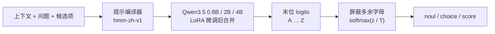

<div align="center">

# Chinese Decision

**中文概率决策模型：一次前向，直接输出候选项概率**

[](docs/MODELS.md)
[](https://huggingface.co/datasets/bbldCVer-hf/CJ-Dataset)
[](https://huggingface.co/datasets/bbldCVer-hf/CJ-Bench)
[](https://github.com/n4ze3m/hmm)
[](https://arxiv.org/abs/2610.23170)
[](https://huggingface.co/quincyqiang/chinese-decision-4b)
[](https://modelscope.cn/models/quincyqiang/chinese-decision-4b)
[](https://huggingface.co/quincyqiang/chinese-decision-4b-gguf)
[](https://huggingface.co/quincyqiang/chinese-decision-unified-0.8b)
[](https://huggingface.co/quincyqiang/chinese-decision-unified-2b)
[](https://huggingface.co/datasets/quincyqiang/CJ-IE)
[](https://github.com/yanqiangmiffy/chinese-decision-studio)

📄 论文：[Chinese Decision: A Family of Language Models for Single-Pass Probabilistic Decision-Making](https://arxiv.org/abs/2610.23170)（arXiv:2610.23170，v2）

中文 | [English](README_EN.md)

</div>

---

## 简介

**Chinese Decision** 是一个面向中文场景的轻量级**决策模型**。它不聊天、不生成文本，只做一件事：给定上下文和一组固定候选项，返回每个候选项的概率。

很多 AI 调用本质上是在有限选项中做判断——意图识别、工单分流、内容审核、数据打标、给模型输出打分、智能体的下一步动作选择等。用生成式大模型回答这类问题又慢又贵，且输出需要再解析。决策模型直接返回结构化的概率分布，程序拿到即可按阈值使用。

本项目提供 [Qwen3.5-0.8B](https://huggingface.co/Qwen/Qwen3.5-0.8B)、[Qwen3.5-2B](https://huggingface.co/Qwen/Qwen3.5-2B) 与 [Qwen3.5-4B](https://huggingface.co/Qwen/Qwen3.5-4B) 三个尺寸，在 1,300 万条中文决策数据 [CJ-Dataset](https://huggingface.co/datasets/bbldCVer-hf/CJ-Dataset) 上进行 LoRA 微调，方法改编自 [n4ze3m/hmm](https://github.com/n4ze3m/hmm)，并在 [Chinese-Jev](https://arxiv.org/abs/2609.36965) 提出的 CJ-Bench 上与其论文结果对比。方法、结果与分析见论文 [arXiv:2610.23170](https://arxiv.org/abs/2610.23170)。

此外还有**统一模型**（[Unified 0.8B 与 Unified 2B](#统一模型)，4B 计划中）：同一份权重在决策之外多一种读出，可以做类型化信息抽取（命名实体、关系、事件论元）。

**主要特点**

- ⚡ **一次前向，零输出 token**：读取最后位置上候选字母 `A`–`Z` 的 logits，softmax 后即为概率；不做自回归生成，也没有思维链。
- 🧩 **三种题型**：`noul`（是/否）、`choice`（单选）、`score`（有序等级，返回期望分值）。
- 🔢 **类别数不止 26 个**：单题每个候选对应一个字母（A–Z，训练数据覆盖 2–16 个）；类别更多的 `choice` 问题用 [`/v1/tournament`](#http-服务) 分组淘汰后决赛，每组仍在训练覆盖范围内，不需要重新训练。
- 🏆 **三种尺寸，单模型覆盖四个领域**：chinese-decision-4b 在 CJ-Bench 全量上整体 ACC **85.97%**，医疗 / 法律 / 金融平均 **84.00%**，四个领域的准确率均高于论文报告的 Chinese-Jev（专业平均 70.82%）和闭源 Jev（77.01%）；chinese-decision-2b 为 **84.11% / 78.25%**，chinese-decision-0.8b 为 **83.11% / 76.90%**。
- 📏 **概率经过校准**：发布权重附带验证集拟合的温度，整体 ECE 4B 为 **1.00%**、2B 为 **0.64%**、0.8B 为 **0.27%**，三个尺寸四个领域的 ECE 都低于论文中的模型。
- 🪶 **GPU / CPU 部署**：三个尺寸均提供 BF16 与 Q8_0 GGUF。chinese-decision-4b-gguf 为 **4.48 GB**（比 BF16 小约 46.7%），CJ-Bench 全量 ACC **85.99%**，与 BF16 版的首选项一致率 **99.19%**；CPU 上用 llama.cpp 运行，不需要 PyTorch。
- 🔌 **兼容 hmm / System One 接口**：提供开箱即用的 HTTP 服务。
- 🧬 **统一模型：一份权重，两种读出**：[Unified 0.8B / 2B](#统一模型) 从原始 Qwen3.5 联合训练，决策之外再提供类型化信息抽取，两种读出都不生成文本。CJ-Bench 全量 ACC 分别为 **83.46% / 85.00%**（纯决策 0.8B / 2B 为 83.11% / 84.11%，T = 1），CJ-IE 测试集抽取 micro F1 为 **63.1 / 66.0**；4B 版计划中。

## 最新动态

- 🧬 **2026-10-27**：发布 **chinese-decision-unified-2b**（🤗 [Hugging Face](https://huggingface.co/quincyqiang/chinese-decision-unified-2b) · [ModelScope](https://www.modelscope.cn/models/quincyqiang/chinese-decision-unified-2b)）。统一 2B 在 CJ-Bench 全量上 ACC **85.00%**（纯决策 2B 为 84.11%，同为 T = 1），CJ-IE 测试集抽取 micro F1 **66.0**（统一 0.8B 为 63.1）。详见[统一模型](#统一模型)与[模型卡](docs/MODEL_CARD_UNIFIED_2B.md)。
- 🗂️ **2026-10-26**：公开抽取训练数据 **CJ-IE**（🤗 [Hugging Face](https://huggingface.co/datasets/quincyqiang/CJ-IE) · [ModelScope](https://www.modelscope.cn/datasets/quincyqiang/CJ-IE)）：把公开的中文 NER、关系和事件语料整理成统一格式（类型带定义），并派生选择 / 判断题。它是多个第三方语料的整理，部分来源为非商业许可，使用前请阅读[数据卡](docs/DATASET_CARD_CJ_IE.md)。
- 🧬 **2026-10-25**：发布 **chinese-decision-unified-0.8b**（🤗 [Hugging Face](https://huggingface.co/quincyqiang/chinese-decision-unified-0.8b) · [ModelScope](https://modelscope.cn/models/quincyqiang/chinese-decision-unified-0.8b)）。一份权重、两种读出：请求带 `questions` 走决策，带 `types` 走抽取；决策准确率没有因为加入抽取而下降（CJ-Bench 全量 **83.46%**，纯决策 0.8B 为 83.11%）。详见[统一模型](#统一模型)与[模型卡](docs/MODEL_CARD_UNIFIED_0_8B.md)。
- 📄 **2026-10-23**：论文 **[arXiv:2610.23170](https://arxiv.org/abs/2610.23170)** 更新到 v2：补入训练完成的 2B 与新增的 4B（均附 Q8_0 版本），新增按母记录聚类的 bootstrap、校准、选择性预测与量化分析，并重新设计了版面。v1 提交于 2026-10-16。
- 🚀 **2026-10-21**：发布 **chinese-decision-4b**（🤗 [Hugging Face](https://huggingface.co/quincyqiang/chinese-decision-4b) · [ModelScope](https://modelscope.cn/models/quincyqiang/chinese-decision-4b)）与 CPU 版 **chinese-decision-4b-gguf**（Q8_0，4.48 GB；🤗 [Hugging Face](https://huggingface.co/quincyqiang/chinese-decision-4b-gguf) · [ModelScope](https://modelscope.cn/models/quincyqiang/chinese-decision-4b-gguf)）。4B 整体 ACC **85.97%**、专业平均 **84.00%**、ECE **1.00%**，4 个领域 × 3 种题型的 12 个组合全部高于 0.8B 与 2B；Q8_0 全量 ACC **85.99%**，与 BF16 首选项一致率 **99.19%**。各尺寸训练过程中的 checkpoint 评测统一整理到 [训练过程 checkpoint 评测](docs/TRAINING_HISTORY.md)。
- 🔢 **2026-10-18**：新增分组淘汰接口 [`/v1/tournament`](#http-服务)，`choice` 问题的类别数不再受 A–Z 26 个字母限制（服务端默认上限 1024，由 `decision/tournament.py` 的 `MAX_CANDIDATES` 设定）。候选先随机分成每组不超过 16 个，各组前几名晋级决赛，不需要重新训练；GPU 与 CPU 服务都已支持。示例 [examples/tournament.json](examples/tournament.json) 有 41 个客服意图，在 GPU 服务上换用 10 条留言全部选对，每题 4 次前向、约 150 ms。
- 🚀 **2026-10-17**：发布 **chinese-decision-2b**（🤗 [Hugging Face](https://huggingface.co/quincyqiang/chinese-decision-2b) · [ModelScope](https://modelscope.cn/models/quincyqiang/chinese-decision-2b)）与 CPU 版 **chinese-decision-2b-gguf**（Q8_0，2.01 GB；🤗 [Hugging Face](https://huggingface.co/quincyqiang/chinese-decision-2b-gguf) · [ModelScope](https://modelscope.cn/models/quincyqiang/chinese-decision-2b-gguf)）。2B 整体 ACC **84.11%**、专业平均 **78.25%**、ECE **0.64%**；Q8_0 全量 ACC **84.11%**，与 BF16 首选项一致率 **99.00%**，CPU 检查见 [2B CPU 部署](docs/CPU_2B.md)。
- 📊 **2026-10-17**：Qwen3.5-2B + LoRA + RLCD 完成 1 epoch 训练（13,048,000 条决策），训练配置、导出与来源诊断见 [2B 训练与交付记录](docs/TRAINING_2B.md)。
- 🧪 **2026-10-15**：开源决策模型测试平台 [Decision Studio](https://github.com/yanqiangmiffy/chinese-decision-studio)：决策实验台、8 个应用场景、鲁棒性实验室、评测中心和性能压测，`docker compose up` 一条命令启动；可以直接接 GPU 服务（`scripts/serve_gpu.py`），也可以接 CPU 上的 GGUF 服务（`scripts/serve.py`）。
- 🎉 **2026-10-15**：发布 **chinese-decision-0.8b**（🤗 [Hugging Face](https://huggingface.co/quincyqiang/chinese-decision-0.8b) · [ModelScope](https://modelscope.cn/models/quincyqiang/chinese-decision-0.8b)）与 **chinese-decision-0.8b-gguf**（Q8_0，812 MB；🤗 [Hugging Face](https://huggingface.co/quincyqiang/chinese-decision-0.8b-gguf) · [ModelScope](https://modelscope.cn/models/quincyqiang/chinese-decision-0.8b-gguf)）。完整训练 1 epoch（13,048,000 条决策），CJ-Bench 通用领域准确率 **72.26%**、专业领域平均 **76.90%**；合并后在验证集的独立划分上拟合温度 T = 1.108。

## 模型

| 模型 | 基础模型 / 训练目标 | 格式 / 权重大小 | 默认温度 | 下载 | Model Card |
|---|---|---|---:|---|---|
| Chinese Decision 0.8B | Qwen3.5-0.8B / CE | BF16 / 1.50 GB | 1.108133 | [HF](https://huggingface.co/quincyqiang/chinese-decision-0.8b) · [ModelScope](https://modelscope.cn/models/quincyqiang/chinese-decision-0.8b) | [0.8B](docs/MODEL_CARD_0_8B.md) |
| Chinese Decision 0.8B Q8_0 | 同一 0.8B 合并权重 | GGUF / 0.812 GB | 1.108133 | [HF](https://huggingface.co/quincyqiang/chinese-decision-0.8b-gguf) · [ModelScope](https://modelscope.cn/models/quincyqiang/chinese-decision-0.8b-gguf) | [0.8B GGUF](docs/MODEL_CARD_0_8B_GGUF.md) |
| Chinese Decision 2B | Qwen3.5-2B / CE + RLCD | BF16 / 3.76 GB | 1.074872 | [HF](https://huggingface.co/quincyqiang/chinese-decision-2b) · [ModelScope](https://modelscope.cn/models/quincyqiang/chinese-decision-2b) | [2B](docs/MODEL_CARD_2B.md) |
| Chinese Decision 2B Q8_0 | 同一 2B 合并权重 | GGUF / 2.01 GB | 1.074872 | [HF](https://huggingface.co/quincyqiang/chinese-decision-2b-gguf) · [ModelScope](https://modelscope.cn/models/quincyqiang/chinese-decision-2b-gguf) | [2B GGUF](docs/MODEL_CARD_2B_GGUF.md) |
| Chinese Decision 4B | Qwen3.5-4B / CE + RLCD | BF16 / 8.41 GB | 1.024758 | [HF](https://huggingface.co/quincyqiang/chinese-decision-4b) · [ModelScope](https://modelscope.cn/models/quincyqiang/chinese-decision-4b) | [4B](docs/MODEL_CARD_4B.md) |
| Chinese Decision 4B Q8_0 | 同一 4B 合并权重 | GGUF / 4.48 GB | 1.024758 | [HF](https://huggingface.co/quincyqiang/chinese-decision-4b-gguf) · [ModelScope](https://modelscope.cn/models/quincyqiang/chinese-decision-4b-gguf) | [4B GGUF](docs/MODEL_CARD_4B_GGUF.md) |
| **Chinese Decision Unified 0.8B** | Qwen3.5-0.8B（原始底座）/ CE + RLCD，决策与抽取联合训练 | BF16 / 1.52 GB | 1.1326（仅决策读出） | [HF](https://huggingface.co/quincyqiang/chinese-decision-unified-0.8b) · [ModelScope](https://modelscope.cn/models/quincyqiang/chinese-decision-unified-0.8b) | [Unified 0.8B](docs/MODEL_CARD_UNIFIED_0_8B.md) |
| **Chinese Decision Unified 2B** | Qwen3.5-2B（原始底座）/ CE + RLCD，决策与抽取联合训练 | BF16 / 3.79 GB | 1.0617（仅决策读出） | [HF](https://huggingface.co/quincyqiang/chinese-decision-unified-2b) · [ModelScope](https://www.modelscope.cn/models/quincyqiang/chinese-decision-unified-2b) | [Unified 2B](docs/MODEL_CARD_UNIFIED_2B.md) |
| Chinese Decision Unified 4B | Qwen3.5-4B / 计划中，尚未训练 | — | — | 尚未发布 | — |

六个纯决策版本都已在 CJ-Bench 全量 307,900 条上完成评测（成绩见[评测结果](#评测结果)），全部支持 16384 tokens；单题 2–26 个候选（训练数据覆盖 2–16 个），类别更多时用 [`/v1/tournament`](#http-服务) 分组淘汰；大小为十进制 GB，不是运行内存。统一模型的 0.8B 和 2B 同样在全量上评测（见[统一模型](#统一模型)），抽取读出只能用 PyTorch，没有 GGUF 版本；统一 4B 计划中，发布后补充到本表。

**怎么选**：GPU 上追求准确率用 4B BF16；需要兼顾延迟与显存时用 2B BF16；CPU 或内存受限时用 Q8_0 GGUF，不需要 PyTorch；对延迟和资源最敏感、或需要最低整体 ECE 时用 0.8B；同一份权重既要做决策、又要做信息抽取时用统一模型：要精度用 Unified 2B（决策准确率也高于纯决策 2B），要轻量用 Unified 0.8B；统一 4B 计划中。完整选型、分领域和外部基线见 [模型总览](docs/MODELS.md)。

代码：[本仓库](https://github.com/yanqiangmiffy/chinese-decision)。测试平台：[Decision Studio](https://github.com/yanqiangmiffy/chinese-decision-studio)。

## 统一模型

**一份权重，两种读出。** 统一模型在[纯决策模型](#模型)的基础上多提供一种读出——**类型化信息抽取**：给定文本和一组“类型名 + 说明”，直接返回每个实体的字符位置和概率，覆盖命名实体、关系（给定主体，抽客体）和事件论元。两种读出共用同一个骨干和同一组 LoRA 参数，只有最后的读出层不同；都是一次前向，**不生成文本**。


### 系列概览

统一模型和纯决策模型一样按尺寸成系列，同一套训练配方、同一种结构、同一套 CJ-IE 数据，只有底座大小不同。下载与模型卡见[模型](#模型)。

| 模型 | 底座 | 跨度头 | 权重（BF16） | CJ-Bench 全量 ACC（T = 1） | CJ-IE 抽取 micro F1 | 状态 |
|---|---|---:|---:|---:|---:|---|
| Unified 0.8B | Qwen3.5-0.8B | 约 3.4M | 1.52 GB | 83.46% | 63.1 | 已发布（2026-10-25） |
| Unified 2B | Qwen3.5-2B | 约 6.6M | 3.79 GB | **85.00%** | **66.0** | 已发布（2026-10-27） |
| Unified 4B | Qwen3.5-4B | — | — | — | — | 计划中，尚未训练 |

**统一 2B 的决策准确率高于纯决策版 2B**（85.00% 对 84.11%，同为 T = 1），所以需要 2B 精度时，直接用统一版即可：决策和抽取一份权重都有。统一 4B 训练完成后，会按同一口径补充本节所有表格的 4B 列，并对照纯决策 4B（85.97%）。

### 与纯决策模型的区别

| | 纯决策模型 | 统一模型 |
|---|---|---|
| 读出 | 决策：`noul` / `choice` / `score` | 决策 + 类型化抽取 |
| 由什么决定任务 | 请求都是决策 | 请求带 `questions` 走决策，带 `types` 走抽取（两者都带或都没有会报错） |
| 训练起点 | 原始 Qwen3.5 + LoRA | 原始 Qwen3.5 + LoRA + 随机初始化的跨度头（一起训练） |
| 训练数据 | [CJ-Dataset](https://huggingface.co/datasets/bbldCVer-hf/CJ-Dataset) 13,048,000 条决策 | CJ-Dataset 决策 + [CJ-IE](#抽取数据-cj-ie)（决策 611,354 条 + 抽取跨度行 573,294 条） |
| 尺寸 | 0.8B / 2B / 4B | 0.8B / 2B / 4B（计划中） |
| 格式 | BF16 + Q8_0 GGUF | 只有 BF16；抽取读出只能用 PyTorch，没有 GGUF |
| 服务入口 | `scripts/serve.py`、`scripts/serve_gpu.py` | `scripts/serve_unified.py` |
| 为什么从原始底座训练 | — | 先试过在决策模型上继续训练抽取，CJ-Bench 准确率从 83.11% 掉到 71.02%（法律 −27.9、金融 −20.2）；让决策数据始终参与训练并从原始底座开始，决策能力得以保留，见[统一模型与遗忘修复](docs/UNIFIED_MODEL.md) |

### 评测结果

#### 决策：CJ-Bench 全量 307,900 条

Transformers BF16，**概率使用 T = 1**（温度不改变选出的答案，所以 ACC 不受影响），ACC 单位 %。**加粗**为已有各列中的最优。

| 切分 | 样本数 | 纯决策 0.8B | 统一 0.8B | 纯决策 2B | 统一 2B | 统一 4B |
|---|---:|---:|---:|---:|---:|---:|
| **整体（micro）** | 307,900 | 83.11 | 83.46 | 84.11 | **85.00** | — |
| 四领域等权平均（macro） | — | 75.74 | 76.17 | 77.13 | **79.12** | — |
| 通用 | 100,000 | 72.26 | 73.86 | 73.95 | **75.43** | — |
| 医疗 | 200,000 | 88.85 | 88.61 | 89.50 | **90.03** | — |
| 法律 | 4,300 | 67.84 | 67.88 | 69.05 | **73.42** | — |
| 金融 | 3,600 | 74.00 | 74.31 | 76.03 | **77.61** | — |
| `noul` | 134,577 | 94.96 | 94.88 | 95.09 | **95.24** | — |
| `choice` | 134,577 | 78.32 | 79.01 | 80.14 | **81.68** | — |
| `score` | 38,746 | 56.45 | 57.17 | 57.64 | **58.91** | — |
| 整体 ECE（%，越低越好） | — | 1.1 | 1.1 | 1.5 | **0.9** | — |

> 纯决策 2B 一列取自未合并 adapter 的评测（合并版准确率相同），所以 macro 与[主要结果](#主要结果)里发布权重的数字略有差别；纯决策模型用发布的默认温度时 ECE 更低。法律和金融样本少（4,300 / 3,600 条），这两个领域的 ECE 波动较大。完整的分领域 / 分题型 / ECE / NLL 见各模型卡：[统一 0.8B](docs/MODEL_CARD_UNIFIED_0_8B.md#评测结果)、[统一 2B](docs/MODEL_CARD_UNIFIED_2B.md#评测结果)。

#### CJ-IE 测试集

CJ-IE 的测试集由各语料的官方 dev / test 构成，做过去泄漏，**是内部评测集，不是公开基准**，数字不能和各语料的公开榜单直接比较。抽取按**精确匹配**计分（起止位置和类型都对才算对），35 个来源共 232,291 个标注跨度。

| 指标 | 统一 0.8B | 统一 2B | 统一 4B |
|---|---:|---:|---:|
| 决策整体 ACC（84,894 条） | 90.65% | **91.30%** | — |
| 旧能力保持（CJ 老来源 3,032 条）ACC | 91.51% | **91.88%** | — |
| 抽取 micro 精确率 / 召回率 / F1 | 73.3 / 55.5 / 63.1 | 75.4 / 58.6 / **66.0** | — |
| 抽取来源宏平均 F1（35 个） | 62.5 | **66.3** | — |
| 其中 NER（31 个来源） | 64.0 | **67.5** | — |
| 其中关系（DuIE、CMeIE） | 47.2 | **55.4** | — |
| 其中事件论元（DuEE、FewFC） | 54.5 | **59.2** | — |

抽取偏保守，精确率明显高于召回率，来源之间差别很大。几个有代表性的来源（F1）：

| 来源 | 内容 | 统一 0.8B | 统一 2B | 统一 4B |
|---|---|---:|---:|---:|
| Resume | 简历实体 | 88.1 | 87.3 | — |
| MSRA | 人名 / 地名 / 机构名 | 76.0 | **82.2** | — |
| DuIE | 关系（客体） | 66.2 | **74.3** | — |
| DuEE | 事件论元 | 56.3 | **62.2** | — |
| Weibo | 社交媒体 | 37.2 | **52.6** | — |
| CMeIE | 医学关系（客体） | 28.2 | **36.5** | — |
| military_ner | 军事领域，类型没有单独的说明 | 0.0 | 0.0 | — |

35 个来源里，统一 2B 有 30 个比统一 0.8B 好；类型没有说明的 `military_ner` 两个尺寸都是 0。完整的逐来源、逐类型指标见各模型卡。

### 训练配置

统一模型的各个尺寸之间配方相同，只有底座和 micro-batch 大小不同（2B 更大，每个 micro-batch 的 token 上限减半，因此总步数更多）。

| 项目 | 统一 0.8B | 统一 2B | 统一 4B |
|---|---|---|---|
| 初始化 | 原始 Qwen3.5-0.8B | 原始 Qwen3.5-2B | 原始 Qwen3.5-4B |
| 发布检查点 | step 14,504（1 epoch 最后一步） | step 15,304（1 epoch 最后一步） | — |
| 每个 micro-batch 的 token 上限 | 24,576 | 12,288 | — |
| 训练硬件 / 耗时 | 4 × A800，约 17 小时 | 4 × A800，约 26 小时 | — |
| 校准温度（只作用于决策读出） | 1.1326 | 1.0617 | — |

| 共同设置 | 内容 |
|---|---|
| 微调方式 | LoRA，r = 32；LoRA 学习率 1e-4，跨度头学习率 5e-4，前 100 步预热 |
| 损失函数 | 两个读出都用 CE + RLCD（权重 1.0，4 个采样，σ 从 0.4 降到 0.1）；抽取里 none 跨度的权重为 0.2 |
| 批次 | 每次更新累积 8 个 micro-batch × 4 卡；决策 micro-batch 32 条、抽取 16 行 |
| 抽取布局 | 回显：文本先读一遍，再逐字重复一遍，跨度从重复的那份上取；跨度最宽 20 字 |
| 模型选择 | 每 1,000 步在独立开发集上评估：决策准确率与抽取得分的均值；开发集来自 CJ-Dataset validation 和 CJ-IE dev，**从不读取 CJ-Bench** |
| 温度校准 | 在 CJ-Dataset validation 的独立划分上，以硬标签交叉熵拟合单一温度 |
| 导出 | 合并 LoRA，写出单个 `model.safetensors`（骨干 + `span_head.*`） |

### 抽取数据 CJ-IE

抽取这一半的训练数据来自 **CJ-IE**：把公开的中文 NER、关系和事件语料整理成统一格式，类型带定义。数据集和数据卡已公开：[Hugging Face](https://huggingface.co/datasets/quincyqiang/CJ-IE) · [ModelScope](https://www.modelscope.cn/datasets/quincyqiang/CJ-IE) · [数据卡](docs/DATASET_CARD_CJ_IE.md) · [构建说明](docs/IE_DATASET.md)。

| 子集 | 内容 | train | dev | test |
|---|---|---:|---:|---:|
| `extraction` | 跨度行：NER（32 个来源）、关系客体（DuIE、CMeIE）、事件论元（DuEE、FewFC） | 573,294 | 11,647 | 85,041 |
| `decision` | 派生的选择 / 判断题：实体类型、关系判断、事件类型、事件大类、公告字段 | 611,354 | 12,554 | 84,894 |
| `structured` | 完整的实体 / 关系 / 事件标注，用于端到端评测 | 125,859 | 1,295 | 15,038 |

CJ-IE 是多个第三方语料的整理，没有单一许可证，部分来源为非商业许可，使用前请阅读数据卡的[许可与使用限制](docs/DATASET_CARD_CJ_IE.md#许可与使用限制)。

### 使用

| 你想做的事 | 请求里带什么 | 返回 |
|---|---|---|
| 决策 | `state` + `questions`（`noul` / `choice` / `score`） | 每个候选的概率 |
| 抽取 | `text` + `types`（`{名称: 说明}`），可选 `threshold` | 实体 `text` / `label` / `start` / `end` / `score` |
| 关系抽取 | 主体固定，类型名写成“{主体}的{关系}”，说明写客体类型 | 客体的跨度 |
| 事件抽取 | 先对每个事件类型问是 / 否问题，再用“触发词 + 角色”作为类型 | 触发词和论元 |
| 意图 + 槽位 | 意图用决策，槽位用抽取，自己级联（训练里没有槽位数据，需要自己评测） | — |

```python
from decision import DecisionPipeline

pipe = DecisionPipeline.from_pretrained("models/chinese-decision-unified-2b", device="cuda")   # 或 unified-0.8b

pipe({"text": "收货地址：浙江省杭州市西湖区文三路90号东部软件园科技大厦A座1203室，联系人王小明。",
      "types": {"省份": "省级行政区划,省、自治区、直辖市,不含港澳台",
                "城市": "地级行政区划,地级市、地区、自治州等",
                "道路": "有正式名称的道路,包括隧道、高架、街、弄、巷等",
                "门牌号": "路号,如'000号'或'000弄',通常位于道路名称之后"},
      "threshold": 0.3})
# {"task": "extraction", "entities": [{"text": "浙江省", "label": "省份", "start": 5, "end": 8, "score": ...}, ...]}
```

`DecisionPipeline` 的决策用法同[Python 调用](#python-调用08b-示例)。HTTP 服务（`python scripts/serve_unified.py --model models/chinese-decision-unified-2b --port 8011`）一个进程同时提供两种读出，并兼容 `scripts/serve_gpu.py` 的决策接口，所以 Decision Studio、hmm / System One SDK 不用再起第二个服务：

| 接口 | 说明 |
|---|---|
| `POST /v1/systemone`、`POST /api/alpha/decisions` | 决策，hmm / System One 响应格式（`?debug=1` 附带 logits 和 token 数），与 `serve_gpu.py` 一致 |
| `POST /v1/batch`、`POST /v1/compile`、`POST /v1/tournament` | 批量请求、只编译提示词、候选多于一题时的分组淘汰 |
| `POST /v1/decide` | 决策，请求格式与 `/v1/systemone` 相同 |
| `POST /v1/extract` | 抽取：`{"text", "types", "threshold"?}` |
| `POST /v1/predict` | 两种请求都收，按请求形状自动选择 |
| `GET /v1/info`、`GET /health`、`GET /v1/training` | 模型名、温度、是否支持抽取、GPU、运行统计；健康检查；训练进度 |

### 类型怎么写

**类型的“说明”比类型名重要得多。** 训练时每个类型都带一句来自标注规范的定义，模型学到的是“按定义找”，而不是“按名字猜”。

| 写法 | 表现 | 建议 |
|---|---|---|
| 训练时的说明 | 召回最高 | 从训练时的类型组开始改，名称保持原样 |
| 只写类型名 | 召回最低，相近类型分不开 | 至少写一句话定义，包括边界（什么不算） |
| 训练里没有的新类型 | 基本抽不出来，或很不稳 | 上线前一定在自己的数据上测；能用训练过的类型表达就不要新造 |
| 没有定义的类型 | `military_ner` 测试 F1 为 0，一个都没预测 | 同上 |

更多写法建议、完整的分来源指标和局限性见模型卡：[统一 0.8B](docs/MODEL_CARD_UNIFIED_0_8B.md) · [统一 2B](docs/MODEL_CARD_UNIFIED_2B.md)。

## 应用案例

以下截图来自我们的测试平台 Decision Studio，后端运行 chinese-decision-0.8b。这些场景采用同一种设计：**业务规则写在代码里，决策模型只负责给出概率**。

### 工单分诊台：一次请求，六个判断

每张工单在一次请求里同时问 6 个问题：类别（`choice`），严重程度和情绪（`score`），是否可复现、是否要求退款、是否有流失风险（`noul`）。不管后续用不用得上都一并提问，省去多次往返。路由规则写在代码里，根据这些概率决定工单派给哪个队列；类别置信度低于 0.5 时转人工复核。截图中 8 张工单 × 6 个问题共 48 次决策，用时 285 ms。


### LLM 护栏：带人工复核区间的安全检查

进出大模型的每句话都先过一道检查。输入侧检查提示注入 / 越狱、隐私信息、辱骂威胁、超出业务范围；输出侧检查泄露系统提示词、越权承诺、回复含隐私、不当内容。每项都是一个是 / 否概率，配两个阈值：低于复核阈值自动放行，高于拦截阈值自动拦截，中间交给人工，复核区间的宽度就是人工审核的预算。截图中的"开发者模式"越狱请求在输入侧就被拦截（85.2%），大模型不会被调用；8 项检查共用时 89.2 ms。


### 弹幕护卫：直播弹幕实时审核

每条弹幕一次请求，包含一个分类和一个是 / 否判断：辱骂和广告直接拦截，剧透折叠，观众提问高亮推给主播。截图中审核延迟 p50 为 82.2 ms。页面也记录了已知短板：剧透判断容易被"剧透"这个字眼本身带偏（例如"请勿剧透"），也分不清"猜测"和"剧透"。


### 智能体路由器：按风险分级的置信度门控

智能体收到每句话后，先由决策模型选择工具、判断信息是否完整、评估操作风险，再按风险等级套用不同的置信度门槛：只读操作（天气、搜索、闲聊）40%，写操作（日程、消息、家居）65%，资金操作（转账、支付）85%。截图中"帮我约王总下周二下午聊一下预算"被识别为日程管理（置信度 99%），但缺少关键信息的概率为 71%，超过 70% 的追问门槛，于是先追问"具体是哪天、几点、和谁"，用时 81.6 ms。


## 工作原理



每个问题被编译成如下提示，套用 Qwen 聊天模板（关闭 thinking）：

```text
待判断的上下文：
{state}

问题：
{instructions}

候选项：
A: {key₁} — {描述₁}
B: {key₂} — {描述₂}
...
只返回候选项对应的字母。
```

训练、评测和服务共用同一个提示编译器，保证三者输入完全一致。

### 题型说明

| 类型 | `criteria` 格式 | 返回字段 |
|---|---|---|
| `noul` | 可选，`{"false": "...", "true": "..."}`，默认“否 / 是” | `noul`：判断为真的概率 |
| `choice` | 对象 `{键: 描述}` | `choice`：概率最大的键 |
| `score` | 列表，按等级从低到高排列 | `score`：等级下标的概率加权期望（0 到 K−1）；`legend`：下标到描述的映射 |

所有题型都会返回完整的 `probabilities` 和 `confidence`。其中 `confidence = (K·p_max − 1) / (K − 1)` 衡量分布的尖锐程度：均匀分布为 0，确定为 1。它**不等于**经验准确率。

## 评测结果

下文的 **chinese-decision-0.8b**、**chinese-decision-2b**、**chinese-decision-4b** 及其 `-gguf` 版本均指已发布的正式权重：训练得到的 LoRA 已合并进基础模型，概率使用 `decision_config.json` 中的默认温度。

> **关于温度 T**：概率按 p = softmax(z / T) 计算，z 为候选字母的 logits。**T = 1** 表示直接对 logits 做 softmax、不做温度校准。发布权重附带在独立验证划分上拟合的温度（0.8B 为 1.108，2B 为 1.075，4B 为 1.025），它只调整概率的尖锐程度，**不改变选出的答案**。训练过程中各 checkpoint（合并前，T = 1）的结果见 [训练过程 checkpoint 评测](docs/TRAINING_HISTORY.md)。

### 主要结果

CJ-Bench 全部 307,900 条（硬标签 304,822、软标签 3,078），无过滤、无截断。ACC / ECE 只计硬标签（ECE 为 15 个等宽分箱），NLL / Brier 包含软标签；Micro 按样本加权，Macro 为四个领域等权平均。**加粗**表示相对上一尺寸同格式版本提升的指标（2B 对 0.8B，4B 对 2B）。

| 模型 | 格式 | Micro ACC (%) ↑ | Macro ACC (%) ↑ | ECE (%) ↓ | NLL ↓ | Brier ↓ | Score MAE ↓ |
| --- | --- | ---: | ---: | ---: | ---: | ---: | ---: |
| chinese-decision-0.8b | BF16 | 83.11 | 75.74 | 0.27 | 0.4313 | 0.2238 | 0.5844 |
| chinese-decision-0.8b-gguf | Q8_0 | 83.12 | 75.81 | 0.27 | 0.4313 | 0.2238 | 0.5840 |
| chinese-decision-2b | BF16 | **84.11** | **77.18** | 0.64 | **0.4165** | **0.2133** | **0.5642** |
| chinese-decision-2b-gguf | Q8_0 | **84.11** | **77.33** | 0.65 | **0.4163** | **0.2132** | **0.5637** |
| chinese-decision-4b | BF16 | **85.97** | **81.92** | 1.00 | **0.3706** | **0.1909** | **0.5253** |
| chinese-decision-4b-gguf | Q8_0 | **85.99** | **81.95** | 0.96 | **0.3705** | **0.1907** | **0.5253** |

- **4B 准确率最高**：相对 2B，Micro **+1.86**、Macro **+4.75**、专业平均 **+5.76** 个百分点，法律 / 金融分别提升 **8.47 / 7.11**，NLL / Brier / Score MAE 分别下降 **11.0% / 10.5% / 6.9%**；整体 ECE 为 1.00%，高于 2B 的 0.64%。4B 与 2B 的训练数据、训练目标、全局 batch 和学习率相同，差别主要是基础模型规模。
- **2B 整体更准**：相对 0.8B，Micro **+1.01**、Macro **+1.44**、医法金专业平均 **+1.35** 个百分点，NLL / Brier / Score MAE 分别下降 **3.4% / 4.7% / 3.5%**；整体 ECE 略高（0.64% vs 0.27%），仍处于很低水平。
- **Q8_0 几乎无损**：与同温度 BF16 逐条配对，0.8B / 2B / 4B 的首选项一致率为 **98.92% / 99.00% / 99.19%**，准确率变化 +0.02 / −0.001 / +0.02 个百分点。单条答案仍有少量变化（2B 为 1,105 条对→错、1,101 条错→对）；2B Q8_0 的 Macro 偏高 0.15 主要来自样本较少的法律领域（4,300 条），不代表量化提升了能力。全量在 llama.cpp CUDA 上测得，CPU 只做接口与有限输入检查，详见 [0.8B GGUF](docs/MODEL_CARD_0_8B_GGUF.md)、[2B GGUF](docs/MODEL_CARD_2B_GGUF.md) 与 [4B GGUF](docs/MODEL_CARD_4B_GGUF.md) 模型卡。

### 与 Chinese-Jev 论文对比

外部模型数字取自 [Chinese-Jev v1 Table 1 / Table 2](https://arxiv.org/html/2609.36965v1) 的作者报告值（2026-10-17 核对，本项目未复现），本项目行为发布权重。单位均为 %，**加粗**为每列最优。

**通用领域（Table 1）**

| 模型 | ACC (%) ↑ | ECE (%) ↓ |
| --- | ---: | ---: |
| Qwen3.5-2B | 32.95 | 43.68 |
| Open-Jev | 52.33 | 10.54 |
| SemIF | 44.21 | 27.27 |
| Laya Multilingual | 40.22 | 23.04 |
| Jev (API) | 68.35 | 11.45 |
| Chinese-Jev General / Specialists | 69.20 | 3.78 |
| chinese-decision-0.8b | 72.26 | **1.68** |
| chinese-decision-2b | 73.96 | 1.93 |
| chinese-decision-4b | **75.69** | 2.91 |

**专业领域（Table 2）**

| 模型 | Medical ACC | Medical ECE | Legal ACC | Legal ECE | Finance ACC | Finance ECE | Avg. ACC | Avg. ECE |
| --- | ---: | ---: | ---: | ---: | ---: | ---: | ---: | ---: |
| Qwen3.5-2B | 53.88 | 28.71 | 31.53 | 44.82 | 38.11 | 49.12 | 41.17 | 40.88 |
| Open-Jev | 73.08 | 2.88 | 44.07 | 23.15 | 48.11 | 10.19 | 55.09 | 12.07 |
| SemIF | 62.17 | 10.39 | 43.07 | 19.99 | 47.89 | 18.45 | 51.04 | 16.28 |
| Laya Multilingual | 24.55 | 43.05 | 34.72 | 31.49 | 38.31 | 26.18 | 32.53 | 33.57 |
| Jev (API) | 84.29 | 5.70 | 68.35 | 8.03 | 78.39 | 2.98 | 77.01 | 5.57 |
| Chinese-Jev General | 39.77 | 17.33 | 38.76 | 15.37 | 35.39 | 14.43 | 37.97 | 15.71 |
| Chinese-Jev General / Specialists | 87.65 | 7.25 | 60.10 | 17.45 | 64.72 | 11.55 | 70.82 | 12.08 |
| chinese-decision-0.8b | 88.85 | 1.12 | 67.84 | 4.05 | 74.00 | 2.45 | 76.90 | 2.54 |
| chinese-decision-2b | 89.50 | **0.24** | 68.74 | 3.37 | 76.50 | 2.13 | 78.25 | 1.92 |
| chinese-decision-4b | **91.19** | 0.25 | **77.21** | **2.02** | **83.61** | **1.65** | **84.00** | **1.30** |

- chinese-decision-4b 相对 Chinese-Jev（General + 三个 Specialist）在通用 / 医疗 / 法律 / 金融分别高 **6.49 / 3.54 / 17.11 / 18.89** 个百分点，专业平均高 **13.18**；相对闭源 Jev，四个领域都更高，专业平均高 **6.99**，金融高 **5.22**。chinese-decision-2b 的专业平均比 Jev 高 1.24，但金融仍低 1.89。
- 三个尺寸在四个领域的 ECE 都低于论文中的所有模型。
- Chinese-Jev General 加三个 Specialist 是四个分别训练的模型，本项目每个尺寸用一个模型覆盖四个领域；Jev 是闭源 API。论文使用 H200 / API，本地为 A800，延迟口径不同，不作等价排名。2B 与 0.8B 的模型规模、batch 和训练目标（2B 加了 RLCD）同时改变，差异不能归因于单一因素。

**与 Chinese-Jev 的方法差异**

| | Chinese-Jev | Chinese Decision（本项目） |
|---|---|---|
| 骨干网络 | mmBERT-base 编码器 + 决策 Transformer（约 322M） | Qwen3.5-0.8B / 2B / 4B 解码器 + LoRA |
| 候选打分 | 在候选标记位置上用共享 MLP 打分 | 读取末位候选字母的 logits |
| 训练目标 | 交叉熵 + RLCD 策略梯度项 | 0.8B 使用候选分布交叉熵；2B、4B 另加 RLCD |
| 训练方式 | 先做通用预训练，再分别微调三个领域专用模型 | 四个领域混合训练，单一模型 |

训练过程中各 checkpoint 的 CJ-Bench 全量结果（0.8B / 2B / 4B）见 [训练过程 checkpoint 评测](docs/TRAINING_HISTORY.md)。

### 分领域 / 分题型明细

<details>
<summary><b>chinese-decision-0.8b：CJ-Bench 分领域 / 分题型明细</b></summary>

> 发布权重（T = 1.108），单卡 A800 80GB，BF16。ACC 与 ECE 仅计硬标签；NLL 与 Brier 覆盖全部样本（含软标签）。医疗样本占测试集的 65%，整体 micro 主要反映医疗领域，跨领域比较建议参考 macro。

**分领域**

| 领域 | 样本数 | ACC ↑ | ECE ↓ | NLL ↓ | Brier ↓ |
|---|---:|---:|---:|---:|---:|
| 通用 General | 100,000 | 72.26 | 1.68 | 0.686 | 0.355 |
| 医疗 Medical | 200,000 | 88.85 | 1.12 | 0.295 | 0.152 |
| 法律 Legal | 4,300 | 67.84 | 4.05 | 0.721 | 0.410 |
| 金融 Finance | 3,600 | 74.00 | 2.45 | 0.597 | 0.337 |
| **整体（micro）** | **307,900** | **83.11** | **0.27** | **0.431** | **0.224** |
| **四领域等权平均（macro）** | — | **75.74** | — | **0.575** | — |

**分题型**

| 题型 | 样本数 | ACC ↑ | ECE ↓ | NLL ↓ | 期望等级 MAE ↓ |
|---|---:|---:|---:|---:|---:|
| `noul` | 134,577 | 94.96 | 0.19 | 0.117 | — |
| `choice` | 134,577 | 78.32 | 0.58 | 0.587 | — |
| `score` | 38,746 | 56.45 | 1.67 | 0.984 | 0.584 |

**领域 × 题型准确率（%）**

| 领域 | `noul` | `choice` | `score` |
|---|---:|---:|---:|
| 通用 | 87.59 | 72.93 | 54.64 |
| 医疗 | 97.82 | 80.55 | 66.50 |
| 法律 | 85.60 | 64.07 | 51.69 |
| 金融 | 76.33 | 62.83 | 82.83 |

</details>

<details>
<summary><b>chinese-decision-2b：CJ-Bench 分领域 / 分题型明细</b></summary>

> 发布权重（T = 1.075），口径同上。**加粗**为相对 chinese-decision-0.8b 提升的准确率。Q8_0 版本的分领域 / 分题型结果见 [2B GGUF 模型卡](docs/MODEL_CARD_2B_GGUF.md#分领域与分题型)。

**分领域**

| 领域 | 样本数 | ACC ↑ | ECE ↓ | NLL ↓ | Brier ↓ |
|---|---:|---:|---:|---:|---:|
| 通用 General | 100,000 | **73.96** | 1.93 | 0.663 | 0.336 |
| 医疗 Medical | 200,000 | **89.50** | 0.24 | 0.284 | 0.146 |
| 法律 Legal | 4,300 | **68.74** | 3.37 | 0.703 | 0.406 |
| 金融 Finance | 3,600 | **76.50** | 2.13 | 0.578 | 0.323 |
| **整体（micro）** | **307,900** | **84.11** | **0.64** | **0.417** | **0.213** |
| **四领域等权平均（macro）** | — | **77.18** | — | **0.557** | — |

**分题型**

| 题型 | 样本数 | ACC ↑ | ECE ↓ | NLL ↓ | 期望等级 MAE ↓ |
|---|---:|---:|---:|---:|---:|
| `noul` | 134,577 | **95.11** | 0.34 | 0.115 | — |
| `choice` | 134,577 | **80.12** | 0.90 | 0.559 | — |
| `score` | 38,746 | **57.67** | 1.65 | 0.969 | 0.564 |

**领域 × 题型准确率（%）**

| 领域 | `noul` | `choice` | `score` |
|---|---:|---:|---:|
| 通用 | **88.01** | **76.16** | **56.05** |
| 医疗 | **97.87** | **81.81** | 66.19 |
| 法律 | 82.07 | **67.20** | **55.15** |
| 金融 | **81.75** | **67.42** | 80.33 |

> 12 个领域 × 题型组合中有 9 个提升；法律判断（`noul`，82.07 vs 85.60）和金融评分（`score`，80.33 vs 82.83）下降较明显，医疗评分略降（66.19 vs 66.50），详见[局限性](#局限性)。

</details>

<details>
<summary><b>chinese-decision-4b：CJ-Bench 分领域 / 分题型明细</b></summary>

> 发布权重（T = 1.025），口径同上。**加粗**为相对 chinese-decision-2b 提升的准确率。Q8_0 版本的分领域 / 分题型结果见 [4B GGUF 模型卡](docs/MODEL_CARD_4B_GGUF.md#分领域与分题型)。

**分领域**

| 领域 | 样本数 | ACC ↑ | ECE ↓ | NLL ↓ | Brier ↓ |
|---|---:|---:|---:|---:|---:|
| 通用 General | 100,000 | **75.69** | 2.91 | 0.621 | 0.318 |
| 医疗 Medical | 200,000 | **91.19** | 0.25 | 0.241 | 0.124 |
| 法律 Legal | 4,300 | **77.21** | 2.02 | 0.529 | 0.304 |
| 金融 Finance | 3,600 | **83.61** | 1.65 | 0.421 | 0.230 |
| **整体（micro）** | **307,900** | **85.97** | **1.00** | **0.371** | **0.191** |
| **四领域等权平均（macro）** | — | **81.92** | — | **0.453** | — |

**分题型**

| 题型 | 样本数 | ACC ↑ | ECE ↓ | NLL ↓ | 期望等级 MAE ↓ |
|---|---:|---:|---:|---:|---:|
| `noul` | 134,577 | **95.47** | 0.43 | 0.107 | — |
| `choice` | 134,577 | **83.25** | 1.26 | 0.475 | — |
| `score` | 38,746 | **60.43** | 2.18 | 0.922 | 0.525 |

**领域 × 题型准确率（%）**

| 领域 | `noul` | `choice` | `score` |
|---|---:|---:|---:|
| 通用 | **88.50** | **78.60** | **58.35** |
| 医疗 | **98.04** | **85.04** | **67.49** |
| 法律 | **88.87** | **74.13** | **67.31** |
| 金融 | **85.67** | **77.00** | **88.17** |

> 12 个领域 × 题型组合全部高于 2B，也全部高于 0.8B；2B 相对 0.8B 下降的法律判断与金融评分，4B 分别为 88.87% 与 88.17%。

</details>

<details>
<summary><b>0.8B 微调前后对比（验证集）</b></summary>

在官方验证集的分层子集（4 个领域 × 3 种题型，每组 100 条，共 1,200 条）上，对比基础模型零样本与微调后最终 checkpoint 的结果：

| 领域 | Qwen3.5-0.8B ACC | **Chinese Decision ACC** | Qwen3.5-0.8B ECE | **Chinese Decision ECE** |
|---|---:|---:|---:|---:|
| 通用 | 36.64 | **75.34** | 28.25 | **3.76** |
| 医疗 | 16.67 | **82.00** | 43.40 | **3.25** |
| 法律 | 40.67 | **65.33** | 24.03 | **7.62** |
| 金融 | 44.33 | **71.33** | 16.77 | **3.41** |
| **整体** | 34.56 | **73.49** | 27.45 | **2.48** |

</details>

### 推理效率

同一组 25 条 CJ-Bench 输入（92–6,521 tokens），发布权重单条请求、预热后各测 3 次：

| 指标（单条请求 p50） | chinese-decision-0.8b | chinese-decision-2b | chinese-decision-4b |
|---|---:|---:|---:|
| GPU · BF16（Transformers） | 44.4 ms | 44.8 ms | 60.1 ms |
| GPU · Q8_0（llama.cpp） | **17.9 ms** | **23.6 ms** | **47.3 ms** |
| CPU 16 线程 · Q8_0（llama.cpp） | 427.0 ms | 818.0 ms | 2004.0 ms |
| CPU 进程内存 · Q8_0 / FP32 | **2.19** / 7.44 GiB | **3.34** / 11.74 GiB | 6.14 / — GiB |

> A800 80GB PCIe 与 Xeon Gold 5318Y 共享服务器；只统计已分词输入的前向与概率计算，不含分词、HTTP 和网络。batch = 1 时两个尺寸在 GPU 上都受调度开销限制，BF16 延迟接近；Q8_0 在 GPU 上短输入更快，在 CPU 上的主要优势是内存。4B 在另一天用同组输入测得，未测 Transformers FP32 CPU 基线。长输入、Windows 台式机等完整测量见 [0.8B GGUF](docs/MODEL_CARD_0_8B_GGUF.md#推理效率)、[2B GGUF](docs/MODEL_CARD_2B_GGUF.md#推理效率) 与 [4B GGUF](docs/MODEL_CARD_4B_GGUF.md#推理效率) 模型卡。

## 快速开始

### 安装

```bash
git clone https://github.com/yanqiangmiffy/chinese-decision.git
cd chinese-decision
pip install -e ".[train]"
```

需要 Python ≥ 3.11。上面的 `[train]` 安装 CUDA 训练/推理依赖；CPU GGUF 服务使用 `pip install -e ".[gguf]"`，不需要 PyTorch、PEFT 或 flash-linear-attention。只使用 Transformers 推理可安装 `.[torch]`。如果环境里已经装好了 CUDA 版 PyTorch，不希望 pip 改动它，可以使用 `pip install -e . --no-deps`。

### 准备模型与数据

只想使用模型、不训练的话，直接下载已发布的权重（六个版本的链接见[模型](#模型)）。按需选择一个即可：

```bash
# GPU：BF16 合并权重
hf download quincyqiang/chinese-decision-4b --local-dir models/chinese-decision-4b
hf download quincyqiang/chinese-decision-2b --local-dir models/chinese-decision-2b
hf download quincyqiang/chinese-decision-0.8b --local-dir models/chinese-decision-0.8b
# CPU：Q8_0 GGUF，不需要 PyTorch
hf download quincyqiang/chinese-decision-4b-gguf --local-dir models/chinese-decision-4b-gguf
hf download quincyqiang/chinese-decision-2b-gguf --local-dir models/chinese-decision-2b-gguf
hf download quincyqiang/chinese-decision-0.8b-gguf --local-dir models/chinese-decision-0.8b-gguf
# 统一版：决策 + 信息抽取（只有 BF16，抽取需要 PyTorch）
hf download quincyqiang/chinese-decision-unified-0.8b --local-dir models/chinese-decision-unified-0.8b
hf download quincyqiang/chinese-decision-unified-2b --local-dir models/chinese-decision-unified-2b
# 国内网络也可以用 ModelScope，仓库名相同，例如
modelscope download --model quincyqiang/chinese-decision-4b --local_dir models/chinese-decision-4b
modelscope download --model quincyqiang/chinese-decision-4b-gguf --local_dir models/chinese-decision-4b-gguf
```

训练和评测所需的基础模型与数据均从本地目录加载。可以使用 Hugging Face CLI 下载（CJ 数据集目前需要申请访问，下载前先运行 `hf auth login`）：

```bash
hf download Qwen/Qwen3.5-0.8B --local-dir models/Qwen3.5-0.8B
hf download Qwen/Qwen3.5-2B --local-dir models/Qwen3.5-2B   # 训练 2B 时
hf download Qwen/Qwen3.5-4B --local-dir models/Qwen3.5-4B   # 训练 4B 时
```

```bash
hf download bbldCVer-hf/CJ-Dataset --repo-type dataset --local-dir datasets/CJ-Dataset
```

```bash
hf download bbldCVer-hf/CJ-Bench --repo-type dataset --local-dir datasets/CJ-Bench
```

### 启动 4B / 2B 服务

下载好对应模型目录后，在项目根运行（以 4B 为例，换成 2B 时把目录和文件名中的 `4b` 改为 `2b`）。GPU BF16：

```bash
python scripts/serve_gpu.py --base models/chinese-decision-4b --host 127.0.0.1 --port 8789 --token-budget 16384 --max-batch 32
```

CPU Q8_0（安装 `[gguf]` 依赖）：

```bash
python scripts/serve.py --backend gguf --base models/chinese-decision-4b-gguf --gguf models/chinese-decision-4b-gguf/chinese-decision-4b-Q8_0.gguf --threads 8 --context-size 16384 --host 127.0.0.1 --port 8790
```

两者都读取 `decision_config.json` 中的校准温度，接口与下文 HTTP 服务一致。直接 Python 推理见 [4B BF16 模型卡](docs/MODEL_CARD_4B.md)，CPU 环境见 [4B Q8_0 模型卡](docs/MODEL_CARD_4B_GGUF.md)。下面的 Python 与 HTTP 示例以 0.8B 为例，把路径换成 2B 或 4B 目录即可。

### Python 调用（0.8B 示例）

```python
from decision import DecisionPipeline

pipe = DecisionPipeline.from_pretrained("models/chinese-decision-0.8b")   # 本地目录或 Hub 仓库名
answer = pipe({
    "state": "客户留言：付款后一直没有收到发票，我已经催了三次，今天必须拿到。",
    "questions": {"q": {
        "type": "choice",
        "instructions": "应该由哪个部门处理？",
        "criteria": {"billing": "支付、发票及退款", "technical": "故障和系统问题", "sales": "购买咨询与升级"},
    }},
})
print(answer)   # {"task": "decision", "answers": {"q": {"billing": 0.97, ...}}}，已按 decision_config.json 的温度校准
```

带跨度头的模型（[统一版](#统一模型)，或联合训练导出的 `runs/<run>/model`）用同一个对象做抽取：

```python
pipe({"text": "华为公司董事长梁华在深圳会见了腾讯游戏负责人。", "types": {"人名": "人物的姓名", "公司": "企业名称"}})
# {"task": "extraction", "entities": [{"text": "华为公司", "label": "公司", "start": 0, "end": 4, "score": ...}, ...]}
```

任务由请求决定：带 `questions` 走分类，带 `types` 走抽取。更底层的接口与 transformers 的用法相同：

| 类 | 作用 |
|---|---|
| `DecisionConfig` | `decision_config.json`：温度、提示版本、跨度头设置 |
| `DecisionProcessor` | 提示编译、编码、填充、解码（两种任务） |
| `DecisionModel` | 底座 + 可选跨度头；`from_pretrained` / `save_pretrained`（合并 LoRA，一份权重）、`enable_lora`、`score_decisions`、`predict_spans` |
| `DecisionPipeline` | 请求级推理：`decide`、`extract`、`__call__` |

训练中的 adapter 也可以直接加载：`DecisionModel.from_pretrained("models/Qwen3.5-0.8B", adapter="runs/cj-ddp/best")`；联合训练的运行目录用 `DecisionPipeline.from_run(base, run)`。

代码结构：

```text
decision/
  configuration.py   DecisionConfig / ExtractionConfig
  processing.py      DecisionProcessor，CJ 题目格式，两种提示布局
  modeling.py        DecisionModel，SpanHead
  pipeline.py        DecisionPipeline，SlotFillingPipeline
  losses.py          RLCDLoss，SpanLoss
  metrics.py         验证、CJ-Bench 与抽取指标
  data/              CJ-Dataset 读取与批处理、槽位记录、CJ-IE 构建（ie/）
  training/          LoRA 目标层、决策评估、温度拟合
  serving/           HTTP 答案格式、Transformers / GGUF 后端、候选淘汰赛
scripts/             训练、导出、评测、服务的命令行入口
```

`import decision` 不会加载 PyTorch，GGUF 的 CPU 服务仍只依赖 transformers。

### HTTP 服务

```bash
python scripts/serve.py --base models/chinese-decision-0.8b --port 8787
```

也可以直接加载基础模型和 adapter：`--base models/Qwen3.5-0.8B --adapter runs/cj-ddp/best`（此时温度为 1，即未校准）。

CPU 上使用 Q8_0 GGUF（转换步骤与验证说明见 [CPU 部署](docs/CPU.md)）：

```bash
python scripts/serve.py --backend gguf --base models/chinese-decision-0.8b-gguf --gguf models/chinese-decision-0.8b-gguf/chinese-decision-0.8b-Q8_0.gguf --threads 8 --context-size 16384 --port 8787
```

`--base` 提供分词器、提示模板和 `decision_config.json`，`--gguf` 提供权重。服务读取最后输入位置的候选字母 logits，不调用文本生成；两个原有接口、三种题型和温度计算均保持一致。上下文超过 `--context-size` 或模型配置的较小限制时返回 `422`，不会截断。原始 Transformers CPU 基线可使用 `--device cpu`，此时加载 FP32 权重。

一个请求可以同时包含多个问题：

```bash
curl http://127.0.0.1:8787/v1/systemone \
  -H 'Content-Type: application/json' \
  --data-binary @examples/request.json
```

```json
{
  "state": "客户留言：付款后一直没有收到发票，我已经催了三次，今天必须拿到。",
  "questions": {
    "urgent": {"type": "noul", "instructions": "客户是否表达了紧迫性？"},
    "department": {"type": "choice", "instructions": "应该由哪个部门处理？",
                   "criteria": {"billing": "支付、发票及退款", "technical": "故障和系统问题", "sales": "购买咨询与升级"}},
    "frustration": {"type": "score", "instructions": "客户有多不满？",
                    "criteria": ["平静", "不满", "非常愤怒"]}
  }
}
```

返回格式如下（数值仅为格式示意）：

```json
{
  "model": "chinese-decision-0.8b",
  "answers": {
    "urgent": {"type": "noul", "probabilities": {"false": 0.04, "true": 0.96}, "confidence": 0.92, "noul": 0.96},
    "department": {"type": "choice", "probabilities": {"billing": 0.97, "technical": 0.02, "sales": 0.01},
                   "confidence": 0.955, "choice": "billing"},
    "frustration": {"type": "score", "probabilities": {"0": 0.02, "1": 0.38, "2": 0.60}, "confidence": 0.40,
                    "score": 1.58, "legend": {"0": "平静", "1": "不满", "2": "非常愤怒"}}
  },
  "usage": {"input_tokens": 242, "output_tokens": 0},
  "latency_ms": 85.3
}
```

| 接口 | 说明 |
|---|---|
| `POST /v1/systemone` | 决策接口；`?debug=1` 附带每个候选的 logits 和每题 token 数 |
| `POST /api/alpha/decisions` | 同上，兼容 hmm 路由 |
| `POST /v1/batch` | `{"requests": [...], "debug": bool}`，一次提交多个请求，单个请求出错不影响其他 |
| `POST /v1/compile` | 只编译提示词并计数 token，不跑模型 |
| `POST /v1/tournament` | 候选多于一题能放下的 `choice` 问题：分组淘汰后决赛，见下文 |
| `GET /v1/info` | 检查点、验证集指标、运行统计 |
| `GET /v1/training` | 训练进度 |
| `GET /health` | 健康检查，返回当前温度、是否已校准及检查点 step |

单个请求最多 64 个问题，单题 2–26 个候选项（类别更多时见下文 `/v1/tournament`），输入不超过 16,384 tokens。超长输入**不会被截断**，非法请求返回 `422`。

**类别更多时：分组淘汰（`/v1/tournament`）**。模型每个候选读一个字母，训练数据最多只有 16 个候选。更多候选的 `choice` 问题由服务端随机分成每组不超过 `group_size` 个，每组前 `keep` 名晋级，直到剩下的候选能放进一题，再做决赛。每组仍走同一个提示编译器，不需要重新训练：

```json
{
  "state": "用户希望了解第 137 号产品。",
  "question": {"type": "choice", "instructions": "用户想了解哪个产品？",
               "criteria": {"p0": "第 0 号产品", "p1": "第 1 号产品", "...": "最多 1024 个候选"}},
  "group_size": 16,
  "keep": 2,
  "seed": 0
}
```

`group_size` 取 3–26（默认 16，即训练覆盖的最大候选数），`keep` 取 1 到 `group_size // 2`（默认 2），`seed` 决定分组。返回的 `answer` 与 `/v1/systemone` 的单题格式相同，但**概率只覆盖决赛候选**；`rounds` 记录每轮各组的概率和晋级者，`decisions` 是前向次数。300 个候选按默认参数是 19 + 3 + 1 = 23 次前向。候选不超过 `group_size` 时只问一题，结果与 `/v1/systemone` 相同。分组淘汰尚未在 CJ-Bench 上评测；决赛候选都比较接近，概率会偏平，按置信度设阈值时要用自己的数据重新确定。

完整示例 [examples/tournament.json](examples/tournament.json) 是 41 个电商客服意图：按默认参数分成 3 组（14 / 14 / 13），每组前 2 名进入 6 个候选的决赛，共 4 次前向。

```bash
curl http://127.0.0.1:8787/v1/tournament \
  -H 'Content-Type: application/json' \
  --data-binary @examples/tournament.json
```

```json
{
  "model": "chinese-decision-0.8b",
  "answer": {"type": "choice", "choice": "damaged_item", "confidence": 0.841,
             "probabilities": {"damaged_item": 0.867, "courier_complaint": 0.071, "repair_request": 0.032,
                               "other": 0.017, "stock_inquiry": 0.008, "wrong_item": 0.005}},
  "candidates": 41, "group_size": 16, "keep": 2,
  "rounds": [{"groups": [
    {"probabilities": {"...": "本组 14 个候选的概率"}, "advanced": ["courier_complaint", "other"]},
    {"probabilities": {"...": "本组 14 个候选的概率"}, "advanced": ["wrong_item", "stock_inquiry"]},
    {"probabilities": {"...": "本组 13 个候选的概率"}, "advanced": ["damaged_item", "repair_request"]}
  ]}],
  "usage": {"input_tokens": 813, "output_tokens": 0},
  "decisions": 4,
  "latency_ms": 161.4
}
```

在 GPU 服务（0.8B step 10000，T = 1，A800）上换用 10 条不同意图的留言，全部选对，每题约 150 ms。这只是功能演示，不是正式评测。

### 部署

两个服务入口，接口和返回格式一致，都可以直接作为 [Decision Studio](https://github.com/yanqiangmiffy/chinese-decision-studio)（测试平台）的 `DECISION_BASE_URL`：

| 入口 | 适用场景 | 权重 | 部署 |
|---|---|---|---|
| `scripts/serve.py` | CPU（GGUF）或单机调试；逐题前向 | GGUF：[HF](https://huggingface.co/quincyqiang/chinese-decision-0.8b-gguf) · [ModelScope](https://modelscope.cn/models/quincyqiang/chinese-decision-0.8b-gguf)（也可加载 BF16） | [docs/CPU.md](docs/CPU.md)、[deploy/gguf](deploy/gguf/) |
| `scripts/serve_gpu.py` | GPU 生产服务；动态批处理、训练进度、检查点热更新（`POST /v1/admin/reload`） | BF16：[HF](https://huggingface.co/quincyqiang/chinese-decision-0.8b) · [ModelScope](https://modelscope.cn/models/quincyqiang/chinese-decision-0.8b)，或基础模型 + 训练出的 adapter | [deploy/gpu](deploy/gpu/README.md) |

检查一个正在运行的服务（两个路由、概率格式、非法请求处理）：

```bash
python scripts/verify_export.py --url http://127.0.0.1:8787
```

## 训练

### 训练配置

下表为 0.8B 的训练配置；2B 与 4B 在此基础上开启 RLCD，全局 batch 改为每步至少 2,048 条决策，见 [2B 交付记录](docs/TRAINING_2B.md) 与 [4B 模型卡](docs/MODEL_CARD_4B.md#训练细节)。

| 项目 | 设置 |
|---|---|
| 基础模型 | Qwen3.5-0.8B（文本主干） |
| 微调方式 | LoRA，r = 32，α = 64，dropout = 0.05 |
| LoRA 目标层 | 全注意力 `q/k/v/o_proj`、线性注意力 `in_proj_qkv/z/a/b`、`out_proj`、MLP `gate/up/down_proj` |
| 损失函数 | 候选分布交叉熵（软标签；硬标签为其 one-hot 特例）；RLCD 项可选，默认关闭 |
| 优化器 | AdamW，lr = 1e-4，前 100 步线性预热，之后余弦衰减至峰值的 10% |
| 全局 batch | 每步累积至少 1,024 条决策；每个 micro-batch 在 padding 后最多 262,144 tokens，长样本自动减小 micro-batch |
| 最大长度 | 16,384 tokens |
| 训练量 | 1 epoch，13,048,000 条决策，10,132 步 |
| 精度 | BF16，gradient checkpointing |
| 模型选择 | 每 1,000 步在验证集上评估，以分布 NLL 选出 best（最终为 step 10000） |
| 温度校准 | 在 validation 的独立划分上拟合单一温度，T = 1.108 |
| 硬件 | 4 × GPU，DDP |

### 数据与训练要点

- **软标签**：CJ 的 `gold` 是候选项上的概率分布，直接以分布交叉熵为目标。
- **候选项打乱**：`choice` 在训练时随机打乱候选顺序并同步重排目标，以减弱位置偏差；`score` 保留等级顺序；`noul` 固定为 false / true。
- **均衡混合**：先按领域、来源、题型重新分片，再按剩余样本量比例交错流式读取，避免原始文件中的任务顺序导致遗忘；全量数据不载入内存。
- **按长度分桶**：按 token 数组 batch。超过 16,384 tokens 的样本会被显式统计并过滤，从不截断上下文或问题。
- **校准不泄漏**：官方 validation 按母记录分组，80% 用于验证与模型选择，另外 20% 仅用于拟合温度。

### 训练流程

```bash
# 1. 校验数据文件的 SHA256，再按领域 / 来源 / 题型重新分片训练数据
python scripts/prepare_data.py --data datasets/CJ-Dataset --out datasets/CJ-mixed

# 2. LoRA 训练（示例为 4 卡；单卡直接运行 python scripts/train.py；断点续训追加 --resume）
torchrun --standalone --nproc_per_node=4 scripts/train.py --out runs/cj-ddp

# 3. 温度校准 + 合并权重 + 导出模型的 HTTP 接口检查
python scripts/finalize.py --run runs/cj-ddp --out models/chinese-decision-0.8b
```

`scripts/train.py` 的默认参数就是上表中的正式配置。`--resume` 会逐项比对 `config.json`，参数与原运行不一致时拒绝恢复；恢复时可以改变 GPU 数量。快速调试可以加上 `--debug-examples 512 --max-steps 12 --global-batch-size 8`。

训练目录中，`last/` 是断点恢复点，`best/` 是验证集上最优的 adapter，`final/` 是最后一步的 adapter。`last/` 与 `best/` 会被原地替换；`--keep-every`（默认 1000，0 为关闭）每隔 N 步另存一份 `step-N/`，供之后评测各阶段 checkpoint。导出的模型目录包含合并权重、`decision_config.json`（校准温度等）、训练配置与摘要，以及基础模型的 `LICENSE`。

### 可选：RLCD 训练目标

`--rlcd` 会在分布交叉熵之外加入 Chinese-Jev 的 RLCD 项（基于适当评分规则奖励的策略梯度）。实现移植自 [Chinese-Jev 官方代码](https://github.com/gulucaptain/Chinese-Jev)，计算结果与原实现逐位一致。**默认关闭；0.8B 未使用 RLCD，2B 与 4B 开启了 RLCD。**

每个训练步对候选项 logits 做若干组零均值高斯扰动，用"对数得分 + 0.75 × 球面得分 − RPS"给每个扰动后的分布打分（RPS 只对 `score` 题生效），再把 logits 推向得分高于同组平均的扰动方向。RPS 让离正确等级越远的错误扣分越多，是唯一考虑等级顺序的项，因此最可能帮助 `score` 题。

| 参数 | 默认值 | 说明 |
|---|---|---|
| `--rlcd` | 关闭 | 开启 RLCD 项，与交叉熵按 1:1 相加 |
| `--rlcd-group-size` | 4 | 每道题的扰动组数（至少为 2） |
| `--rlcd-sigma-start` | 0.4 | 训练开始时 logits 噪声的大小 |
| `--rlcd-sigma-end` | 0.1 | 训练结束时的噪声大小，按训练进度线性退火 |

- **与原实现的差异**：Chinese-Jev 按 epoch 退火 σ（训练 4 个 epoch，依次为 0.4 / 0.3 / 0.2 / 0.1）；本项目只训练 1 个 epoch，因此改为按训练进度线性退火。σ 是直接加在 logits 上的噪声，大模型字母 logits 的量级可能与 Chinese-Jev 打分头不同，默认值只是起点。
- **配置与续训**：开启后 `config.json` 会记录 RLCD 参数，`training_algorithm` 带 `+rlcd` 后缀，交叉熵运行和 RLCD 运行不能互相续训。不开启时配置与之前完全一致，已有运行照常续训。
- **日志**：每步额外输出 `ce`、`rlcd`、`reward` 和 `sigma`。

**对照实验**：用相同参数加 `--rlcd` 从头开一个新运行。两个运行的数据顺序、验证集和 LoRA 初始化都相同，只有训练目标不同。

```bash
torchrun --standalone --nproc_per_node=4 scripts/train.py --out runs/cj-ddp-rlcd --rlcd
```

不要加 `--max-steps`，否则学习率和 σ 的调度会被压缩，与基线不可比。在 step 1000 或 2000 的验证完成后停止，对比两个运行同一步的验证集指标（每次验证都会写入 `latest_metrics.json`，包含分题型结果），重点看 `type:score`。

## 评测

```bash
# 1. 将验证集选出的 best adapter 复制到独立的快照目录
python scripts/snapshot_best.py --source-run runs/cj-ddp --out runs/cj-bench/my-eval

# 2. 先快评（每个领域 × 题型抽 1,000 条），再全量评测
python scripts/evaluate.py --snapshot-run runs/cj-bench/my-eval --data datasets/CJ-Bench
```

- 只做快评：追加 `--quick-only`。
- 评测合并后的部署模型（使用验证集上拟合的温度）：追加 `--model models/chinese-decision-0.8b`。
- 脚本不会覆盖已有结果，每次评测请使用新的快照目录。所有校准与模型选择都只使用验证集，不使用测试集标签。

## 项目结构

```text
chinese-decision/
├── decision/               # 核心库（pip install -e .），接口仿 transformers
│   ├── configuration.py    #   DecisionConfig / ExtractionConfig（decision_config.json）
│   ├── processing.py       #   DecisionProcessor：提示编译、编码、填充、解码
│   ├── modeling.py         #   DecisionModel（底座 + 可选跨度头）、SpanHead
│   ├── pipeline.py         #   DecisionPipeline（决策 / 抽取）、SlotFillingPipeline
│   ├── losses.py           #   RLCDLoss、SpanLoss
│   ├── metrics.py          #   验证集、CJ-Bench 与抽取指标
│   ├── data/               #   CJ-Dataset 读取与批处理、槽位记录、CJ-IE 构建（ie/）
│   ├── training/           #   LoRA 目标层、决策评估、温度拟合
│   ├── serving/            #   HTTP 答案格式、Transformers / GGUF 后端、候选淘汰赛
│   └── utils.py            #   日志、原子写入、SHA256
├── scripts/                # 命令行入口
│   ├── prepare_data.py     #   数据校验与重新分片
│   ├── train.py            #   LoRA 训练（单卡 / torchrun 多卡），纯决策模型
│   ├── train_multitask_ddp.py #  决策 + 抽取联合训练（统一模型），流式读取数据
│   ├── build_ie_data.py    #   构建 CJ-IE；build_multitask_data.py / build_replay_data.py 构建联合训练与回放数据
│   ├── finalize.py         #   温度校准、权重合并、导出检查
│   ├── snapshot_best.py    #   冻结 best adapter 用于评测
│   ├── evaluate.py         #   CJ-Bench 评测
│   ├── evaluate_cj_bench.py #  已导出模型（含统一模型）的 CJ-Bench 全量评测；compare_cj_bench.py 做配对比较
│   ├── evaluate_extraction.py # 抽取评测；evaluate_slots.py 评测意图 + 槽位
│   ├── convert_gguf.py     #   导出 GGUF（BF16 / Q8_0）
│   ├── evaluate_gguf.py    #   用 GGUF 权重跑 CJ-Bench
│   ├── benchmark_*.py      #   CPU 延迟与吞吐测试；compare_gguf_benchmark.py 做配对比较
│   ├── verify_export.py    #   HTTP 接口端到端检查
│   ├── serve.py            #   HTTP 服务：CPU / GGUF、单机调试
│   ├── serve_gpu.py        #   HTTP 服务：GPU 生产部署（动态批处理、热更新）
│   └── serve_unified.py    #   HTTP 服务：统一模型（/v1/decide、/v1/extract、/v1/predict）
├── deploy/
│   ├── gpu/                # GPU 部署脚本（本机 deploy.sh → 服务器 tmux）
│   └── gguf/               # CPU 部署脚本（push / install / service）
├── docs/
│   ├── MODELS.md           #   模型总览：选型、结果口径、外部基线
│   ├── MODEL_CARD_*.md     #   八个模型卡（0.8B / 2B / 4B × BF16 / Q8_0，加统一版 0.8B 与 2B）
│   ├── UNIFIED_MODEL.md    #   统一模型：一份权重做分类和抽取，以及联合训练的遗忘修复
│   ├── DATASET_CARD_CJ_IE.md #  CJ-IE 数据卡（HF / ModelScope 数据集的说明）
│   ├── IE_DATASET.md       #   CJ-IE：中文信息抽取的多任务数据
│   ├── MULTITASK_EXTRACTION.md # 分类 + 抽取的可行性实验
│   ├── TRAINING_HISTORY.md #   各尺寸训练过程的 checkpoint 评测
│   ├── TRAINING_2B.md      #   2B 训练、导出与诊断记录
│   ├── CPU.md              #   0.8B CPU 部署与 GGUF 验证
│   └── CPU_2B.md           #   2B CPU 部署与量化检查
├── tests/                  # 单元测试（不需要 GPU）
├── examples/               # 请求示例：request.json、tournament.json、slot_filling/、rlcd_loss.py
├── assets/                 # README 配图
├── pyproject.toml
├── LICENSE
├── LICENSES/               # 第三方许可证全文
└── THIRD_PARTY_NOTICES.md
```

运行测试：

```bash
python -m unittest discover -s tests
```

## 局限性

- **配置要分开解读**：发布权重（合并后 + 默认温度）、训练 checkpoint（T = 1）和 Q8_0 的数值有细微差别，比较时请对齐配置，不要把差值归因于单一因素。Q8_0 全量在 GPU（llama.cpp CUDA）上测得，CPU 后端只做了有限输入对照。校准验证集不能当测试集，整体 ECE 低也不代表每个来源都校准良好。
- **改善并不均匀**：2B 的法律判断 / 金融评分 ACC 为 82.07% / 80.33%，低于 0.8B 的 85.60% / 82.83%（4B 为 88.87% / 88.17%），详见 [2B 诊断](docs/TRAINING_2B.md)。4B 的商品分类来源（3,151 条）ACC 为 64.58%，低于 2B 的 70.96%，整体 ECE（1.00%）也高于 2B 和 0.8B，详见 [4B 模型卡](docs/MODEL_CARD_4B.md#局限性)。
- **延迟高于编码器方案**：0.8B / 2B / 4B 解码器的单条延迟高于约 322M 的 Chinese-Jev 编码器模型；4B 的 GPU 单条 p50 约 60 ms，CPU Q8_0 约 2 秒。
- **`confidence` 不是准确率**：它只反映分布的尖锐程度。若要按阈值自动执行，请先在自己的数据上验证校准效果。
- **标签含义来自上游任务**：例如医疗匹配类标签表示原任务中的匹配关系，并不代表医学正确性。请勿将模型输出作为医疗、法律或金融决策的唯一依据。
- **统一模型的抽取读出仍有明显短板**：CJ-IE 测试集上 micro F1 为 63.1（0.8B）/ 66.0（2B），精确率 73.3% / 75.4%、召回率 55.5% / 58.6%，边界要求精确匹配；没有类型说明或训练里没出现过的新类型可能一个都抽不出；社交媒体、细粒度新闻类型和医学关系较弱。抽取只能用 PyTorch，不支持 GGUF，也不支持意图 + 槽位的端到端填充。详见模型卡的局限性：[0.8B](docs/MODEL_CARD_UNIFIED_0_8B.md#局限性)、[2B](docs/MODEL_CARD_UNIFIED_2B.md#局限性)。
- **论文 v2 的比较基于单次训练和引入的基线数字**：没有多随机种子的方差估计，外部模型的数字取自原作者报告值，本项目未复现。
- **仅针对中文训练**，不适用于开放式生成。
- 本项目是 hmm 方法的中文适配，并不复现 Microsoft Decision、Jev 或 Chinese-Jev 的训练过程。

## 致谢

- [Chinese-Jev](https://arxiv.org/abs/2609.36965)：CJ-Dataset、CJ-Bench、本文对比所用的基线结果，以及 RLCD 训练项的[参考实现](https://github.com/gulucaptain/Chinese-Jev)（Apache-2.0）。
- B2NERD 等中文 NER / 关系 / 事件语料：统一版所用 CJ-IE 抽取数据的来源。
- [n4ze3m/hmm](https://github.com/n4ze3m/hmm)：选项字母决策目标、LoRA 流程、候选项格式与 System One 响应约定（MIT）。
- [Qwen3.5-0.8B](https://huggingface.co/Qwen/Qwen3.5-0.8B)、[Qwen3.5-2B](https://huggingface.co/Qwen/Qwen3.5-2B) 与 [Qwen3.5-4B](https://huggingface.co/Qwen/Qwen3.5-4B)：基础模型（Apache-2.0）。

## 许可证

- 本项目代码以 [MIT 许可证](LICENSE) 发布。
- 改编自 hmm 的部分同样遵循 MIT 许可证，原始版权声明见 [THIRD_PARTY_NOTICES](THIRD_PARTY_NOTICES.md)。
- `scripts/train.py` 的可选 `--rlcd` 训练项改编自 Chinese-Jev（实现见 `decision/losses.py` 的 `RLCDLossConfig.chinese_jev()`），遵循 Apache-2.0，许可证全文见 [LICENSES/Apache-2.0.txt](LICENSES/Apache-2.0.txt)。
- 基础模型 Qwen3.5-0.8B、Qwen3.5-2B 与 Qwen3.5-4B 遵循 Apache-2.0，导出的模型目录会保留其原始 `LICENSE`。
- 统一模型 Chinese Decision Unified 0.8B 与 2B 的权重同样遵循 Apache-2.0（分别继承自 Qwen3.5-0.8B 与 Qwen3.5-2B）。
- CJ-Dataset 与 CJ-Bench 的许可按数据来源分别适用（部分来源为非商业许可）。统一模型所用的 CJ-IE 是多个 NER / 关系 / 事件语料的整理，没有单一许可证，部分来源为非商业许可或许可不明，使用前请阅读[数据卡](docs/DATASET_CARD_CJ_IE.md#许可与使用限制)并逐个来源核对。本项目不授予任何额外的再分发权限。

## 引用

如果使用了本项目的模型或代码，请引用论文：

```bibtex
@misc{yan2026chinesedecision,
  title         = {Chinese Decision: A Family of Language Models for Single-Pass Probabilistic Decision-Making},
  author        = {Yan, Qiang},
  year          = {2026},
  eprint        = {2610.23170},
  archivePrefix = {arXiv},
  primaryClass  = {cs.CL},
  url           = {https://arxiv.org/abs/2610.23170},
  note          = {Code: https://github.com/yanqiangmiffy/chinese-decision}
}
```

如果使用了 CJ-Dataset 或 CJ-Bench，请同时引用 Chinese-Jev：

```bibtex
@misc{wang2026chinesejev,
  title         = {Chinese-Jev: Bringing System One Model to Chinese-Language Tasks},
  author        = {Wang, Zexiao and Zhang, Zihao and Wang, Xudong and Wang, Pan and Ye, Ziyi and Zhao, Haoyu and Wu, Zuxuan and Yan, Shuicheng},
  year          = {2026},
  eprint        = {2609.36965},
  archivePrefix = {arXiv},
  primaryClass  = {cs.CL}
}
```
