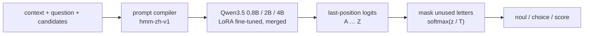

<div align="center">

# Chinese Decision

**A Chinese probabilistic decision model: one forward pass, straight to candidate probabilities**

[](docs/MODELS.md)
[](https://huggingface.co/datasets/bbldCVer-hf/CJ-Dataset)
[](https://huggingface.co/datasets/bbldCVer-hf/CJ-Bench)
[](https://github.com/n4ze3m/hmm)
[](https://arxiv.org/abs/2610.23170)
[](https://huggingface.co/quincyqiang/chinese-decision-4b)
[](https://modelscope.cn/models/quincyqiang/chinese-decision-4b)
[](https://huggingface.co/quincyqiang/chinese-decision-4b-gguf)
[](https://huggingface.co/quincyqiang/chinese-decision-unified-4b)
[](https://huggingface.co/datasets/quincyqiang/CJ-IE)
[](https://github.com/yanqiangmiffy/chinese-decision-studio)

📄 Paper: [Chinese Decision: A Family of Language Models for Single-Pass Probabilistic Decision-Making](https://arxiv.org/abs/2610.23170) (arXiv:2610.23170, v2)

[中文](README.md) | English

</div>

---

## Introduction

**Chinese Decision** is a lightweight **decision model** for Chinese text. It does not chat or generate text. Given a context and a fixed set of candidates, it returns a probability for each candidate.

Many AI calls in real software are really judgments over a closed set: intent detection, ticket routing, content moderation, data labeling, grading model outputs, or choosing an agent's next action. Answering these with a generative LLM is slow, expensive, and requires parsing free text. A decision model returns a structured probability distribution that code can threshold directly.

There are two model families, both LoRA fine-tunes of [Qwen3.5-0.8B](https://huggingface.co/Qwen/Qwen3.5-0.8B), [Qwen3.5-2B](https://huggingface.co/Qwen/Qwen3.5-2B) and [Qwen3.5-4B](https://huggingface.co/Qwen/Qwen3.5-4B):

- **Decision-only models** (`chinese-decision-{0.8b,2b,4b}` and their `-gguf` builds): trained on [CJ-Dataset](https://huggingface.co/datasets/bbldCVer-hf/CJ-Dataset), a corpus of 13 million Chinese decisions; they only make decisions.
- **Unified models** (`chinese-decision-unified-{0.8b,2b,4b}`): the same weight file adds a second readout next to decisions, typed information extraction (named entities, relations, event arguments), trained with the extra extraction data [CJ-IE](https://huggingface.co/datasets/quincyqiang/CJ-IE).

The method is adapted from [n4ze3m/hmm](https://github.com/n4ze3m/hmm), and results are compared against the [Chinese-Jev](https://arxiv.org/abs/2609.36965) paper on its CJ-Bench benchmark. The method, results and analyses are in the paper, [arXiv:2610.23170](https://arxiv.org/abs/2610.23170).

**Highlights**

- ⚡ **One forward pass, zero output tokens**: reads the logits of candidate letters `A`–`Z` at the last position and applies softmax. No autoregressive decoding, no chain of thought.
- 🧩 **Three question types**: `noul` (yes/no), `choice` (single choice), and `score` (ordered levels, returns the expected level).
- 🔢 **More than 26 categories**: one question maps each candidate to a letter (A–Z; training covers 2–16). `choice` questions with more categories go through [`/v1/tournament`](#http-server): grouped rounds and a final, no retraining.
- 🏆 **One model for all four domains**: chinese-decision-4b reaches **85.97%** overall accuracy on the full CJ-Bench and **84.00%** across medical / legal / finance, higher in every domain than the paper's Chinese-Jev (specialized average 70.82%) and the closed-source Jev (77.01%). The full comparison of every model is in [Evaluation](#evaluation).
- 📏 **Calibrated probabilities**: the released weights ship a validation-fitted temperature; overall ECE for chinese-decision-0.8b / 2b / 4b is **0.27% / 0.64% / 1.00%**, and every released model has lower ECE than every model in the paper in all four domains.
- 🪶 **GPU and CPU**: every decision-only model ships BF16 and Q8_0 GGUF. chinese-decision-4b-gguf is **4.48 GB**, reaches **85.99%** on the full CJ-Bench, agrees with BF16 on the top choice **99.19%** of the time, and runs on CPU through llama.cpp without PyTorch.
- 🧬 **Unified model, one weight file, two readouts**: chinese-decision-unified-4b reaches **86.86%** on the full CJ-Bench, the highest of all released models (chinese-decision-4b: 85.97%), and an extraction micro F1 of **68.9** on the CJ-IE test set; neither readout generates text, and one request can carry both.
- 🔌 **hmm / System One compatible API**: ships with a ready-to-run HTTP server.

## News

- 🧬 **2026-10-31**: Released **chinese-decision-unified-4b** (🤗 [Hugging Face](https://huggingface.co/quincyqiang/chinese-decision-unified-4b) · [ModelScope](https://www.modelscope.cn/models/quincyqiang/chinese-decision-unified-4b)). Full CJ-Bench ACC **86.86%** and Macro **83.85%**, above chinese-decision-4b (85.97% / 81.92%), legal **82.44%**; extraction micro F1 **68.9** on the CJ-IE test set (chinese-decision-unified-2b: 66.0).
- 🧬 **2026-10-27**: Released **chinese-decision-unified-2b** (🤗 [Hugging Face](https://huggingface.co/quincyqiang/chinese-decision-unified-2b) · [ModelScope](https://www.modelscope.cn/models/quincyqiang/chinese-decision-unified-2b)): **85.00%** on the full CJ-Bench (chinese-decision-2b: 84.11%, both at T = 1) and an extraction micro F1 of **66.0** on the CJ-IE test set (chinese-decision-unified-0.8b: 63.1).
- 🗂️ **2026-10-26**: Published the extraction training data **CJ-IE** (🤗 [Hugging Face](https://huggingface.co/datasets/quincyqiang/CJ-IE) · [ModelScope](https://www.modelscope.cn/datasets/quincyqiang/CJ-IE)): public Chinese NER, relation and event corpora in one format with type definitions, plus derived choice / yes-no questions. Some sources are non-commercial; read the [dataset card](docs/DATASET_CARD_CJ_IE.md) (Chinese) before using it.
- 🧬 **2026-10-25**: Released **chinese-decision-unified-0.8b** (🤗 [Hugging Face](https://huggingface.co/quincyqiang/chinese-decision-unified-0.8b) · [ModelScope](https://modelscope.cn/models/quincyqiang/chinese-decision-unified-0.8b)). A request with `questions` runs a decision, one with `types` runs extraction; decision accuracy did not drop when extraction was added (**83.46%** on the full CJ-Bench vs 83.11% for chinese-decision-0.8b).
- 📄 **2026-10-23**: The paper **[arXiv:2610.23170](https://arxiv.org/abs/2610.23170)** was updated to v2: it now covers chinese-decision-2b and chinese-decision-4b (both with Q8_0 builds) and adds parent-clustered bootstrap, calibration, selective-prediction and quantization analyses. v1 was submitted on 2026-10-16.
- 🚀 **2026-10-21**: Released **chinese-decision-4b** and **chinese-decision-4b-gguf** (Q8_0, 4.48 GB): **85.97%** overall accuracy, an **84.00%** specialized average and **1.00%** ECE, beating 0.8B and 2B in all 12 domain × type cells. Checkpoint results from training, for every size, are in [Training checkpoint evaluations](docs/TRAINING_HISTORY.md) (Chinese).
- 🔢 **2026-10-18**: Added the tournament endpoint [`/v1/tournament`](#http-server), so a `choice` question is no longer limited to 26 letters (the server caps it at 1024 by default).
- 🚀 **2026-10-17**: Released **chinese-decision-2b** and **chinese-decision-2b-gguf** (Q8_0, 2.01 GB): **84.11%** overall accuracy, a **78.25%** specialized average and **0.64%** ECE. Training and diagnostics: [2B release record](docs/TRAINING_2B.md); CPU checks: [2B CPU deployment](docs/CPU_2B.md) (Chinese).
- 🧪 **2026-10-15**: Open-sourced [Decision Studio](https://github.com/yanqiangmiffy/chinese-decision-studio), a test platform with a decision playground, 8 application scenarios, a robustness lab, an evaluation center and load testing, started with one `docker compose up`.
- 🎉 **2026-10-15**: Released **chinese-decision-0.8b** and **chinese-decision-0.8b-gguf** (Q8_0, 812 MB). Full training ran 1 epoch (13,048,000 decisions); **72.26%** on the CJ-Bench general domain and a **76.90%** specialized average.

## Models

Every model is referred to by its model ID (the Hugging Face / ModelScope repository name) throughout this README.

| Model ID | Family | Base / objective | Format / size | Default T | Download | Model card |
|---|---|---|---|---:|---|---|
| chinese-decision-0.8b | Decision-only | Qwen3.5-0.8B / CE | BF16 / 1.50 GB | 1.108133 | [HF](https://huggingface.co/quincyqiang/chinese-decision-0.8b) · [ModelScope](https://modelscope.cn/models/quincyqiang/chinese-decision-0.8b) | [card](docs/MODEL_CARD_0_8B.md) |
| chinese-decision-0.8b-gguf | Decision-only | chinese-decision-0.8b, Q8_0 | GGUF / 0.812 GB | 1.108133 | [HF](https://huggingface.co/quincyqiang/chinese-decision-0.8b-gguf) · [ModelScope](https://modelscope.cn/models/quincyqiang/chinese-decision-0.8b-gguf) | [card](docs/MODEL_CARD_0_8B_GGUF.md) |
| chinese-decision-2b | Decision-only | Qwen3.5-2B / CE + RLCD | BF16 / 3.76 GB | 1.074872 | [HF](https://huggingface.co/quincyqiang/chinese-decision-2b) · [ModelScope](https://modelscope.cn/models/quincyqiang/chinese-decision-2b) | [card](docs/MODEL_CARD_2B.md) |
| chinese-decision-2b-gguf | Decision-only | chinese-decision-2b, Q8_0 | GGUF / 2.01 GB | 1.074872 | [HF](https://huggingface.co/quincyqiang/chinese-decision-2b-gguf) · [ModelScope](https://modelscope.cn/models/quincyqiang/chinese-decision-2b-gguf) | [card](docs/MODEL_CARD_2B_GGUF.md) |
| chinese-decision-4b | Decision-only | Qwen3.5-4B / CE + RLCD | BF16 / 8.41 GB | 1.024758 | [HF](https://huggingface.co/quincyqiang/chinese-decision-4b) · [ModelScope](https://modelscope.cn/models/quincyqiang/chinese-decision-4b) | [card](docs/MODEL_CARD_4B.md) |
| chinese-decision-4b-gguf | Decision-only | chinese-decision-4b, Q8_0 | GGUF / 4.48 GB | 1.024758 | [HF](https://huggingface.co/quincyqiang/chinese-decision-4b-gguf) · [ModelScope](https://modelscope.cn/models/quincyqiang/chinese-decision-4b-gguf) | [card](docs/MODEL_CARD_4B_GGUF.md) |
| chinese-decision-unified-0.8b | Unified | Qwen3.5-0.8B / CE + RLCD, decisions and extraction trained jointly | BF16 / 1.52 GB | 1.1326 (decisions only) | [HF](https://huggingface.co/quincyqiang/chinese-decision-unified-0.8b) · [ModelScope](https://modelscope.cn/models/quincyqiang/chinese-decision-unified-0.8b) | [card](docs/MODEL_CARD_UNIFIED_0_8B.md) |
| chinese-decision-unified-2b | Unified | Qwen3.5-2B / CE + RLCD, decisions and extraction trained jointly | BF16 / 3.79 GB | 1.0617 (decisions only) | [HF](https://huggingface.co/quincyqiang/chinese-decision-unified-2b) · [ModelScope](https://www.modelscope.cn/models/quincyqiang/chinese-decision-unified-2b) | [card](docs/MODEL_CARD_UNIFIED_2B.md) |
| chinese-decision-unified-4b | Unified | Qwen3.5-4B / CE + RLCD, decisions and extraction trained jointly | BF16 / 8.44 GB | 1.0986 (decisions only) | [HF](https://huggingface.co/quincyqiang/chinese-decision-unified-4b) · [ModelScope](https://www.modelscope.cn/models/quincyqiang/chinese-decision-unified-4b) | [card](docs/MODEL_CARD_UNIFIED_4B.md) (Chinese) |

Every released model has full CJ-Bench results on all 307,900 decisions (see [Evaluation](#evaluation)) and supports 16,384 input tokens; one question holds 2–26 candidates (training covers 2–16), and larger `choice` questions go through [`/v1/tournament`](#http-server). Sizes are decimal GB, not runtime memory. Model cards are in Chinese.

**Decision-only vs. unified**

| | Decision-only models | Unified models |
|---|---|---|
| Readouts | Decisions: `noul` / `choice` / `score` | Decisions + typed extraction (see [How It Works](#how-it-works)) |
| What picks the task | Every request is a decision | `questions` runs a decision, `types` runs extraction, both run both on the same input |
| Starting point | Raw Qwen3.5 + LoRA | Raw Qwen3.5 + LoRA + a randomly initialized span head (about 3.4M parameters for 0.8B, 6.6M for 2B, 8.2M for 4B), trained together |
| Training data | CJ-Dataset, 13,048,000 decisions | CJ-Dataset decisions + CJ-IE (611,354 decisions + 573,294 extraction span rows); see [Training Data](#training-data) |
| Formats | BF16 + Q8_0 GGUF | BF16 only; extraction needs PyTorch, no GGUF |
| Server | `scripts/serve.py`, `scripts/serve_gpu.py` | `scripts/serve_unified.py` |

The unified models are trained from the raw base rather than on top of a decision-only model: continuing to train chinese-decision-0.8b on extraction alone dropped CJ-Bench accuracy from 83.11% to 71.02% (legal −27.9, finance −20.2); keeping decision data in every batch and starting from the raw base preserved decision ability. See [Unified model and forgetting fix](docs/UNIFIED_MODEL.md) (Chinese).

**Which one?**

| Need | Use |
|---|---|
| Highest decision accuracy on GPU | chinese-decision-unified-4b; chinese-decision-4b if you need GGUF or a lower calibrated ECE |
| Balance latency and memory | chinese-decision-2b, or chinese-decision-unified-2b if you also need extraction (it is also more accurate on decisions) |
| CPU or tight memory, no PyTorch | a `-gguf` build (Q8_0) |
| Lowest latency and resources, lowest overall ECE | chinese-decision-0.8b |
| One weight file for decisions and information extraction | chinese-decision-unified-4b (most accurate), chinese-decision-unified-2b (balanced) or chinese-decision-unified-0.8b (lightest) |

See [model selection and complete comparison](docs/MODELS.md) (Chinese). Code: [this repository](https://github.com/yanqiangmiffy/chinese-decision). Test platform: [Decision Studio](https://github.com/yanqiangmiffy/chinese-decision-studio).

## Showcase

The screenshots below come from Decision Studio, our test platform, serving chinese-decision-0.8b (the interface is in Chinese). Every scenario follows the same design: **business rules live in code; the decision model only supplies probabilities**.

### Ticket Triage: Six Judgments in One Request

Each support ticket gets six questions in a single request: category (`choice`); severity and frustration (`score`); and whether it is reproducible, asks for a refund, or signals churn risk (`noul`). All six are asked up front whether or not they end up being used, which saves extra round trips. Routing rules in code turn these probabilities into a queue, and tickets whose category confidence is below 0.5 go to human review. In the screenshot, 8 tickets × 6 questions = 48 decisions take 285 ms.


### LLM Guardrail: Safety Checks with a Human-Review Band

Every message into and out of an LLM is checked first. The input side checks for prompt injection / jailbreaks, private information, abuse or threats, and off-topic requests; the output side checks for system-prompt leaks, unauthorized promises, private information in the reply, and inappropriate content. Each check is a yes / no probability with two thresholds: below the review threshold it passes automatically, above the block threshold it is blocked, and anything in between goes to a person, so the width of that band is the human-review budget. In the screenshot, a "developer mode" jailbreak is blocked on the input side (85.2%) before the LLM is ever called; all 8 checks take 89.2 ms.


### Danmaku Guard: Real-Time Moderation of Live-Stream Comments

Each live-stream comment (danmaku) takes one request with one classification and one yes / no judgment: abuse and ads are blocked, spoilers are folded, and viewer questions are highlighted for the host. In the screenshot, median (p50) moderation latency is 82.2 ms. The page also records a known weakness: the spoiler check is swayed by the word "spoiler" itself (as in "no spoilers, please") and cannot tell speculation from an actual spoiler.


### Agent Router: Confidence Gates by Risk Level

For every user message, the decision model first picks a tool, checks whether the request has the information it needs, and estimates the operation's risk; the confidence threshold then depends on the risk tier: 40% for read-only actions (weather, search, chat), 65% for writes (calendar, messages, smart home), and 85% for money (transfers, payments). In the screenshot, "帮我约王总下周二下午聊一下预算" ("set up a budget chat with Mr. Wang next Tuesday afternoon") is routed to the calendar tool with 99% confidence, but the probability that key information is missing is 71%, above the 70% follow-up threshold, so the agent first asks which day, what time, and with whom, in 81.6 ms.


## How It Works


**Decision readout** (every model): each question is compiled into the following Chinese prompt, wrapped in the Qwen chat template with thinking disabled, and the logits of the candidate letters are read at the last position.



```text
待判断的上下文：            # Context to judge:
{state}

问题：                      # Question:
{instructions}

候选项：                    # Candidates:
A: {key₁} — {description₁}
B: {key₂} — {description₂}
...
只返回候选项对应的字母。    # Answer with the candidate letter only.
```

Training, evaluation, and serving share the same prompt compiler, so all three see identical inputs.

| Type | `criteria` format | Returned field |
|---|---|---|
| `noul` | Optional `{"false": "...", "true": "..."}`; defaults to “否 / 是” (no / yes) | `noul`: probability of true |
| `choice` | Object `{key: description}` | `choice`: the most probable key |
| `score` | List of levels, ordered low to high | `score`: probability-weighted expected level index (0 to K−1); `legend`: index-to-description map |

Every answer also includes the full `probabilities` and a `confidence` value, where `confidence = (K·p_max − 1) / (K − 1)` measures how sharp the distribution is: 0 for uniform, 1 for certain. It is **not** an empirical accuracy.

**Extraction readout** (unified models only): given a text and a set of "type name + description" pairs, the span head returns each entity's character span and probability, covering named entities, relations (given a subject, extract the object) and event arguments. Both readouts share one backbone and one set of LoRA parameters; only the last layer differs. Each is a single forward pass and **neither generates text**.

## Evaluation

Unless noted otherwise, results are for the released weights (LoRA merged into the base model) on **all 307,900 CJ-Bench decisions** (304,822 hard labels, 3,078 soft labels), with no filtering or truncation. ACC / ECE use hard labels only (15 equal-width bins); NLL / Brier include soft labels. Micro is weighted by items; Macro is the unweighted mean of the four domains. All values are percentages.

> **About the temperature T**: probabilities are p = softmax(z / T), where z are the candidate-letter logits. Decision-only models use the default temperature in `decision_config.json`; the unified models' CJ-Bench results use **T = 1** (plain softmax, no calibration), and ECE, NLL and Brier values marked † are at T = 1 (score MAE is the error of the expected level and barely depends on the temperature, so it compares directly). Temperature only changes how sharp the probabilities are and **never changes the chosen answer**, so ACC is directly comparable across the two settings and ECE is not. Results for training checkpoints (before merging, T = 1) are in [Training checkpoint evaluations](docs/TRAINING_HISTORY.md) (Chinese).

### Main Results

**Bold** marks the best value in each column.

| Model ID | Format | Micro ACC ↑ | Macro ACC ↑ | ECE ↓ | NLL ↓ | Brier ↓ | Score MAE ↓ |
| --- | --- | ---: | ---: | ---: | ---: | ---: | ---: |
| chinese-decision-0.8b | BF16 | 83.11 | 75.74 | **0.27** | 0.4313 | 0.2238 | 0.5844 |
| chinese-decision-0.8b-gguf | Q8_0 | 83.12 | 75.81 | **0.27** | 0.4313 | 0.2238 | 0.5840 |
| chinese-decision-unified-0.8b | BF16 | 83.46 | 76.17 | 1.1† | 0.4243† | 0.2198† | 0.5786 |
| chinese-decision-2b | BF16 | 84.11 | 77.18 | 0.64 | 0.4165 | 0.2133 | 0.5642 |
| chinese-decision-2b-gguf | Q8_0 | 84.11 | 77.33 | 0.65 | 0.4163 | 0.2132 | 0.5637 |
| chinese-decision-unified-2b | BF16 | 85.00 | 79.12 | 0.9† | 0.3881† | 0.2016† | 0.5508 |
| chinese-decision-4b | BF16 | 85.97 | 81.92 | 1.00 | 0.3706 | 0.1909 | 0.5253 |
| chinese-decision-4b-gguf | Q8_0 | 85.99 | 81.95 | 0.96 | 0.3705 | 0.1907 | 0.5253 |
| chinese-decision-unified-4b | BF16 | **86.86** | **83.85** | 1.0† | **0.3483†** | **0.1799†** | **0.5144** |

- **chinese-decision-unified-4b is the most accurate**: compared with chinese-decision-4b, Micro **+0.89**, Macro **+1.93**, legal **+5.23** and general **+1.61**; at T = 1 their overall ECE is 1.0% and 1.3%.
- **Among decision-only models, chinese-decision-4b is the most accurate**: compared with chinese-decision-2b, Micro **+1.86**, Macro **+4.75** and the specialized average **+5.76** points, with legal / finance up **8.47 / 7.11**; NLL / Brier / score MAE drop by **11.0% / 10.5% / 6.9%**. Overall ECE is 1.00%, above 2B's 0.64%. 4B and 2B share training data, objective, global batch and learning rate, so the main difference is base-model size.
- **chinese-decision-2b vs. chinese-decision-0.8b**: Micro **+1.01**, Macro **+1.44** and the specialized average **+1.35** points; NLL / Brier / score MAE drop by **3.4% / 4.7% / 3.5%**. Overall ECE is slightly higher (0.64% vs 0.27%) but still very low.
- **The unified models keep their decision ability**: at every size the unified model is above the decision-only one. chinese-decision-unified-4b is +0.89 Micro above chinese-decision-4b; chinese-decision-unified-2b is above chinese-decision-2b by **+0.89** Micro and **+1.94** Macro (legal +4.68); chinese-decision-unified-0.8b is +0.35 Micro above chinese-decision-0.8b. At T = 1, overall ECE is 1.5% for chinese-decision-2b and 0.9% for chinese-decision-unified-2b.
- **Q8_0 is nearly lossless**: paired item by item with BF16 at the same temperature, top-1 agreement is **98.92% / 99.00% / 99.19%** for 0.8B / 2B / 4B, and accuracy changes by +0.02 / −0.001 / +0.02 points. A few individual answers still change (for 2B, 1,105 flip correct→wrong and 1,101 wrong→correct); the 0.15-point macro gain of chinese-decision-2b-gguf comes mostly from the small legal domain and does not mean quantization improves the model. Full results were measured with llama.cpp on CUDA; CPU checks cover the API and limited inputs. See the GGUF model cards.

### Results by Domain and Type

BF16 accuracy (%) of each model, with columns ordered by size so the decision-only and unified models of the same size sit next to each other. chinese-decision-unified-4b is the highest in every row.

| Slice | Items | chinese-decision-0.8b | chinese-decision-unified-0.8b | chinese-decision-2b | chinese-decision-unified-2b | chinese-decision-4b | chinese-decision-unified-4b |
|---|---:|---:|---:|---:|---:|---:|---:|
| General | 100,000 | 72.26 | 73.86 | 73.96 | 75.43 | 75.69 | 77.30 |
| Medical | 200,000 | 88.85 | 88.61 | 89.50 | 90.03 | 91.19 | 91.64 |
| Legal | 4,300 | 67.84 | 67.88 | 68.74 | 73.42 | 77.21 | 82.44 |
| Finance | 3,600 | 74.00 | 74.31 | 76.50 | 77.61 | 83.61 | 84.00 |
| `noul` | 134,577 | 94.96 | 94.88 | 95.11 | 95.24 | 95.47 | 95.65 |
| `choice` | 134,577 | 78.32 | 79.01 | 80.12 | 81.68 | 83.25 | 84.77 |
| `score` | 38,746 | 56.45 | 57.17 | 57.67 | 58.91 | 60.43 | 61.60 |

Medical is 65% of the test set, so micro metrics mostly reflect medical; prefer macro for cross-domain comparisons. Legal and finance have few items (4,300 / 3,600), so their numbers are noisy.

<details>
<summary><b>Accuracy by domain × type (decision-only models)</b></summary>

| Domain | Type | chinese-decision-0.8b | chinese-decision-2b | chinese-decision-4b |
|---|---|---:|---:|---:|
| General | `noul` | 87.59 | 88.01 | 88.50 |
| General | `choice` | 72.93 | 76.16 | 78.60 |
| General | `score` | 54.64 | 56.05 | 58.35 |
| Medical | `noul` | 97.82 | 97.87 | 98.04 |
| Medical | `choice` | 80.55 | 81.81 | 85.04 |
| Medical | `score` | 66.50 | 66.19 | 67.49 |
| Legal | `noul` | 85.60 | 82.07 | 88.87 |
| Legal | `choice` | 64.07 | 67.20 | 74.13 |
| Legal | `score` | 51.69 | 55.15 | 67.31 |
| Finance | `noul` | 76.33 | 81.75 | 85.67 |
| Finance | `choice` | 62.83 | 67.42 | 77.00 |
| Finance | `score` | 82.83 | 80.33 | 88.17 |

chinese-decision-2b improves on 0.8B in 9 of the 12 cells; legal yes/no (82.07 vs 85.60) and finance rating (80.33 vs 82.83) drop clearly, and medical rating dips slightly. chinese-decision-4b beats both 0.8B and 2B in all 12 cells. Per-domain and per-type ECE, NLL and Brier for each model are in its model card.

</details>

### Comparison with Chinese-Jev

External rows are author-reported results from [Chinese-Jev v1 Tables 1 and 2](https://arxiv.org/html/2609.36965v1) (checked on 2026-10-17, not reproduced here). **Bold** marks the best value in each column; † marks ECE at T = 1.

**General (Table 1)**

| Model | ACC ↑ | ECE ↓ |
| --- | ---: | ---: |
| Qwen3.5-2B | 32.95 | 43.68 |
| Open-Jev | 52.33 | 10.54 |
| SemIF | 44.21 | 27.27 |
| Laya Multilingual | 40.22 | 23.04 |
| Jev (API) | 68.35 | 11.45 |
| Chinese-Jev General / Specialists | 69.20 | 3.78 |
| chinese-decision-0.8b | 72.26 | **1.68** |
| chinese-decision-unified-0.8b | 73.86 | 2.8† |
| chinese-decision-2b | 73.96 | 1.93 |
| chinese-decision-unified-2b | 75.43 | 2.5† |
| chinese-decision-4b | 75.69 | 2.91 |
| chinese-decision-unified-4b | **77.30** | 2.8† |

**Specialized domains (Table 2)**

| Model | Medical ACC | Medical ECE | Legal ACC | Legal ECE | Finance ACC | Finance ECE | Avg. ACC | Avg. ECE |
| --- | ---: | ---: | ---: | ---: | ---: | ---: | ---: | ---: |
| Qwen3.5-2B | 53.88 | 28.71 | 31.53 | 44.82 | 38.11 | 49.12 | 41.17 | 40.88 |
| Open-Jev | 73.08 | 2.88 | 44.07 | 23.15 | 48.11 | 10.19 | 55.09 | 12.07 |
| SemIF | 62.17 | 10.39 | 43.07 | 19.99 | 47.89 | 18.45 | 51.04 | 16.28 |
| Laya Multilingual | 24.55 | 43.05 | 34.72 | 31.49 | 38.31 | 26.18 | 32.53 | 33.57 |
| Jev (API) | 84.29 | 5.70 | 68.35 | 8.03 | 78.39 | 2.98 | 77.01 | 5.57 |
| Chinese-Jev General | 39.77 | 17.33 | 38.76 | 15.37 | 35.39 | 14.43 | 37.97 | 15.71 |
| Chinese-Jev General / Specialists | 87.65 | 7.25 | 60.10 | 17.45 | 64.72 | 11.55 | 70.82 | 12.08 |
| chinese-decision-0.8b | 88.85 | 1.12 | 67.84 | 4.05 | 74.00 | 2.45 | 76.90 | 2.54 |
| chinese-decision-unified-0.8b | 88.61 | 0.4† | 67.88 | 2.3† | 74.31 | **1.1†** | 76.93 | **1.27†** |
| chinese-decision-2b | 89.50 | 0.24 | 68.74 | 3.37 | 76.50 | 2.13 | 78.25 | 1.92 |
| chinese-decision-unified-2b | 90.03 | 0.3† | 73.42 | 3.3† | 77.61 | 2.2† | 80.35 | 1.93† |
| chinese-decision-4b | 91.19 | 0.25 | 77.21 | **2.02** | 83.61 | 1.65 | 84.00 | 1.30 |
| chinese-decision-unified-4b | **91.64** | **0.2†** | **82.44** | 2.5† | **84.00** | 1.5† | **86.03** | 1.37† |

- chinese-decision-unified-4b reaches **86.03%** on the specialized average, **15.21** points above Chinese-Jev (General + three Specialists) and **9.02** above the closed-source Jev, and **5.61** above Jev on finance.
- Compared with Chinese-Jev (General + three Specialists), chinese-decision-4b is **6.49 / 3.54 / 17.11 / 18.89** points higher on general / medical / legal / finance, and **13.18** higher on the specialized average. It also beats the closed-source Jev in every domain: **6.99** points on the specialized average and **5.22** on finance. chinese-decision-2b and chinese-decision-unified-2b are also above Jev on the specialized average, but still 1.89 / 0.78 lower on finance.
- Every model of this project in the tables has lower ECE than every model in the paper, in all four domains.
- Chinese-Jev General plus three Specialists are four separately trained models; each model here covers all four domains. Jev is a closed API. The paper uses H200 / API and this project uses an A800, so latency is not ranked.

**Method differences from Chinese-Jev**

| | Chinese-Jev | Chinese Decision (ours) |
|---|---|---|
| Backbone | mmBERT-base encoder + decision Transformer (about 322M) | Qwen3.5-0.8B / 2B / 4B decoder + LoRA |
| Candidate scoring | Shared MLP over candidate-marker positions | Last-position logits of candidate letters |
| Objective | Cross-entropy + RLCD policy-gradient term | Candidate-distribution cross-entropy for chinese-decision-0.8b; every other model also uses RLCD |
| Training | General pre-training, then three separately fine-tuned specialists | All four domains mixed into one model |

### Information Extraction: CJ-IE Test Set

Unified models only. The CJ-IE test set is built from the official dev / test splits of each corpus with leakage removed. It is an **internal evaluation set, not a public benchmark**, so the numbers are not comparable with the public leaderboards of the individual corpora. Extraction is scored by **exact match** (start, end and type must all be right) over 232,291 gold spans from 35 sources.

| Metric | chinese-decision-unified-0.8b | chinese-decision-unified-2b | chinese-decision-unified-4b |
|---|---:|---:|---:|
| Decision ACC overall (84,894 CJ-IE-derived items) | 90.65% | 91.30% | **91.89%** |
| Old-ability retention (3,032 older CJ items) ACC | 91.51% | 91.88% | **92.81%** |
| Extraction micro precision / recall / F1 | 73.3 / 55.5 / 63.1 | 75.4 / 58.6 / 66.0 | 78.9 / 61.1 / **68.9** |
| Extraction source-macro F1 (35 sources) | 62.5 | 66.3 | **69.8** |
| of which NER (31 sources) | 64.0 | 67.4 | **71.0** |
| of which relations (DuIE, CMeIE) | 47.2 | 55.4 | **56.9** |
| of which event arguments (DuEE, FewFC) | 54.5 | 59.2 | **64.0** |
| Resume (résumé entities) | 88.1 | 87.3 | **90.9** |
| MSRA (person / location / organization) | 76.0 | 82.2 | **82.6** |
| DuIE (relation objects) | 66.2 | 74.3 | **78.5** |
| DuEE (event arguments) | 56.3 | 62.2 | **68.3** |
| Weibo (social media) | 37.2 | 52.6 | **63.6** |
| CMeIE (medical relation objects) | 28.2 | **36.5** | 35.4 |
| military_ner (types without descriptions) | 0.0 | 0.0 | 3.0 |

Extraction is conservative, with precision well above recall, and varies a lot by source. chinese-decision-unified-2b beats chinese-decision-unified-0.8b on 30 of the 35 sources, and chinese-decision-unified-4b beats chinese-decision-unified-2b on 33 (CMeIE and IMCS21 are slightly lower); `military_ner`, whose types have no description, stays near 0 for all three. Complete per-source and per-type metrics are in the model cards.

### Inference Efficiency

The same 25 CJ-Bench inputs (92–6,521 tokens), single requests on the released weights, three warmed runs each:

| Metric (single-request p50) | chinese-decision-0.8b | chinese-decision-2b | chinese-decision-4b |
|---|---:|---:|---:|
| GPU · BF16 (Transformers) | 44.4 ms | 44.8 ms | 60.1 ms |
| GPU · Q8_0 (llama.cpp) | **17.9 ms** | **23.6 ms** | **47.3 ms** |
| CPU, 16 threads · Q8_0 (llama.cpp) | 427.0 ms | 818.0 ms | 2004.0 ms |
| CPU process memory · Q8_0 / FP32 | **2.19** / 7.44 GiB | **3.34** / 11.74 GiB | 6.14 / — GiB |

> Shared server with an A800 80GB PCIe and a Xeon Gold 5318Y. Timing covers the forward pass and probabilities for pre-tokenized input; it excludes tokenization, HTTP and network. At batch = 1 the GPU is bound by scheduling overhead, so BF16 latency is similar; Q8_0 is faster for short inputs on GPU, and its main CPU advantage is memory. 4B was measured on a different day with the same inputs and has no Transformers FP32 CPU baseline. A unified model's decision readout has the same architecture as the decision-only model of its size. Long inputs and the Windows desktop measurements are in the [0.8B GGUF](docs/MODEL_CARD_0_8B_GGUF.md), [2B GGUF](docs/MODEL_CARD_2B_GGUF.md) and [4B GGUF](docs/MODEL_CARD_4B_GGUF.md) cards.

<details>
<summary><b>chinese-decision-0.8b before vs. after fine-tuning (validation)</b></summary>

On a stratified subset of the official validation set (4 domains × 3 types, 100 items each, 1,200 total), zero-shot base model vs. the final fine-tuned checkpoint:

| Domain | Qwen3.5-0.8B ACC | **chinese-decision-0.8b ACC** | Qwen3.5-0.8B ECE | **chinese-decision-0.8b ECE** |
|---|---:|---:|---:|---:|
| General | 36.64 | **75.34** | 28.25 | **3.76** |
| Medical | 16.67 | **82.00** | 43.40 | **3.25** |
| Legal | 40.67 | **65.33** | 24.03 | **7.62** |
| Finance | 44.33 | **71.33** | 16.77 | **3.41** |
| **Overall** | 34.56 | **73.49** | 27.45 | **2.48** |

</details>

## Quick Start

### Installation

```bash
git clone https://github.com/yanqiangmiffy/chinese-decision.git
cd chinese-decision
pip install -e ".[train]"
```

Python ≥ 3.11 is required. `[train]` installs the CUDA training/inference dependencies. For CPU GGUF serving use `pip install -e ".[gguf]"`; PyTorch, PEFT and flash-linear-attention are not required. Transformers-only inference uses `.[torch]`. If your environment already has a CUDA build of PyTorch that pip should leave alone, use `pip install -e . --no-deps`.

### Download a Model

Pick the one you need (all models are listed in [Models](#models)):

```bash
# Decision-only, GPU: merged BF16 weights
hf download quincyqiang/chinese-decision-4b --local-dir models/chinese-decision-4b
# Decision-only, CPU: Q8_0 GGUF, no PyTorch needed
hf download quincyqiang/chinese-decision-4b-gguf --local-dir models/chinese-decision-4b-gguf
# Unified: decisions + information extraction (BF16 only, extraction needs PyTorch)
hf download quincyqiang/chinese-decision-unified-2b --local-dir models/chinese-decision-unified-2b
# or from ModelScope (same repository names)
modelscope download --model quincyqiang/chinese-decision-4b --local_dir models/chinese-decision-4b
```

For other models, replace the repository name with the model ID.

### Python

**Decisions** (every model):

```python
from decision import DecisionPipeline

pipe = DecisionPipeline.from_pretrained("models/chinese-decision-0.8b")   # local directory or Hub repository id
answer = pipe({
    "state": "客户留言：付款后一直没有收到发票，我已经催了三次，今天必须拿到。",
    "questions": {"q": {
        "type": "choice",
        "instructions": "应该由哪个部门处理？",
        "criteria": {"billing": "支付、发票及退款", "technical": "故障和系统问题", "sales": "购买咨询与升级"},
    }},
})
print(answer)   # {"task": "decision", "answers": {"q": {"billing": 0.97, ...}}}, calibrated with decision_config.json
```

**Extraction** (unified models, or a joint-training export, `runs/<run>/model`) uses the same object:

```python
pipe = DecisionPipeline.from_pretrained("models/chinese-decision-unified-2b", device="cuda")

pipe({"text": "收货地址：浙江省杭州市西湖区文三路90号东部软件园科技大厦A座1203室，联系人王小明。",
      "types": {"省份": "省级行政区划,省、自治区、直辖市,不含港澳台",
                "城市": "地级行政区划,地级市、地区、自治州等",
                "道路": "有正式名称的道路,包括隧道、高架、街、弄、巷等",
                "门牌号": "路号,如'000号'或'000弄',通常位于道路名称之后"},
      "threshold": 0.3})
# {"task": "extraction", "entities": [{"text": "浙江省", "label": "省份", "start": 5, "end": 8, "score": ...}, ...]}
```

The request picks the task; with both `questions` and `types` it does both on the same input (`text` defaults to `state`):

| What you want | What the request carries | What comes back |
|---|---|---|
| Decision | `state` + `questions` (`noul` / `choice` / `score`) | A probability per candidate |
| Extraction | `text` + `types` (`{name: description}`), optional `threshold` | Entities with `text` / `label` / `start` / `end` / `score` |
| Relation extraction | Fix the subject, write the type name as "{subject}'s {relation}" and describe the object type in the description | Object spans |
| Event extraction | Ask a yes/no question per event type, then use "trigger + roles" as the types | Triggers and arguments |
| Intent + slots | Intent via decisions, slots via extraction, cascaded by you (no slot data in training, so evaluate it yourself) | — |

**Writing extraction types**: the description of a type matters far more than its name. During training each type carried a definition taken from the annotation guideline, so the model learns to "find by definition", not to "guess by name".

| What you write | Behaviour | Advice |
|---|---|---|
| The training-time description | Highest recall | Start from the training-time type set, keep the names, and adjust the descriptions |
| Only the type name | Lowest recall; similar types are not separated | Add at least one sentence of definition, including boundaries (what does not count) |
| A new type never seen in training | Mostly not extracted, or unstable | Test on your own data before relying on it; prefer types the model was trained on |
| A type without a definition | `military_ner` scores F1 0 on the test set and nothing is predicted | Same as above |

The lower-level API follows transformers:

| Class | Role |
|---|---|
| `DecisionConfig` | `decision_config.json`: temperature, prompt version, span head settings |
| `DecisionProcessor` | prompt compilation, encoding, padding and decoding for both tasks |
| `DecisionModel` | backbone + optional span head; `from_pretrained` / `save_pretrained` (LoRA merged, one weight set), `enable_lora`, `score_decisions`, `predict_spans` |
| `DecisionPipeline` | request-level inference: `decide`, `extract`, `__call__` |

A training adapter loads directly with `DecisionModel.from_pretrained("models/Qwen3.5-0.8B", adapter="runs/cj-ddp/best")`; a joint-training run directory with `DecisionPipeline.from_run(base, run)`. `import decision` does not load PyTorch; the GGUF CPU server still needs only transformers.

### HTTP Server

Three server entry points share the same decision API and response format; any of them can back [Decision Studio](https://github.com/yanqiangmiffy/chinese-decision-studio) as its `DECISION_BASE_URL`, and all are compatible with the hmm / System One SDKs:

| Entry point | Models | Use | Deployment |
|---|---|---|---|
| `scripts/serve.py` | Decision-only (GGUF or BF16) | CPU or local debugging; one forward pass per question | [docs/CPU.md](docs/CPU.md), [deploy/gguf](deploy/gguf/) |
| `scripts/serve_gpu.py` | Decision-only BF16, or base model + adapter | Production GPU serving: dynamic batching, training progress, checkpoint hot reload (`POST /v1/admin/reload`) | [deploy/gpu](deploy/gpu/README.md) |
| `scripts/serve_unified.py` | Unified models | Decisions and extraction from one process | — |

```bash
# Decision-only, GPU BF16
python scripts/serve_gpu.py --base models/chinese-decision-4b --host 127.0.0.1 --port 8789 --token-budget 16384 --max-batch 32
# Decision-only, CPU Q8_0 (needs the [gguf] extra)
python scripts/serve.py --backend gguf --base models/chinese-decision-4b-gguf --gguf models/chinese-decision-4b-gguf/chinese-decision-4b-Q8_0.gguf --threads 8 --context-size 16384 --host 127.0.0.1 --port 8790
# Unified: decisions + extraction
python scripts/serve_unified.py --model models/chinese-decision-unified-2b --port 8011
# Local debugging: merged BF16 weights
python scripts/serve.py --base models/chinese-decision-0.8b --port 8787
```

The servers use the calibrated temperature in `decision_config.json`. `serve.py` can also load the base model with an adapter: `--base models/Qwen3.5-0.8B --adapter runs/cj-ddp/best` (temperature is then 1, i.e. uncalibrated). With the GGUF backend, `--base` supplies the tokenizer, prompt template and `decision_config.json` and `--gguf` supplies the weights; see [CPU deployment](docs/CPU.md) for conversion and validation. `--device cpu` selects a Transformers FP32 baseline.

One request can carry several questions:

```bash
curl http://127.0.0.1:8787/v1/systemone \
  -H 'Content-Type: application/json' \
  --data-binary @examples/request.json
```

```json
{
  "state": "客户留言：付款后一直没有收到发票，我已经催了三次，今天必须拿到。",
  "questions": {
    "urgent": {"type": "noul", "instructions": "客户是否表达了紧迫性？"},
    "department": {"type": "choice", "instructions": "应该由哪个部门处理？",
                   "criteria": {"billing": "支付、发票及退款", "technical": "故障和系统问题", "sales": "购买咨询与升级"}},
    "frustration": {"type": "score", "instructions": "客户有多不满？",
                    "criteria": ["平静", "不满", "非常愤怒"]}
  }
}
```

Response format (values are illustrative only):

```json
{
  "model": "chinese-decision-0.8b",
  "answers": {
    "urgent": {"type": "noul", "probabilities": {"false": 0.04, "true": 0.96}, "confidence": 0.92, "noul": 0.96},
    "department": {"type": "choice", "probabilities": {"billing": 0.97, "technical": 0.02, "sales": 0.01},
                   "confidence": 0.955, "choice": "billing"},
    "frustration": {"type": "score", "probabilities": {"0": 0.02, "1": 0.38, "2": 0.60}, "confidence": 0.40,
                    "score": 1.58, "legend": {"0": "平静", "1": "不满", "2": "非常愤怒"}}
  },
  "usage": {"input_tokens": 242, "output_tokens": 0},
  "latency_ms": 85.3
}
```

| Endpoint | Description | Decision-only servers | Unified server |
|---|---|:---:|:---:|
| `POST /v1/systemone` | Decision endpoint; `?debug=1` adds each candidate's logit and each question's token count | ✓ | ✓ |
| `POST /api/alpha/decisions` | Same as above; hmm-compatible route | ✓ | ✓ |
| `POST /v1/batch` | `{"requests": [...], "debug": bool}`: several requests at once; one invalid request does not fail the others | ✓ | ✓ |
| `POST /v1/compile` | Compile prompts and count tokens without running the model | ✓ | ✓ |
| `POST /v1/tournament` | `choice` questions with more candidates than one prompt holds: group rounds, then a final (see below) | ✓ | ✓ |
| `POST /v1/decide` | Decisions, same request format as `/v1/systemone` | | ✓ |
| `POST /v1/extract` | Extraction: `{"text", "types", "threshold"?}` | | ✓ |
| `POST /v1/predict` | Picks the task by request shape; with both `questions` and `types` it returns `answers` and `entities` in one response (short inputs share one forward pass) | | ✓ |
| `GET /v1/info` | Model name, checkpoint, temperature, whether extraction is available, serving statistics | ✓ | ✓ |
| `GET /v1/training` | Training progress | ✓ | ✓ |
| `GET /health` | Health check; reports the temperature, whether the model is calibrated and the checkpoint step | ✓ | ✓ |

A request may contain up to 64 questions, each with 2–26 candidates and at most 16,384 input tokens. Over-length inputs are **never truncated**; invalid requests return `422`. To check a running server (both routes, probability format, and invalid-request handling):

```bash
python scripts/verify_export.py --url http://127.0.0.1:8787
```

**More categories: tournaments (`/v1/tournament`)**. The model reads one letter per candidate, and the training data has at most 16 candidates. The server shuffles a larger `choice` question into groups of at most `group_size`, advances the top `keep` of each group until the rest fit one question, and asks that final question. Every group goes through the same prompt compiler, so no retraining is needed:

```json
{
  "state": "用户希望了解第 137 号产品。",
  "question": {"type": "choice", "instructions": "用户想了解哪个产品？",
               "criteria": {"p0": "第 0 号产品", "p1": "第 1 号产品", "...": "up to 1024 candidates"}},
  "group_size": 16,
  "keep": 2,
  "seed": 0
}
```

`group_size` is 3–26 (default 16, the largest count seen in training), `keep` is 1 to `group_size // 2` (default 2), `seed` fixes the grouping, and the candidate cap is `MAX_CANDIDATES` in `decision/tournament.py` (default 1024). `answer` has the same shape as a `/v1/systemone` answer, but **its probabilities cover the finalists only**; `rounds` records each group's probabilities and who advanced, and `decisions` counts forward passes. With the defaults, 300 candidates take 19 + 3 + 1 = 23 forward passes. A field that already fits in `group_size` is one question, identical to `/v1/systemone`. Tournaments have not been evaluated on CJ-Bench; finalists tend to be close, so their probabilities are flatter, and confidence thresholds should be re-tuned on your own data.

[examples/tournament.json](examples/tournament.json) is a complete example with 41 e-commerce customer-service intents. With the defaults it becomes 3 groups (14 / 14 / 13), and the top 2 of each meet in a 6-candidate final: 4 forward passes in total.

```bash
curl http://127.0.0.1:8787/v1/tournament \
  -H 'Content-Type: application/json' \
  --data-binary @examples/tournament.json
```

```json
{
  "model": "chinese-decision-0.8b",
  "answer": {"type": "choice", "choice": "damaged_item", "confidence": 0.841,
             "probabilities": {"damaged_item": 0.867, "courier_complaint": 0.071, "repair_request": 0.032,
                               "other": 0.017, "stock_inquiry": 0.008, "wrong_item": 0.005}},
  "candidates": 41, "group_size": 16, "keep": 2,
  "rounds": [{"groups": [
    {"probabilities": {"...": "this group's 14 candidates"}, "advanced": ["courier_complaint", "other"]},
    {"probabilities": {"...": "this group's 14 candidates"}, "advanced": ["wrong_item", "stock_inquiry"]},
    {"probabilities": {"...": "this group's 13 candidates"}, "advanced": ["damaged_item", "repair_request"]}
  ]}],
  "usage": {"input_tokens": 813, "output_tokens": 0},
  "decisions": 4,
  "latency_ms": 161.4
}
```

On the GPU service (chinese-decision-0.8b step 10000, T = 1, A800), 10 messages with different intents were all classified correctly, at about 150 ms each. This is a functional demo, not a formal evaluation.

## Training and Benchmarking

### Training Data

| Data | Content | Used by |
|---|---|---|
| [CJ-Dataset](https://huggingface.co/datasets/bbldCVer-hf/CJ-Dataset) | 13,048,000 Chinese decisions across general / medical / legal / finance | every model |
| [CJ-Bench](https://huggingface.co/datasets/bbldCVer-hf/CJ-Bench) | 307,900 test decisions | evaluation only; never read by training or model selection |
| CJ-IE ([HF](https://huggingface.co/datasets/quincyqiang/CJ-IE) · [ModelScope](https://www.modelscope.cn/datasets/quincyqiang/CJ-IE) · [dataset card](docs/DATASET_CARD_CJ_IE.md) · [build notes](docs/IE_DATASET.md)) | public Chinese NER, relation and event corpora in one format, with type definitions | unified models |

The three CJ-IE subsets:

| Subset | Content | train | dev | test |
|---|---|---:|---:|---:|
| `extraction` | Span rows: NER (32 sources), relation objects (DuIE, CMeIE), event arguments (DuEE, FewFC) | 573,294 | 11,647 | 85,041 |
| `decision` | Derived choice / yes-no questions: entity type, relation, event type, event category, announcement fields | 611,354 | 12,554 | 84,894 |
| `structured` | Full entity / relation / event annotations for end-to-end evaluation | 125,859 | 1,295 | 15,038 |

CJ-IE is a compilation of third-party corpora with no single license, and some sources are non-commercial; read the [License and usage limits](docs/DATASET_CARD_CJ_IE.md#许可与使用限制) of the dataset card (Chinese) before using it.

For training and evaluation, the base model and data are loaded from local directories (the CJ datasets are currently gated; run `hf auth login` first):

```bash
hf download Qwen/Qwen3.5-0.8B --local-dir models/Qwen3.5-0.8B   # Qwen3.5-2B / Qwen3.5-4B for the larger sizes
hf download bbldCVer-hf/CJ-Dataset --repo-type dataset --local-dir datasets/CJ-Dataset
hf download bbldCVer-hf/CJ-Bench --repo-type dataset --local-dir datasets/CJ-Bench
```

### Configuration

**Decision-only models** (the table is chinese-decision-0.8b; chinese-decision-2b and chinese-decision-4b add RLCD and use a global batch of at least 2,048 decisions per step; see [the 2B record](docs/TRAINING_2B.md) and the [4B card](docs/MODEL_CARD_4B.md), Chinese)

| Item | Setting |
|---|---|
| Base model | Qwen3.5-0.8B (text backbone) |
| Fine-tuning | LoRA, r = 32, α = 64, dropout = 0.05 |
| LoRA targets | Full attention `q/k/v/o_proj`, linear attention `in_proj_qkv/z/a/b` and `out_proj`, MLP `gate/up/down_proj` |
| Loss | Cross-entropy against the candidate distribution (soft labels; hard labels are the one-hot case); optional RLCD term, off by default |
| Optimizer | AdamW, lr = 1e-4, 100-step linear warmup, then cosine decay to 10% of peak |
| Global batch | Each step accumulates at least 1,024 decisions; each micro-batch holds at most 262,144 padded tokens and shrinks automatically for long inputs |
| Max length | 16,384 tokens |
| Training budget | 1 epoch, 13,048,000 decisions, 10,132 steps |
| Precision | BF16, gradient checkpointing |
| Model selection | Validation every 1,000 steps; best checkpoint by distribution NLL (step 10000 in the end) |
| Temperature calibration | One temperature fitted on a separate validation partition, T = 1.108 |
| Hardware | 4 × GPU, DDP |

**Unified models** (one recipe for every size; only the base, the micro-batch size and gradient checkpointing differ. Training script: `scripts/train_multitask_ddp.py`; details in [the unified model notes](docs/UNIFIED_MODEL.md), Chinese)

| Item | chinese-decision-unified-0.8b | chinese-decision-unified-2b | chinese-decision-unified-4b |
|---|---|---|---|
| Initialization | Raw Qwen3.5-0.8B | Raw Qwen3.5-2B | Raw Qwen3.5-4B |
| Released checkpoint | step 14,504 (last step of 1 epoch) | step 15,304 (last step of 1 epoch) | step 14,504 (last step of 1 epoch) |
| Tokens per micro-batch (cap) | 24,576 | 12,288 | 24,576 (gradient checkpointing) |
| Hardware / time | 4 × A800, about 17 h | 4 × A800, about 26 h | 4 × A800, about 83 h |
| Calibration temperature (decision readout only) | 1.1326 | 1.0617 | 1.0986 |
| Fine-tuning | LoRA, r = 32; LoRA lr 1e-4, span-head lr 5e-4, 100 warm-up steps | same | same |
| Loss | CE + RLCD for both readouts (weight 1.0, 4 samples, σ from 0.4 to 0.1); weight 0.2 for none spans in extraction | same | same |
| Batch | 8 micro-batches × 4 GPUs per update; 32 decisions or 16 extraction rows per micro-batch | same | same |
| Extraction layout | Echo: the text is read once, then repeated character by character, and spans are taken from the repeated copy; spans are at most 20 characters wide | same | same |
| Model selection | Every 1,000 steps on an independent dev set: the mean of decision accuracy and the extraction score; the dev set comes from CJ-Dataset validation and CJ-IE dev, and **CJ-Bench is never read** | same | same |
| Export | LoRA merged into a single `model.safetensors` (backbone + `span_head.*`) | same | same |

**Data and training notes**

- **Soft labels**: CJ's `gold` is a probability distribution over candidates, used directly as the cross-entropy target.
- **Candidate shuffling**: `choice` candidates are shuffled during training, with targets permuted to match, to reduce position bias. `score` keeps its level order, and `noul` stays false / true.
- **Balanced mixing**: data is re-sharded by domain, source, and type, then interleaved in proportion to the remaining records, so task order in the raw files does not cause forgetting. The corpus is streamed and never fully loaded into memory.
- **Length bucketing**: batches are formed by token count. Items longer than 16,384 tokens are counted and filtered explicitly; context and questions are never truncated.
- **Leak-free calibration**: the official validation set is split by parent record; 80% is used for validation and model selection, and the other 20% only for fitting the temperature.

### Pipeline

```bash
# 1. Verify dataset SHA256 checksums, then re-shard training data by domain / source / type
python scripts/prepare_data.py --data datasets/CJ-Dataset --out datasets/CJ-mixed

# 2. LoRA training (4 GPUs shown; for one GPU run `python scripts/train.py`; add --resume to continue)
torchrun --standalone --nproc_per_node=4 scripts/train.py --out runs/cj-ddp

# 3. Temperature calibration + weight merge + HTTP check of the exported model
python scripts/finalize.py --run runs/cj-ddp --out models/chinese-decision-0.8b

# 4. Copy the validation-selected best adapter into a fresh snapshot directory, then run a quick
#    evaluation (1,000 items per domain × type) followed by the full benchmark
python scripts/snapshot_best.py --source-run runs/cj-ddp --out runs/cj-bench/my-eval
python scripts/evaluate.py --snapshot-run runs/cj-bench/my-eval --data datasets/CJ-Bench
```

- The defaults of `scripts/train.py` are the release configuration in the table above. `--resume` compares every key of `config.json` and refuses to continue with different arguments; the number of GPUs may change. For a quick debug run, add `--debug-examples 512 --max-steps 12 --global-batch-size 8`.
- In the run directory, `last/` is the resume point, `best/` is the best adapter on validation, and `final/` is the adapter after the last step. `last/` and `best/` are replaced in place; `--keep-every` (default 1000, 0 = off) also keeps a frozen `step-N/` copy every N steps. The exported model directory contains the merged weights, `decision_config.json` (calibrated temperature and limits), the training config and summary, and the base model's `LICENSE`.
- Quick evaluation only: add `--quick-only`. Evaluate the merged deployment model (with its validation-fitted temperature): add `--model models/chinese-decision-0.8b`. The script never overwrites existing results; use a new snapshot directory for each run.
- Exported models, including the unified ones, are evaluated on the full CJ-Bench with `scripts/evaluate_cj_bench.py`; extraction with `scripts/evaluate_extraction.py`; GGUF with `scripts/evaluate_gguf.py`. Calibration and model selection use validation data only, never test labels.

<details>
<summary><b>Optional: RLCD objective (off for chinese-decision-0.8b, on for every other model)</b></summary>

`--rlcd` adds Chinese-Jev's RLCD term (a policy gradient over a proper-scoring-rule reward) to the distribution cross-entropy. It is ported from the [official Chinese-Jev code](https://github.com/gulucaptain/Chinese-Jev), reproduces its results bit for bit, and is off by default.

Each training step perturbs the candidate logits with several zero-mean Gaussian draws, scores every perturbed distribution with "log score + 0.75 × spherical score − RPS" (RPS applies to `score` questions only), and pushes the logits toward the perturbations that score above their group's average. RPS penalizes errors more the further they are from the correct level; it is the only term that knows level order, so `score` questions are the most likely to benefit.

| Argument | Default | Meaning |
|---|---|---|
| `--rlcd` | off | Add the RLCD term to the cross-entropy, weighted 1:1 |
| `--rlcd-group-size` | 4 | Perturbations per decision (at least 2) |
| `--rlcd-sigma-start` | 0.4 | Logit noise scale at the start of training |
| `--rlcd-sigma-end` | 0.1 | Noise scale at the end, annealed linearly over training progress |

- **Difference from the original**: Chinese-Jev anneals σ per epoch (four epochs: 0.4 / 0.3 / 0.2 / 0.1). This project trains for one epoch, so σ is annealed linearly over training progress instead. σ is noise added directly to the logits, and an LLM's letter logits may have a different scale from Chinese-Jev's scoring head, so the defaults are only a starting point.
- **Config and resuming**: with `--rlcd`, `config.json` records the RLCD settings and `training_algorithm` gets a `+rlcd` suffix, so cross-entropy runs and RLCD runs cannot resume each other. Without it, the config is exactly as before and existing runs resume normally.
- **Logs**: each step also reports `ce`, `rlcd`, `reward`, and `sigma`.

**Ablation**: start a new run from scratch with the same arguments plus `--rlcd` (`torchrun --standalone --nproc_per_node=4 scripts/train.py --out runs/cj-ddp-rlcd --rlcd`). Both runs share the data order, validation set, and LoRA initialization; only the objective differs. Do not pass `--max-steps`, which would compress the learning-rate and σ schedules and make the runs incomparable. Stop after the validation at step 1000 or 2000 and compare both runs at the same step (each validation writes `latest_metrics.json`, including per-type results), focusing on `type:score`.

</details>

## Repository Layout

```text
chinese-decision/
├── decision/               # Core library (pip install -e .), transformers-style API
│   ├── configuration.py    #   DecisionConfig / ExtractionConfig (decision_config.json)
│   ├── processing.py       #   DecisionProcessor: prompt compilation, encoding, padding, decoding
│   ├── modeling.py         #   DecisionModel (backbone + optional span head), SpanHead
│   ├── pipeline.py         #   DecisionPipeline (decisions / extraction), SlotFillingPipeline
│   ├── losses.py           #   RLCDLoss, SpanLoss
│   ├── metrics.py          #   validation, CJ-Bench and extraction metrics
│   ├── data/               #   CJ-Dataset streaming and batching, slot records, CJ-IE builders (ie/)
│   ├── training/           #   LoRA targets, decision evaluation, temperature fitting
│   ├── serving/            #   HTTP answer format, Transformers / GGUF backends, candidate tournaments
│   └── utils.py            #   logging, atomic writes, SHA256
├── scripts/                # Command-line entry points
│   ├── prepare_data.py     #   dataset verification and re-sharding
│   ├── train.py            #   LoRA training (one GPU / torchrun), decision-only models
│   ├── train_multitask_ddp.py #  joint decision + extraction training (unified models), streaming data
│   ├── build_ie_data.py    #   build CJ-IE; build_multitask_data.py / build_replay_data.py build the joint and replay data
│   ├── finalize.py         #   calibration, merge, export checks
│   ├── snapshot_best.py    #   freeze the best adapter for evaluation
│   ├── evaluate.py         #   CJ-Bench evaluation
│   ├── evaluate_cj_bench.py #  full CJ-Bench for an exported model (including the unified ones); compare_cj_bench.py compares two runs
│   ├── evaluate_extraction.py # extraction evaluation; evaluate_slots.py scores intent + slot filling
│   ├── convert_gguf.py     #   GGUF export (BF16 / Q8_0)
│   ├── evaluate_gguf.py    #   CJ-Bench with the GGUF weights
│   ├── benchmark_*.py      #   CPU latency and throughput; compare_gguf_benchmark.py pairs two runs
│   ├── verify_export.py    #   end-to-end HTTP API check
│   ├── serve.py            #   HTTP server: CPU / GGUF, local debugging
│   ├── serve_gpu.py        #   HTTP server: production GPU (dynamic batching, hot reload)
│   └── serve_unified.py    #   HTTP server: unified models (/v1/decide, /v1/extract, /v1/predict)
├── deploy/
│   ├── gpu/                # GPU deployment (local deploy.sh → tmux on the server)
│   └── gguf/               # CPU deployment (push / install / service)
├── docs/
│   ├── MODELS.md           #   model overview: selection, protocol, external baselines
│   ├── MODEL_CARD_*.md     #   eight model cards (one per released model)
│   ├── UNIFIED_MODEL.md    #   unified models: one weight file for classification and extraction, joint-training forgetting fix
│   ├── DATASET_CARD_CJ_IE.md #  CJ-IE dataset card (the HF / ModelScope dataset page)
│   ├── IE_DATASET.md       #   CJ-IE: multi-task Chinese information-extraction data
│   ├── MULTITASK_EXTRACTION.md # feasibility experiments for classification + extraction
│   ├── TRAINING_HISTORY.md #   checkpoint evaluations during training, all sizes
│   ├── TRAINING_2B.md      #   chinese-decision-2b training, export and diagnostics
│   ├── CPU.md              #   chinese-decision-0.8b CPU deployment and GGUF validation
│   └── CPU_2B.md           #   chinese-decision-2b CPU deployment and quantization checks
├── tests/                  # Unit tests (no GPU needed): python -m unittest discover -s tests
├── examples/               # Example requests: request.json, tournament.json, slot_filling/, rlcd_loss.py
├── assets/                 # README images
├── pyproject.toml
├── LICENSE
├── LICENSES/               # Full texts of third-party licenses
└── THIRD_PARTY_NOTICES.md
```

## Limitations

- **Keep result configurations separate**: the released weights (merged, default temperature), training checkpoints (T = 1) and Q8_0 differ slightly. Compare like with like rather than attributing a difference to one factor. Q8_0 full results were measured on GPU (llama.cpp CUDA); the CPU backend was checked on limited inputs only. Calibration validation is not test accuracy, and a low overall ECE does not mean every source is well calibrated.
- **Uneven improvements**: chinese-decision-2b's legal yes/no and finance rating accuracies are 82.07% / 80.33%, below chinese-decision-0.8b at 85.60% / 82.83% (chinese-decision-4b: 88.87% / 88.17%); see the [2B record](docs/TRAINING_2B.md). On chinese-decision-4b the product-catalog source (3,151 items) reaches only 64.58%, below chinese-decision-2b's 70.96%, and overall ECE (1.00%) is higher than on 2B and 0.8B; see the [4B card](docs/MODEL_CARD_4B.md) (Chinese).
- **Slower than encoder models**: the 0.8B / 2B / 4B decoders have higher single-request latency than the roughly 322M Chinese-Jev encoder; chinese-decision-4b takes about 60 ms per request on GPU and about 2 s with Q8_0 on CPU.
- **`confidence` is not accuracy**: it only measures how sharp the distribution is. Before acting automatically on a threshold, check calibration on your own data.
- **Label semantics follow the upstream tasks**: for example, medical matching labels describe the original matching task and do not imply medical correctness. Do not use model outputs as the sole basis for medical, legal, or financial decisions.
- **The unified models' extraction readout has clear weak spots**: micro F1 on the CJ-IE test set is 63.1 (chinese-decision-unified-0.8b) / 66.0 (chinese-decision-unified-2b) / 68.9 (chinese-decision-unified-4b), with 73.3% / 75.4% / 78.9% precision and 55.5% / 58.6% / 61.1% recall, and boundaries must match exactly. Types without a description, or new types unseen in training, may extract nothing; social media, fine-grained news types and medical relations are weak. Extraction needs PyTorch (no GGUF) and there is no end-to-end intent + slot filling. See the limitations in the model cards: [chinese-decision-unified-0.8b](docs/MODEL_CARD_UNIFIED_0_8B.md#局限性), [chinese-decision-unified-2b](docs/MODEL_CARD_UNIFIED_2B.md#局限性), [chinese-decision-unified-4b](docs/MODEL_CARD_UNIFIED_4B.md#局限性) (Chinese).
- **Paper v2 comparisons rest on single training runs and imported baselines**: there is no variance estimate across random seeds, and external numbers are the original authors' reported values, not reproduced here.
- **Trained for Chinese only**, and not suited to open-ended generation.
- This project is a Chinese adaptation of the hmm method. It does not reproduce the training of Microsoft Decision, Jev, or Chinese-Jev.

## Acknowledgements

- [Chinese-Jev](https://arxiv.org/abs/2609.36965): CJ-Dataset, CJ-Bench, the baseline results used in our comparison, and the [reference implementation](https://github.com/gulucaptain/Chinese-Jev) of the RLCD term (Apache-2.0).
- B2NERD and other Chinese NER / relation / event corpora: the sources of the CJ-IE extraction data used by the unified models.
- [n4ze3m/hmm](https://github.com/n4ze3m/hmm): option-letter decision objective, LoRA workflow, candidate formatting, and System One response conventions (MIT).
- [Qwen3.5-0.8B](https://huggingface.co/Qwen/Qwen3.5-0.8B), [Qwen3.5-2B](https://huggingface.co/Qwen/Qwen3.5-2B) and [Qwen3.5-4B](https://huggingface.co/Qwen/Qwen3.5-4B): base models (Apache-2.0).

## License

- This project's code is released under the [MIT License](LICENSE).
- Portions adapted from hmm are also under the MIT License; the original notice is in [THIRD_PARTY_NOTICES](THIRD_PARTY_NOTICES.md).
- The optional `--rlcd` term of `scripts/train.py` is adapted from Chinese-Jev under Apache-2.0 (computed by `RLCDLossConfig.chinese_jev()` in `decision/losses.py`); the full license text is in [LICENSES/Apache-2.0.txt](LICENSES/Apache-2.0.txt).
- The base models Qwen3.5-0.8B, Qwen3.5-2B and Qwen3.5-4B are under Apache-2.0; exported model directories keep its original `LICENSE`.
- The weights of the unified models, chinese-decision-unified-0.8b, chinese-decision-unified-2b and chinese-decision-unified-4b, are also under Apache-2.0 (inherited from Qwen3.5-0.8B, Qwen3.5-2B and Qwen3.5-4B).
- CJ-Dataset and CJ-Bench licenses are source-specific (some sources are non-commercial). CJ-IE, used by the unified models, is a compilation of NER / relation / event corpora with no single license; some sources are non-commercial or have unclear terms, so read the [dataset card](docs/DATASET_CARD_CJ_IE.md#许可与使用限制) (Chinese) and check each source before use. This project grants no additional redistribution rights.

## Citation

If you use the models or the code, please cite the paper:

```bibtex
@misc{yan2026chinesedecision,
  title         = {Chinese Decision: A Family of Language Models for Single-Pass Probabilistic Decision-Making},
  author        = {Yan, Qiang},
  year          = {2026},
  eprint        = {2610.23170},
  archivePrefix = {arXiv},
  primaryClass  = {cs.CL},
  url           = {https://arxiv.org/abs/2610.23170},
  note          = {Code: https://github.com/yanqiangmiffy/chinese-decision}
}
```

If you use CJ-Dataset or CJ-Bench, please also cite Chinese-Jev:

```bibtex
@misc{wang2026chinesejev,
  title         = {Chinese-Jev: Bringing System One Model to Chinese-Language Tasks},
  author        = {Wang, Zexiao and Zhang, Zihao and Wang, Xudong and Wang, Pan and Ye, Ziyi and Zhao, Haoyu and Wu, Zuxuan and Yan, Shuicheng},
  year          = {2026},
  eprint        = {2609.36965},
  archivePrefix = {arXiv},
  primaryClass  = {cs.CL}
}
```
