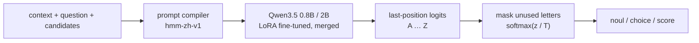

<div align="center">

# Chinese Decision

**A Chinese probabilistic decision model: one forward pass, straight to candidate probabilities**

[](docs/MODELS.md)
[](https://huggingface.co/datasets/bbldCVer-hf/CJ-Dataset)
[](https://huggingface.co/datasets/bbldCVer-hf/CJ-Bench)
[](https://github.com/n4ze3m/hmm)
[](https://huggingface.co/quincyqiang/chinese-decision-0.8b)
[](https://modelscope.cn/models/quincyqiang/chinese-decision-0.8b)
[](https://huggingface.co/quincyqiang/chinese-decision-0.8b-gguf)
[](https://github.com/yanqiangmiffy/chinese-decision-studio)

[中文](README.md) | English

</div>

---

## Introduction

**Chinese Decision** is a lightweight **decision model** for Chinese text. It does not chat or generate text. Given a context and a fixed set of candidates, it returns a probability for each candidate.

Many AI calls in real software are really judgments over a closed set: intent detection, ticket routing, content moderation, data labeling, grading model outputs, or choosing an agent's next action. Answering these with a generative LLM is slow, expensive, and requires parsing free text. A decision model returns a structured probability distribution that code can threshold directly.

The model family is built on [Qwen3.5-0.8B](https://huggingface.co/Qwen/Qwen3.5-0.8B) and [Qwen3.5-2B](https://huggingface.co/Qwen/Qwen3.5-2B), fine-tuned with LoRA on [CJ-Dataset](https://huggingface.co/datasets/bbldCVer-hf/CJ-Dataset), a corpus of 13 million Chinese decisions. The method is adapted from [n4ze3m/hmm](https://github.com/n4ze3m/hmm), and results are compared against the [Chinese-Jev](https://arxiv.org/abs/2609.36965) paper on its CJ-Bench benchmark.

**Highlights**

- ⚡ **One forward pass, zero output tokens**: reads the logits of candidate letters `A`–`Z` at the last position and applies softmax. No autoregressive decoding, no chain of thought.
- 🧩 **Three question types**: `noul` (yes/no), `choice` (single choice), and `score` (ordered levels, returns the expected level).
- 🏆 **Two sizes, one model for all four domains**: chinese-decision-2b reaches **84.11%** overall accuracy on the full CJ-Bench and **78.25%** across medical / legal / finance, above the paper's Chinese-Jev (70.82%) and the closed-source Jev (77.01%); chinese-decision-0.8b reaches **83.11% / 76.90%**. Some legal yes/no and finance rating tasks still favor 0.8B.
- 📏 **Calibrated probabilities**: the released weights ship a validation-fitted temperature; overall ECE is **0.64%** for 2B and **0.27%** for 0.8B, and ECE is lower than every model in the paper in all four domains.
- 🪶 **GPU and CPU**: both sizes ship BF16 and Q8_0 GGUF packages. chinese-decision-2b-gguf is only **2.01 GB** (about 46.5% smaller than BF16), reaches **84.11%** on the full CJ-Bench, and agrees with BF16 on the top choice **99.00%** of the time; it runs on CPU through llama.cpp without PyTorch.
- 🔌 **hmm / System One compatible API**: ships with a ready-to-run HTTP server.

## News

- 🚀 **2026-10-17**: Released **chinese-decision-2b** (🤗 [Hugging Face](https://huggingface.co/quincyqiang/chinese-decision-2b) · [ModelScope](https://modelscope.cn/models/quincyqiang/chinese-decision-2b)) and the CPU build **chinese-decision-2b-gguf** (Q8_0, 2.01 GB; 🤗 [Hugging Face](https://huggingface.co/quincyqiang/chinese-decision-2b-gguf) · [ModelScope](https://modelscope.cn/models/quincyqiang/chinese-decision-2b-gguf)). 2B reaches **84.11%** overall accuracy, a **78.25%** specialized average and **0.64%** ECE; Q8_0 reaches **84.11%** on the full benchmark with **99.00%** top-choice agreement with BF16. CPU checks: [2B CPU deployment](docs/CPU_2B.md) (Chinese).
- 📊 **2026-10-17**: Qwen3.5-2B + LoRA + RLCD finished training (13,048,000 decisions, best step 4994), and all five stage checkpoints completed the full CJ-Bench. See [2B Training History](#2b-training-history) and the [2B release record](docs/TRAINING_2B.md) (Chinese).
- 🧪 **2026-10-15**: Open-sourced [Decision Studio](https://github.com/yanqiangmiffy/chinese-decision-studio), a test platform for the model with a decision playground, 8 application scenarios, a robustness lab, an evaluation center and load testing, started with one `docker compose up`. It runs against either the GPU service (`scripts/serve_gpu.py`) or the GGUF service on CPU (`scripts/serve.py`).
- 🎉 **2026-10-15**: Released **chinese-decision-0.8b** (🤗 [Hugging Face](https://huggingface.co/quincyqiang/chinese-decision-0.8b) · [ModelScope](https://modelscope.cn/models/quincyqiang/chinese-decision-0.8b)) and **chinese-decision-0.8b-gguf** (Q8_0, 812 MB; 🤗 [Hugging Face](https://huggingface.co/quincyqiang/chinese-decision-0.8b-gguf) · [ModelScope](https://modelscope.cn/models/quincyqiang/chinese-decision-0.8b-gguf)). Full training ran 1 epoch (13,048,000 decisions, 10,132 steps); the validation-selected step 10000 reaches **72.24%** on the CJ-Bench general domain and a **76.98%** specialized average. After merging, a temperature of T = 1.108 was fitted on a separate validation partition.
- 📈 **2026-10-14**: Evaluated the step 5000 checkpoint on the full CJ-Bench test set (307,900 decisions) and compared it with Tables 1 and 2 of the Chinese-Jev paper.

## Models

| Model | Base / objective | Format / size | Default T | Download | Model Card |
|---|---|---|---:|---|---|
| Chinese Decision 0.8B | Qwen3.5-0.8B / CE | BF16 / 1.50 GB | 1.108133 | [HF](https://huggingface.co/quincyqiang/chinese-decision-0.8b) · [ModelScope](https://modelscope.cn/models/quincyqiang/chinese-decision-0.8b) | [0.8B](docs/MODEL_CARD_0_8B.md) |
| Chinese Decision 0.8B Q8_0 | Same merged 0.8B | GGUF / 0.812 GB | 1.108133 | [HF](https://huggingface.co/quincyqiang/chinese-decision-0.8b-gguf) · [ModelScope](https://modelscope.cn/models/quincyqiang/chinese-decision-0.8b-gguf) | [0.8B GGUF](docs/MODEL_CARD_0_8B_GGUF.md) |
| Chinese Decision 2B | Qwen3.5-2B / CE + RLCD | BF16 / 3.76 GB | 1.074872 | [HF](https://huggingface.co/quincyqiang/chinese-decision-2b) · [ModelScope](https://modelscope.cn/models/quincyqiang/chinese-decision-2b) | [2B](docs/MODEL_CARD_2B.md) |
| Chinese Decision 2B Q8_0 | Same merged 2B | GGUF / 2.01 GB | 1.074872 | [HF](https://huggingface.co/quincyqiang/chinese-decision-2b-gguf) · [ModelScope](https://modelscope.cn/models/quincyqiang/chinese-decision-2b-gguf) | [2B GGUF](docs/MODEL_CARD_2B_GGUF.md) |

All four variants have full CJ-Bench results on all 307,900 decisions (see [Evaluation](#evaluation)) and support 16,384 input tokens and 2–26 candidates. Sizes are decimal GB, not runtime memory.

**Which one?** On a GPU, prefer 2B BF16 (highest accuracy). On CPU or under memory limits, use a Q8_0 GGUF, which needs no PyTorch. If latency and resources matter most, or your workload is mainly legal yes/no or finance rating, 0.8B still has an edge. See [model selection and complete comparison](docs/MODELS.md) (Chinese).

Code: [this repository](https://github.com/yanqiangmiffy/chinese-decision). Test platform: [Decision Studio](https://github.com/yanqiangmiffy/chinese-decision-studio).

## Showcase

The screenshots below come from Decision Studio, our test platform, serving the final 0.8B step 10000 model (the interface is in Chinese). Every scenario follows the same design: **business rules live in code; the decision model only supplies probabilities**.

### Ticket Triage: Six Judgments in One Request

Each support ticket gets six questions in a single request: category (`choice`); severity and frustration (`score`); and whether it is reproducible, asks for a refund, or signals churn risk (`noul`). All six are asked up front whether or not they end up being used, which saves extra round trips. Routing rules in code turn these probabilities into a queue, and tickets whose category confidence is below 0.5 go to human review. In the screenshot, 8 tickets × 6 questions = 48 decisions take 285 ms.


### LLM Guardrail: Safety Checks with a Human-Review Band

Every message into and out of an LLM is checked first. The input side checks for prompt injection / jailbreaks, private information, abuse or threats, and off-topic requests; the output side checks for system-prompt leaks, unauthorized promises, private information in the reply, and inappropriate content. Each check is a yes / no probability with two thresholds: below the review threshold it passes automatically, above the block threshold it is blocked, and anything in between goes to a person, so the width of that band is the human-review budget. In the screenshot, a "developer mode" jailbreak is blocked on the input side (85.2%) before the LLM is ever called; all 8 checks take 89.2 ms.


### Danmaku Guard: Real-Time Moderation of Live-Stream Comments

Each live-stream comment (danmaku) takes one request with one classification and one yes / no judgment: abuse and ads are blocked, spoilers are folded, and viewer questions are highlighted for the host. In the screenshot, median (p50) moderation latency is 82.2 ms. The page also records a known weakness: the spoiler check is swayed by the word "spoiler" itself (as in "no spoilers, please") and cannot tell speculation from an actual spoiler.


### Agent Router: Confidence Gates by Risk Level

For every user message, the decision model first picks a tool, checks whether the request has the information it needs, and estimates the operation's risk; the confidence threshold then depends on the risk tier: 40% for read-only actions (weather, search, chat), 65% for writes (calendar, messages, smart home), and 85% for money (transfers, payments). In the screenshot, "帮我约王总下周二下午聊一下预算" ("set up a budget chat with Mr. Wang next Tuesday afternoon") is routed to the calendar tool with 99% confidence, but the probability that key information is missing is 71%, above the 70% follow-up threshold, so the agent first asks which day, what time, and with whom, in 81.6 ms.


## How It Works



Each question is compiled into the following Chinese prompt and wrapped in the Qwen chat template with thinking disabled:

```text
待判断的上下文：            # Context to judge:
{state}

问题：                      # Question:
{instructions}

候选项：                    # Candidates:
A: {key₁} — {description₁}
B: {key₂} — {description₂}
...
只返回候选项对应的字母。    # Answer with the candidate letter only.
```

Training, evaluation, and serving share the same prompt compiler, so all three see identical inputs.

### Question Types

| Type | `criteria` format | Returned field |
|---|---|---|
| `noul` | Optional `{"false": "...", "true": "..."}`; defaults to “否 / 是” (no / yes) | `noul`: probability of true |
| `choice` | Object `{key: description}` | `choice`: the most probable key |
| `score` | List of levels, ordered low to high | `score`: probability-weighted expected level index (0 to K−1); `legend`: index-to-description map |

Every answer also includes the full `probabilities` and a `confidence` value, where `confidence = (K·p_max − 1) / (K − 1)` measures how sharp the distribution is: 0 for uniform, 1 for certain. It is **not** an empirical accuracy.

## Evaluation

Throughout this section, **chinese-decision-0.8b**, **chinese-decision-2b** and their `-gguf` builds are the published weights: the trained LoRA is merged into the base model, and probabilities use the default temperature in `decision_config.json`.

> **About the temperature T**: probabilities are p = softmax(z / T), where z are the candidate-letter logits. **T = 1** means a plain softmax over the logits, with no temperature calibration. The released weights ship a temperature fitted on a held-out validation partition (1.108 for 0.8B, 1.075 for 2B). It only changes how sharp the probabilities are and **never changes the chosen answer**: accuracy stays the same while ECE / NLL improve. Training checkpoints in the history tables are evaluated at T = 1.

### Main Results

All 307,900 CJ-Bench decisions (304,822 hard labels, 3,078 soft labels), with no filtering or truncation. ACC / ECE use hard labels only (15 equal-width bins); NLL / Brier include soft labels. Micro is weighted by items; Macro is the unweighted mean of the four domains. **Bold** marks metrics where 2B improves on 0.8B in the same format.

| Model | Format | Micro ACC (%) ↑ | Macro ACC (%) ↑ | ECE (%) ↓ | NLL ↓ | Brier ↓ | Score MAE ↓ |
| --- | --- | ---: | ---: | ---: | ---: | ---: | ---: |
| chinese-decision-0.8b | BF16 | 83.11 | 75.74 | 0.27 | 0.4313 | 0.2238 | 0.5844 |
| chinese-decision-0.8b-gguf | Q8_0 | 83.12 | 75.81 | 0.27 | 0.4313 | 0.2238 | 0.5840 |
| chinese-decision-2b | BF16 | **84.11** | **77.18** | 0.64 | **0.4165** | **0.2133** | **0.5642** |
| chinese-decision-2b-gguf | Q8_0 | **84.11** | **77.33** | 0.65 | **0.4163** | **0.2132** | **0.5637** |

- **2B is more accurate overall**: compared with 0.8B, Micro **+1.01**, Macro **+1.44** and the medical/legal/finance average **+1.35** points; NLL / Brier / score MAE drop by **3.4% / 4.7% / 3.5%**. Overall ECE is slightly higher (0.64% vs 0.27%) but still very low.
- **Q8_0 is nearly lossless**: paired item by item with BF16 at the same temperature, top-1 agreement is **98.92% / 99.00%** for 0.8B / 2B, and accuracy changes by +0.02 / −0.001 points. A few individual answers still change (for 2B, 1,105 flip correct→wrong and 1,101 wrong→correct); the 0.15-point macro gain of 2B Q8_0 comes mostly from the small legal domain (4,300 items) and does not mean quantization improves the model. Full results were measured with llama.cpp on CUDA; CPU checks cover the API and limited inputs. See the [0.8B GGUF](docs/MODEL_CARD_0_8B_GGUF.md) and [2B GGUF](docs/MODEL_CARD_2B_GGUF.md) cards.

### Comparison with Chinese-Jev

External rows are author-reported results from [Chinese-Jev v1 Tables 1 and 2](https://arxiv.org/html/2609.36965v1) (checked on 2026-10-17, not reproduced here); project rows are the released weights. All values are percentages; **bold** marks the best value in each column.

**General (Table 1)**

| Model | ACC (%) ↑ | ECE (%) ↓ |
| --- | ---: | ---: |
| Qwen3.5-2B | 32.95 | 43.68 |
| Open-Jev | 52.33 | 10.54 |
| SemIF | 44.21 | 27.27 |
| Laya Multilingual | 40.22 | 23.04 |
| Jev (API) | 68.35 | 11.45 |
| Chinese-Jev General / Specialists | 69.20 | 3.78 |
| chinese-decision-0.8b | 72.26 | **1.68** |
| chinese-decision-2b | **73.96** | 1.93 |

**Specialized domains (Table 2)**

| Model | Medical ACC | Medical ECE | Legal ACC | Legal ECE | Finance ACC | Finance ECE | Avg. ACC | Avg. ECE |
| --- | ---: | ---: | ---: | ---: | ---: | ---: | ---: | ---: |
| Qwen3.5-2B | 53.88 | 28.71 | 31.53 | 44.82 | 38.11 | 49.12 | 41.17 | 40.88 |
| Open-Jev | 73.08 | 2.88 | 44.07 | 23.15 | 48.11 | 10.19 | 55.09 | 12.07 |
| SemIF | 62.17 | 10.39 | 43.07 | 19.99 | 47.89 | 18.45 | 51.04 | 16.28 |
| Laya Multilingual | 24.55 | 43.05 | 34.72 | 31.49 | 38.31 | 26.18 | 32.53 | 33.57 |
| Jev (API) | 84.29 | 5.70 | 68.35 | 8.03 | **78.39** | 2.98 | 77.01 | 5.57 |
| Chinese-Jev General | 39.77 | 17.33 | 38.76 | 15.37 | 35.39 | 14.43 | 37.97 | 15.71 |
| Chinese-Jev General / Specialists | 87.65 | 7.25 | 60.10 | 17.45 | 64.72 | 11.55 | 70.82 | 12.08 |
| chinese-decision-0.8b | 88.85 | 1.12 | 67.84 | 4.05 | 74.00 | 2.45 | 76.90 | 2.54 |
| chinese-decision-2b | **89.50** | **0.24** | **68.74** | **3.37** | 76.50 | **2.13** | **78.25** | **1.92** |

- Compared with Chinese-Jev (General + three Specialists), chinese-decision-2b is **4.76 / 1.85 / 8.64 / 11.78** points higher on general / medical / legal / finance, and **7.43** higher on the specialized average. It is **1.24** points above the closed-source Jev on the specialized average, while finance is still 1.89 points lower.
- Both sizes have lower ECE than every model in the paper, in all four domains.
- Chinese-Jev General plus three Specialists are four separately trained models; this project covers all four domains with one model per size. Jev is a closed API. The paper uses H200 / API and this project uses an A800, so latency is not ranked. Model size, batch and objective (2B adds RLCD) all change between 0.8B and 2B, so differences are not attributable to one factor.

**Method differences from Chinese-Jev**

| | Chinese-Jev | Chinese Decision (ours) |
|---|---|---|
| Backbone | mmBERT-base encoder + decision Transformer (about 322M) | Qwen3.5-0.8B / 2B decoder + LoRA |
| Candidate scoring | Shared MLP over candidate-marker positions | Last-position logits of candidate letters |
| Objective | Cross-entropy + RLCD policy-gradient term | Candidate-distribution cross-entropy for 0.8B; 2B also uses RLCD (see release record) |
| Training | General pre-training, then three separately fine-tuned specialists | All four domains mixed into one model |

### 0.8B Training History

The four best checkpoints selected in turn by validation distribution NLL during the same run, each evaluated on all 307,900 CJ-Bench decisions under the same protocol (before merging, T = 1). The third-to-last row is the released model; the last two rows are quoted from the Chinese-Jev paper for reference.

| Checkpoint | Progress | Val. NLL ↓ | General ACC ↑ | Medical ACC ↑ | Legal ACC ↑ | Finance ACC ↑ | Specialized avg. ACC ↑ | Specialized avg. ECE ↓ | Overall ECE ↓ |
|---|---:|---:|---:|---:|---:|---:|---:|---:|---:|
| step 2000 | 19.82% | 0.739 | 69.04 | 86.78 | 54.07 | 64.17 | 68.34 | 2.73 | 1.63 |
| step 3000 | 29.71% | 0.691 | 70.26 | 87.22 | 58.93 | 68.67 | 71.61 | 1.75 | 1.25 |
| step 5000 | 49.41% | 0.676 | 70.90 | 87.89 | 63.37 | 71.17 | 74.14 | 1.49 | 0.84 |
| **step 10000 (final)** | 98.71% | 0.600 | 72.24 | 88.86 | 67.86 | 74.22 | 76.98 | 2.46 | 1.07 |
| *chinese-decision-0.8b (released)* | — | — | 72.26 | 88.85 | 67.84 | 74.00 | 76.90 | 2.54 | 0.27 |
| *Reference: Chinese-Jev (G / S)* | — | — | 69.20 | 87.65 | 60.10 | 64.72 | 70.82 | 12.08 | — |
| *Reference: Jev* | — | — | 68.35 | 84.29 | 68.35 | 78.39 | 77.01 | 5.57 | — |

> Progress uses actual trained decisions: steps 2000 / 3000 / 5000 / 10000 saw 2,586,624 / 3,876,160 / 6,447,104 / 12,879,232 decisions, or 19.82% / 29.71% / 49.41% / 98.71% of one epoch. For the separate 2B trajectory see [the release record](docs/TRAINING_2B.md).

- **Steady gains in every domain**: from step 2000 to step 10000, legal improves by **13.79** points, finance by **10.06**, general by **3.20**, and medical by **2.08**.
- **Ahead of Chinese-Jev-S from step 3000 on**: specialized-domain average accuracy rises from 68.34% to **76.98%**, and the gap to Jev (77.01%) narrows from 8.67 to **0.03** points.
- **Calibration does not improve monotonically**: without temperature calibration, overall ECE falls from 1.63% to 0.84% at step 5000 and ends at 1.07%; specialized-domain average ECE is lowest at step 5000 (1.49%) and ends at 2.46%, mostly because legal ECE rises from 2.30% to 5.70%. After temperature calibration the released model's overall ECE is **0.27%**.
- Validation NLL keeps falling (0.739 → 0.600), in the same direction as the test-set accuracy gains.

### 2B Training History

The best 2B (CE + RLCD) checkpoint selected by validation distribution NLL every 1,000 steps, each evaluated on all 307,900 CJ-Bench decisions under the same protocol (before merging, T = 1, no filtering or truncation). The last row is the released model.

| Checkpoint | Progress | Val. NLL ↓ | General ACC ↑ | Medical ACC ↑ | Legal ACC ↑ | Finance ACC ↑ | Specialized avg. ACC ↑ | Specialized avg. ECE ↓ | Overall ECE ↓ |
|---|---:|---:|---:|---:|---:|---:|---:|---:|---:|
| step 1000 | 20.08% | 0.694 | 70.55 | 87.69 | 55.67 | 66.94 | 70.10 | 3.71 | 2.03 |
| step 2000 | 40.13% | 0.630 | 72.56 | 88.54 | 62.67 | 71.44 | 74.22 | 2.28 | 1.27 |
| step 3000 | 60.11% | 0.603 | 71.87 | 88.99 | 65.56 | 74.31 | 76.28 | 1.63 | 1.63 |
| step 4000 | 80.18% | 0.592 | 73.77 | 89.42 | 68.40 | 76.03 | 77.95 | 1.74 | 0.85 |
| **step 4994 (final)** | 100.00% | 0.586 | 73.95 | 89.50 | 69.05 | 76.03 | 78.19 | 2.17 | 1.49 |
| *chinese-decision-2b (released)* | — | — | 73.96 | 89.50 | 68.74 | 76.50 | 78.25 | 1.92 | 0.64 |

> Progress uses actual trained decisions: steps 1000 / 2000 / 3000 / 4000 / 4994 saw 2,619,904 / 5,236,736 / 7,842,752 / 10,461,952 / 13,048,000 decisions. Step numbers are not comparable with 0.8B (global batch ≈ 2048 vs 1024); compare by data progress.

- **Legal and finance gain the most**: from step 1000 to the final checkpoint, legal improves by **13.37** points, finance by **9.08**, general by **3.39**, and medical by **1.81**.
- **Ahead of Chinese-Jev (G / S) from step 2000 on**; the specialized average passes the closed-source Jev (77.01%) from step 4000 and ends **1.18** points ahead, although finance alone is still below Jev.
- **General drops 0.69 points at step 3000**: mostly because the product-catalog source (3,151 items) collapses from 75.06% to 30.05%; it recovers by step 4000. See the [2B record](docs/TRAINING_2B.md) (Chinese).
- **Plateau late in training**: from step 4000 to 4994 overall accuracy rises only 0.12 points, and uncalibrated overall ECE rises from 0.85% to 1.49%; the temperature-calibrated release is at **0.64%**.
- At about 20% of the data, 2B step 1000 is **1.13** points more accurate overall than 0.8B step 2000. Model size, batch and RLCD all changed, so this is not attributable to one factor.

### Results by Domain and Type

<details>
<summary><b>chinese-decision-0.8b: CJ-Bench by domain and by type</b></summary>

> Released weights (T = 1.108), one A800 80GB, BF16. ACC and ECE use hard labels only; NLL and Brier cover every item, including soft labels. Medical is 65% of the test set, so micro metrics mostly reflect medical; prefer macro for cross-domain comparisons.

**By domain**

| Domain | Items | ACC ↑ | ECE ↓ | NLL ↓ | Brier ↓ |
|---|---:|---:|---:|---:|---:|
| General | 100,000 | 72.26 | 1.68 | 0.686 | 0.355 |
| Medical | 200,000 | 88.85 | 1.12 | 0.295 | 0.152 |
| Legal | 4,300 | 67.84 | 4.05 | 0.721 | 0.410 |
| Finance | 3,600 | 74.00 | 2.45 | 0.597 | 0.337 |
| **Overall (micro)** | **307,900** | **83.11** | **0.27** | **0.431** | **0.224** |
| **Unweighted mean of four domains (macro)** | — | **75.74** | — | **0.575** | — |

**By question type**

| Type | Items | ACC ↑ | ECE ↓ | NLL ↓ | Expected-level MAE ↓ |
|---|---:|---:|---:|---:|---:|
| `noul` | 134,577 | 94.96 | 0.19 | 0.117 | — |
| `choice` | 134,577 | 78.32 | 0.58 | 0.587 | — |
| `score` | 38,746 | 56.45 | 1.67 | 0.984 | 0.584 |

**Accuracy by domain × type (%)**

| Domain | `noul` | `choice` | `score` |
|---|---:|---:|---:|
| General | 87.59 | 72.93 | 54.64 |
| Medical | 97.82 | 80.55 | 66.50 |
| Legal | 85.60 | 64.07 | 51.69 |
| Finance | 76.33 | 62.83 | 82.83 |

</details>

<details>
<summary><b>chinese-decision-2b: CJ-Bench by domain and by type</b></summary>

> Released weights (T = 1.075), same protocol. **Bold** marks accuracies that improve on chinese-decision-0.8b. Domain and type results for Q8_0 are in the [2B GGUF card](docs/MODEL_CARD_2B_GGUF.md).

**By domain**

| Domain | Items | ACC ↑ | ECE ↓ | NLL ↓ | Brier ↓ |
|---|---:|---:|---:|---:|---:|
| General | 100,000 | **73.96** | 1.93 | 0.663 | 0.336 |
| Medical | 200,000 | **89.50** | 0.24 | 0.284 | 0.146 |
| Legal | 4,300 | **68.74** | 3.37 | 0.703 | 0.406 |
| Finance | 3,600 | **76.50** | 2.13 | 0.578 | 0.323 |
| **Overall (micro)** | **307,900** | **84.11** | **0.64** | **0.417** | **0.213** |
| **Unweighted mean of four domains (macro)** | — | **77.18** | — | **0.557** | — |

**By question type**

| Type | Items | ACC ↑ | ECE ↓ | NLL ↓ | Expected-level MAE ↓ |
|---|---:|---:|---:|---:|---:|
| `noul` | 134,577 | **95.11** | 0.34 | 0.115 | — |
| `choice` | 134,577 | **80.12** | 0.90 | 0.559 | — |
| `score` | 38,746 | **57.67** | 1.65 | 0.969 | 0.564 |

**Accuracy by domain × type (%)**

| Domain | `noul` | `choice` | `score` |
|---|---:|---:|---:|
| General | **88.01** | **76.16** | **56.05** |
| Medical | **97.87** | **81.81** | 66.19 |
| Legal | 82.07 | **67.20** | **55.15** |
| Finance | **81.75** | **67.42** | 80.33 |

> 9 of the 12 domain × type cells improve; legal yes/no (`noul`, 82.07 vs 85.60) and finance rating (`score`, 80.33 vs 82.83) drop clearly, and medical rating dips slightly (66.19 vs 66.50). See [Limitations](#limitations).

</details>

<details>
<summary><b>0.8B before vs. after fine-tuning (validation)</b></summary>

On a stratified subset of the official validation set (4 domains × 3 types, 100 items each, 1,200 total), zero-shot base model vs. step 10000:

| Domain | Qwen3.5-0.8B ACC | **Chinese Decision ACC** | Qwen3.5-0.8B ECE | **Chinese Decision ECE** |
|---|---:|---:|---:|---:|
| General | 36.64 | **75.34** | 28.25 | **3.76** |
| Medical | 16.67 | **82.00** | 43.40 | **3.25** |
| Legal | 40.67 | **65.33** | 24.03 | **7.62** |
| Finance | 44.33 | **71.33** | 16.77 | **3.41** |
| **Overall** | 34.56 | **73.49** | 27.45 | **2.48** |

</details>

### Inference Efficiency

The same 25 CJ-Bench inputs (92–6,521 tokens), single requests on the released weights, three warmed runs each:

| Metric (single-request p50) | chinese-decision-0.8b | chinese-decision-2b |
|---|---:|---:|
| GPU · BF16 (Transformers) | 44.4 ms | 44.8 ms |
| GPU · Q8_0 (llama.cpp) | **17.9 ms** | **23.6 ms** |
| CPU, 16 threads · Q8_0 (llama.cpp) | 427.0 ms | 818.0 ms |
| CPU process memory · Q8_0 / FP32 | **2.19** / 7.44 GiB | **3.34** / 11.74 GiB |

> Shared server with an A800 80GB PCIe and a Xeon Gold 5318Y. Timing covers the forward pass and probabilities for pre-tokenized input; it excludes tokenization, HTTP and network. At batch = 1 both sizes are bound by GPU scheduling overhead, so BF16 latency is similar; Q8_0 is faster for short inputs on GPU, and its main CPU advantage is memory. Long inputs and the Windows desktop measurements are in the [0.8B GGUF](docs/MODEL_CARD_0_8B_GGUF.md) and [2B GGUF](docs/MODEL_CARD_2B_GGUF.md) cards.

## Quick Start

### Installation

```bash
git clone https://github.com/yanqiangmiffy/chinese-decision.git
cd chinese-decision
pip install -e ".[train]"
```

Python ≥ 3.11 is required. `[train]` installs the CUDA training/inference dependencies. For CPU GGUF serving use `pip install -e ".[gguf]"`; PyTorch, PEFT and flash-linear-attention are not required. Transformers-only inference uses `.[torch]`. If your environment already has a CUDA build of PyTorch that pip should leave alone, use `pip install -e . --no-deps`.

### Models and Data

To use the model without training, download the released weights (links for all four variants are in [Models](#models)). Pick the one you need:

```bash
# GPU: merged BF16 weights
hf download quincyqiang/chinese-decision-2b --local-dir models/chinese-decision-2b
hf download quincyqiang/chinese-decision-0.8b --local-dir models/chinese-decision-0.8b
# CPU: Q8_0 GGUF, no PyTorch needed
hf download quincyqiang/chinese-decision-2b-gguf --local-dir models/chinese-decision-2b-gguf
hf download quincyqiang/chinese-decision-0.8b-gguf --local-dir models/chinese-decision-0.8b-gguf
# or from ModelScope (same repository names), e.g.
modelscope download --model quincyqiang/chinese-decision-2b --local_dir models/chinese-decision-2b
modelscope download --model quincyqiang/chinese-decision-2b-gguf --local_dir models/chinese-decision-2b-gguf
```

For training and evaluation, the base model and data are also loaded from local directories. You can fetch them with the Hugging Face CLI (the CJ datasets are currently gated; run `hf auth login` first):

```bash
hf download Qwen/Qwen3.5-0.8B --local-dir models/Qwen3.5-0.8B
hf download Qwen/Qwen3.5-2B --local-dir models/Qwen3.5-2B   # for training 2B
```

```bash
hf download bbldCVer-hf/CJ-Dataset --repo-type dataset --local-dir datasets/CJ-Dataset
```

```bash
hf download bbldCVer-hf/CJ-Bench --repo-type dataset --local-dir datasets/CJ-Bench
```

### Run the 2B models

After downloading the model directory, run from the repository root. For GPU BF16:

```bash
python scripts/serve_gpu.py --base models/chinese-decision-2b --host 127.0.0.1 --port 8789 --token-budget 16384 --max-batch 32
```

For CPU Q8_0 (install the `[gguf]` extra):

```bash
python scripts/serve.py --backend gguf --base models/chinese-decision-2b-gguf --gguf models/chinese-decision-2b-gguf/chinese-decision-2b-Q8_0.gguf --threads 8 --context-size 16384 --host 127.0.0.1 --port 8790
```

Both use the calibrated temperature in `decision_config.json` and expose the same API as the HTTP server below. See the [2B BF16 card](docs/MODEL_CARD_2B.md) for direct Python inference and the [2B Q8_0 card](docs/MODEL_CARD_2B_GGUF.md) for CPU setup. The Python and HTTP examples below use 0.8B; swap in a 2B directory to use 2B.

### Python (0.8B example)

```python
import json
from pathlib import Path

import torch
from decision.model import forward_batch, letter_tokens, load_model, load_tokenizer
from decision.schema import compile_prompt, options_for

base = "models/chinese-decision-0.8b"  # merged model; or load_model("models/Qwen3.5-0.8B", adapter="runs/cj-ddp/best")
tokenizer = load_tokenizer(base)
model = load_model(base).eval()
letters = letter_tokens(tokenizer, "cuda")
config = Path(base, "decision_config.json")
temperature = json.loads(config.read_text())["temperature"] if config.exists() else 1.0

state = "客户留言：付款后一直没有收到发票，我已经催了三次，今天必须拿到。"
question = {
    "type": "choice",
    "instructions": "应该由哪个部门处理？",
    "criteria": {"billing": "支付、发票及退款", "technical": "故障和系统问题", "sales": "购买咨询与升级"},
}

options = options_for(question)
prompt = compile_prompt(tokenizer, state, question["instructions"], options)
item = {"input_ids": tokenizer.encode(prompt, add_special_tokens=False), "target": [0.0] * len(options)}
with torch.inference_mode():
    logits, _ = forward_batch(model, tokenizer, letters, [item])
probs = (logits[0, :len(options)] / temperature).softmax(-1).tolist()
print({key: round(p, 4) for (key, _), p in zip(options, probs)})
```

### HTTP Server

```bash
python scripts/serve.py --base models/chinese-decision-0.8b --port 8787
```

For CPU Q8_0 serving, install `.[gguf]`, export the model using
`scripts/convert_gguf.py`, and run:

```bash
python scripts/serve.py --backend gguf --base models/chinese-decision-0.8b-gguf --gguf models/chinese-decision-0.8b-gguf/chinese-decision-0.8b-Q8_0.gguf --threads 8 --context-size 16384 --port 8787
```

See [CPU deployment](docs/CPU.md) for conversion and benchmark instructions.
The existing routes and probability semantics are preserved. `--device cpu`
selects a Transformers FP32 baseline. Requests exceeding the effective runtime
context limit return HTTP 422 without truncation.

You can also load the base model with an adapter: `--base models/Qwen3.5-0.8B --adapter runs/cj-ddp/best` (temperature is then 1, i.e. uncalibrated).

One request can carry several questions:

```bash
curl http://127.0.0.1:8787/v1/systemone \
  -H 'Content-Type: application/json' \
  --data-binary @examples/request.json
```

```json
{
  "state": "客户留言：付款后一直没有收到发票，我已经催了三次，今天必须拿到。",
  "questions": {
    "urgent": {"type": "noul", "instructions": "客户是否表达了紧迫性？"},
    "department": {"type": "choice", "instructions": "应该由哪个部门处理？",
                   "criteria": {"billing": "支付、发票及退款", "technical": "故障和系统问题", "sales": "购买咨询与升级"}},
    "frustration": {"type": "score", "instructions": "客户有多不满？",
                    "criteria": ["平静", "不满", "非常愤怒"]}
  }
}
```

Response format (values are illustrative only):

```json
{
  "model": "chinese-decision-0.8b",
  "answers": {
    "urgent": {"type": "noul", "probabilities": {"false": 0.04, "true": 0.96}, "confidence": 0.92, "noul": 0.96},
    "department": {"type": "choice", "probabilities": {"billing": 0.97, "technical": 0.02, "sales": 0.01},
                   "confidence": 0.955, "choice": "billing"},
    "frustration": {"type": "score", "probabilities": {"0": 0.02, "1": 0.38, "2": 0.60}, "confidence": 0.40,
                    "score": 1.58, "legend": {"0": "平静", "1": "不满", "2": "非常愤怒"}}
  },
  "usage": {"input_tokens": 242, "output_tokens": 0},
  "latency_ms": 85.3
}
```

| Endpoint | Description |
|---|---|
| `POST /v1/systemone` | Decision endpoint; `?debug=1` adds each candidate's logit and each question's token count |
| `POST /api/alpha/decisions` | Same as above; hmm-compatible route |
| `POST /v1/batch` | `{"requests": [...], "debug": bool}`: several requests at once; one invalid request does not fail the others |
| `POST /v1/compile` | Compile prompts and count tokens without running the model |
| `POST /v1/tournament` | `choice` questions with more candidates than one prompt holds: group rounds, then a final (see below) |
| `GET /v1/info` | Checkpoint, validation metrics and serving statistics |
| `GET /v1/training` | Training progress |
| `GET /health` | Health check; reports the temperature, whether the model is calibrated and the checkpoint step |

A request may contain up to 64 questions, each with 2–26 candidates and at most 16,384 input tokens. Over-length inputs are **never truncated**; invalid requests return `422`.

**More than 26 candidates: tournaments (`/v1/tournament`)**. The model reads one letter per candidate, and the training data has at most 16 candidates. The server shuffles a larger `choice` question into groups of at most `group_size`, advances the top `keep` of each group until the rest fit one question, and asks that final question. Every group goes through the same prompt compiler, so no retraining is needed:

```json
{
  "state": "用户希望了解第 137 号产品。",
  "question": {"type": "choice", "instructions": "用户想了解哪个产品？",
               "criteria": {"p0": "第 0 号产品", "p1": "第 1 号产品", "...": "up to 1024 candidates"}},
  "group_size": 16,
  "keep": 2,
  "seed": 0
}
```

`group_size` is 3–26 (default 16, the largest count seen in training), `keep` is 1 to `group_size // 2` (default 2), and `seed` fixes the grouping. `answer` has the same shape as a `/v1/systemone` answer, but **its probabilities cover the finalists only**; `rounds` records each group's probabilities and who advanced, and `decisions` counts forward passes. With the defaults, 300 candidates take 19 + 3 + 1 = 23 forward passes. A field that already fits in `group_size` is one question, identical to `/v1/systemone`. Tournaments have not been evaluated on CJ-Bench; finalists tend to be close, so their probabilities are flatter, and confidence thresholds should be re-tuned on your own data.

### Deployment

Two server entry points share the same API and response format; either can back [Decision Studio](https://github.com/yanqiangmiffy/chinese-decision-studio) (the test platform) as its `DECISION_BASE_URL`:

| Entry point | Use | Weights | Deployment |
|---|---|---|---|
| `scripts/serve.py` | CPU (GGUF) or local debugging; one forward pass per question | GGUF: [HF](https://huggingface.co/quincyqiang/chinese-decision-0.8b-gguf) · [ModelScope](https://modelscope.cn/models/quincyqiang/chinese-decision-0.8b-gguf) (BF16 also works) | [docs/CPU.md](docs/CPU.md), [deploy/gguf](deploy/gguf/) |
| `scripts/serve_gpu.py` | Production GPU serving: dynamic batching, training progress, checkpoint hot reload (`POST /v1/admin/reload`) | BF16: [HF](https://huggingface.co/quincyqiang/chinese-decision-0.8b) · [ModelScope](https://modelscope.cn/models/quincyqiang/chinese-decision-0.8b), or the base model plus a trained adapter | [deploy/gpu](deploy/gpu/README.md) |

To check a running server (both routes, probability format, and invalid-request handling):

```bash
python scripts/verify_export.py --url http://127.0.0.1:8787
```

## Training

### Configuration

The table below retains the 0.8B configuration. For the 2B CE + RLCD run and actual sample progress, see [the 2B record](docs/TRAINING_2B.md).

| Item | Setting |
|---|---|
| Base model | Qwen3.5-0.8B (text backbone) |
| Fine-tuning | LoRA, r = 32, α = 64, dropout = 0.05 |
| LoRA targets | Full attention `q/k/v/o_proj`, linear attention `in_proj_qkv/z/a/b` and `out_proj`, MLP `gate/up/down_proj` |
| Loss | Cross-entropy against the candidate distribution (soft labels; hard labels are the one-hot case); optional RLCD term, off by default |
| Optimizer | AdamW, lr = 1e-4, 100-step linear warmup, then cosine decay to 10% of peak |
| Global batch | Each step accumulates at least 1,024 decisions; each micro-batch holds at most 262,144 padded tokens and shrinks automatically for long inputs |
| Max length | 16,384 tokens |
| Training budget | 1 epoch, 13,048,000 decisions, 10,132 steps |
| Precision | BF16, gradient checkpointing |
| Model selection | Validation every 1,000 steps; best checkpoint by distribution NLL (step 10000 in the end) |
| Temperature calibration | One temperature fitted on a separate validation partition, T = 1.108 |
| Hardware | 4 × GPU, DDP |

### Data and Training Notes

- **Soft labels**: CJ's `gold` is a probability distribution over candidates, used directly as the cross-entropy target.
- **Candidate shuffling**: `choice` candidates are shuffled during training, with targets permuted to match, to reduce position bias. `score` keeps its level order, and `noul` stays false / true.
- **Balanced mixing**: data is re-sharded by domain, source, and type, then interleaved in proportion to the remaining records, so task order in the raw files does not cause forgetting. The corpus is streamed and never fully loaded into memory.
- **Length bucketing**: batches are formed by token count. Items longer than 16,384 tokens are counted and filtered explicitly; context and questions are never truncated.
- **Leak-free calibration**: the official validation set is split by parent record; 80% is used for validation and model selection, and the other 20% only for fitting the temperature.

### Pipeline

```bash
# 1. Verify dataset SHA256 checksums, then re-shard training data by domain / source / type
python scripts/prepare_data.py --data datasets/CJ-Dataset --out datasets/CJ-mixed

# 2. LoRA training (4 GPUs shown; for one GPU run `python scripts/train.py`; add --resume to continue)
torchrun --standalone --nproc_per_node=4 scripts/train.py --out runs/cj-ddp

# 3. Temperature calibration + weight merge + HTTP check of the exported model
python scripts/finalize.py --run runs/cj-ddp --out models/chinese-decision-0.8b
```

The defaults of `scripts/train.py` are the release configuration in the table above. `--resume` compares every key of `config.json` and refuses to continue with different arguments; the number of GPUs may change. For a quick debug run, add `--debug-examples 512 --max-steps 12 --global-batch-size 8`.

In the run directory, `last/` is the resume point, `best/` is the best adapter on validation, and `final/` is the adapter after the last step. The exported model directory contains the merged weights, `decision_config.json` (calibrated temperature and limits), the training config and summary, and the base model's `LICENSE`.

### Optional: RLCD Objective

`--rlcd` adds Chinese-Jev's RLCD term (a policy gradient over a proper-scoring-rule reward) to the distribution cross-entropy. It is ported from the [official Chinese-Jev code](https://github.com/gulucaptain/Chinese-Jev) and reproduces its results bit for bit. **It is off by default. The existing 0.8B results use cross-entropy only; the new 2B run enables RLCD.**

Each training step perturbs the candidate logits with several zero-mean Gaussian draws, scores every perturbed distribution with "log score + 0.75 × spherical score − RPS" (RPS applies to `score` questions only), and pushes the logits toward the perturbations that score above their group's average. RPS penalizes errors more the further they are from the correct level; it is the only term that knows level order, so `score` questions are the most likely to benefit.

| Argument | Default | Meaning |
|---|---|---|
| `--rlcd` | off | Add the RLCD term to the cross-entropy, weighted 1:1 |
| `--rlcd-group-size` | 4 | Perturbations per decision (at least 2) |
| `--rlcd-sigma-start` | 0.4 | Logit noise scale at the start of training |
| `--rlcd-sigma-end` | 0.1 | Noise scale at the end, annealed linearly over training progress |

- **Difference from the original**: Chinese-Jev anneals σ per epoch (four epochs: 0.4 / 0.3 / 0.2 / 0.1). This project trains for one epoch, so σ is annealed linearly over training progress instead. σ is noise added directly to the logits, and an LLM's letter logits may have a different scale from Chinese-Jev's scoring head, so the defaults are only a starting point.
- **Config and resuming**: with `--rlcd`, `config.json` records the RLCD settings and `training_algorithm` gets a `+rlcd` suffix, so cross-entropy runs and RLCD runs cannot resume each other. Without it, the config is exactly as before and existing runs resume normally.
- **Logs**: each step also reports `ce`, `rlcd`, `reward`, and `sigma`.

**Ablation**: start a new run from scratch with the same arguments plus `--rlcd`. Both runs share the data order, validation set, and LoRA initialization; only the objective differs.

```bash
torchrun --standalone --nproc_per_node=4 scripts/train.py --out runs/cj-ddp-rlcd --rlcd
```

Do not pass `--max-steps`, which would compress the learning-rate and σ schedules and make the runs incomparable. Stop after the validation at step 1000 or 2000 and compare both runs at the same step (each validation writes `latest_metrics.json`, including per-type results), focusing on `type:score`.

## Benchmarking

```bash
# 1. Copy the validation-selected best adapter into a fresh snapshot directory
python scripts/snapshot_best.py --source-run runs/cj-ddp --out runs/cj-bench/my-eval

# 2. Quick evaluation (1,000 items per domain × type), then the full benchmark
python scripts/evaluate.py --snapshot-run runs/cj-bench/my-eval --data datasets/CJ-Bench
```

- Quick evaluation only: add `--quick-only`.
- Evaluate the merged deployment model (with its validation-fitted temperature): add `--model models/chinese-decision-0.8b`.
- The script never overwrites existing results; use a new snapshot directory for each run. Calibration and model selection use validation data only, never test labels.

## Repository Layout

```text
chinese-decision/
├── decision/               # Core library (pip install -e .)
│   ├── schema.py           #   question parsing, target distributions, prompt compiler
│   ├── data.py             #   data sharding, streaming mixing, token batching
│   ├── model.py            #   model loading and candidate-letter logits
│   ├── inference.py        #   serving backends: Transformers and GGUF (llama.cpp)
│   ├── gguf_batch.py       #   padding-free llama.cpp batches for evaluation
│   ├── training.py         #   validation, LoRA targets, checkpoint helpers
│   ├── rlcd.py             #   optional RLCD training term (ported from Chinese-Jev)
│   ├── metrics.py          #   validation and CJ-Bench metrics
│   ├── api.py              #   decision response format and checks
│   ├── tournament.py       #   grouped rounds for more candidates than one prompt holds
│   └── utils.py            #   logging, atomic writes, SHA256
├── scripts/                # Command-line entry points
│   ├── prepare_data.py     #   dataset verification and re-sharding
│   ├── train.py            #   LoRA training (one GPU / torchrun)
│   ├── finalize.py         #   calibration, merge, export checks
│   ├── snapshot_best.py    #   freeze the best adapter for evaluation
│   ├── evaluate.py         #   CJ-Bench evaluation
│   ├── convert_gguf.py     #   GGUF export (BF16 / Q8_0)
│   ├── evaluate_gguf.py    #   CJ-Bench with the GGUF weights
│   ├── benchmark_*.py      #   CPU latency and throughput; compare_gguf_benchmark.py pairs two runs
│   ├── verify_export.py    #   end-to-end HTTP API check
│   ├── serve.py            #   HTTP server: CPU / GGUF, local debugging
│   └── serve_gpu.py        #   HTTP server: production GPU (dynamic batching, hot reload)
├── deploy/
│   ├── gpu/                # GPU deployment (local deploy.sh → tmux on the server)
│   └── gguf/               # CPU deployment (push / install / service)
├── docs/
│   ├── MODELS.md           #   model overview: selection, protocol, external baselines
│   ├── MODEL_CARD_*.md     #   four model cards (0.8B / 2B × BF16 / Q8_0)
│   ├── TRAINING_2B.md      #   2B training, export and diagnostics
│   ├── CPU.md              #   0.8B CPU deployment and GGUF validation
│   └── CPU_2B.md           #   2B CPU deployment and quantization checks
├── tests/                  # Unit tests (no GPU needed)
├── examples/request.json   # Example request
├── assets/                 # README images
├── pyproject.toml
├── LICENSE
├── LICENSES/               # Full texts of third-party licenses
└── THIRD_PARTY_NOTICES.md
```

Run the tests:

```bash
python -m unittest discover -s tests
```

## Limitations

- **Keep result configurations separate**: the released weights (merged, default temperature), training checkpoints (T = 1) and Q8_0 differ slightly. Compare like with like rather than attributing a difference to one factor. Q8_0 full results were measured on GPU (llama.cpp CUDA); the CPU backend was checked on limited inputs only. Calibration validation is not test accuracy, and a low overall ECE does not mean every source is well calibrated.
- **Uneven improvements**: 2B improves aggregate accuracy but its legal yes/no and finance rating accuracies are 82.07% / 80.33%, below 0.8B at 85.60% / 82.83%. Finance still trails Jev; product-catalog performance fluctuates during training. Full diagnostics are in the [2B record](docs/TRAINING_2B.md).
- **Slower than encoder models**: the 0.8B / 2B decoders have higher single-request latency than the roughly 322M Chinese-Jev encoder.
- **`confidence` is not accuracy**: it only measures how sharp the distribution is. Before acting automatically on a threshold, check calibration on your own data.
- **Label semantics follow the upstream tasks**: for example, medical matching labels describe the original matching task and do not imply medical correctness. Do not use model outputs as the sole basis for medical, legal, or financial decisions.
- **Trained for Chinese only**, and not suited to open-ended generation.
- This project is a Chinese adaptation of the hmm method. It does not reproduce the training of Microsoft Decision, Jev, or Chinese-Jev.

## Acknowledgements

- [Chinese-Jev](https://arxiv.org/abs/2609.36965): CJ-Dataset, CJ-Bench, the baseline results used in our comparison, and the [reference implementation](https://github.com/gulucaptain/Chinese-Jev) of the RLCD term (Apache-2.0).
- [n4ze3m/hmm](https://github.com/n4ze3m/hmm): option-letter decision objective, LoRA workflow, candidate formatting, and System One response conventions (MIT).
- [Qwen3.5-0.8B](https://huggingface.co/Qwen/Qwen3.5-0.8B) and [Qwen3.5-2B](https://huggingface.co/Qwen/Qwen3.5-2B): base models (Apache-2.0).

## License

- This project's code is released under the [MIT License](LICENSE).
- Portions adapted from hmm are also under the MIT License; the original notice is in [THIRD_PARTY_NOTICES](THIRD_PARTY_NOTICES.md).
- `decision/rlcd.py` is adapted from Chinese-Jev under Apache-2.0; the full license text is in [LICENSES/Apache-2.0.txt](LICENSES/Apache-2.0.txt).
- The base models Qwen3.5-0.8B and Qwen3.5-2B are under Apache-2.0; exported model directories keep its original `LICENSE`.
- CJ-Dataset and CJ-Bench licenses are source-specific (some sources are non-commercial). This project grants no additional redistribution rights.

## Citation

```bibtex
@misc{chinese-decision-2026,
  title        = {Chinese Decision: A Lightweight Chinese Probabilistic Decision Model},
  author       = {yanqiangmiffy},
  year         = {2026},
  howpublished = {\url{https://github.com/yanqiangmiffy/chinese-decision}}
}
```

If you use CJ-Dataset or CJ-Bench, please also cite Chinese-Jev:

```bibtex
@misc{wang2026chinesejev,
  title         = {Chinese-Jev: Bringing System One Model to Chinese-Language Tasks},
  author        = {Wang, Zexiao and Zhang, Zihao and Wang, Xudong and Wang, Pan and Ye, Ziyi and Zhao, Haoyu and Wu, Zuxuan and Yan, Shuicheng},
  year          = {2026},
  eprint        = {2609.36965},
  archivePrefix = {arXiv},
  primaryClass  = {cs.CL}
}
```
