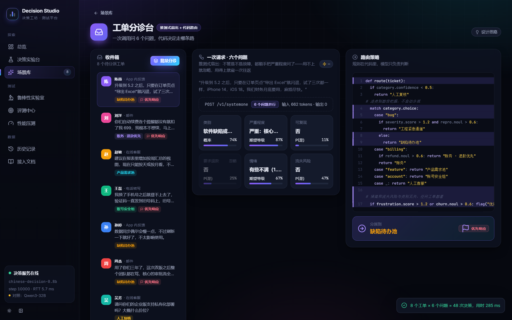
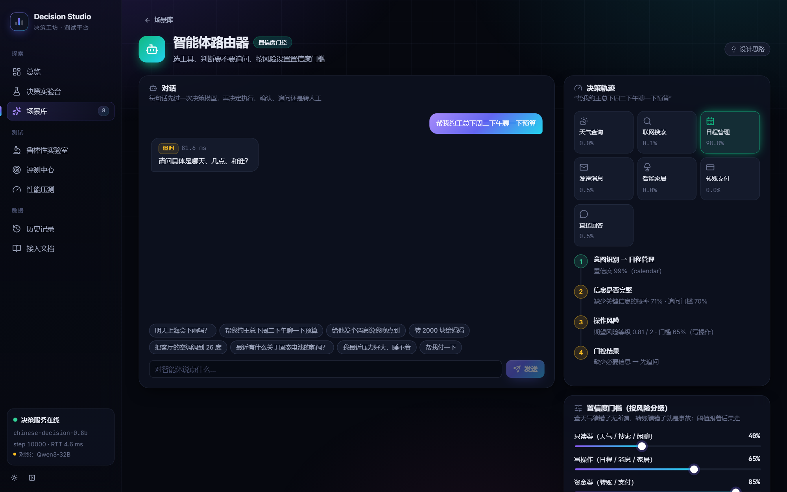

<div align="center">

# Chinese Decision 0.8B

**中文概率决策模型：一次前向，直接输出候选项概率**

[GitHub 代码](https://github.com/yanqiangmiffy/chinese-decision) ·
[测试平台 Decision Studio](https://github.com/yanqiangmiffy/chinese-decision-studio) ·
[GGUF 版本](https://huggingface.co/quincyqiang/chinese-decision-0.8b-gguf) ·
[基础模型 Qwen3.5-0.8B](https://huggingface.co/Qwen/Qwen3.5-0.8B) ·
[训练数据 CJ-Dataset](https://huggingface.co/datasets/bbldCVer-hf/CJ-Dataset) ·
[评测集 CJ-Bench](https://huggingface.co/datasets/bbldCVer-hf/CJ-Bench)

</div>

> A lightweight Chinese decision model fine-tuned from Qwen3.5-0.8B. Given a context and a fixed set of 2–26 candidates, it returns a probability for each candidate in a single forward pass, without generating any tokens. It supports yes/no (`noul`), single-choice (`choice`) and ordinal (`score`) questions in general, medical, legal and finance domains.

## 模型系列与结果范围

本文保留 **0.8B** 已发布版本的使用方法和既有评测。本次文档更新没有重新运行 0.8B；新增 2B 及其 Q8_0 是独立权重与报告，不能混用其温度或测试数字。

[0.8B BF16](MODEL_CARD_0_8B.md) · [0.8B Q8_0](MODEL_CARD_0_8B_GGUF.md) · [2B BF16](MODEL_CARD_2B.md) · [2B Q8_0](MODEL_CARD_2B_GGUF.md)

[各尺寸、部署格式与外部模型对比](MODELS.md)。2B BF16 与 2B Q8_0 均已公开发布并完成 CJ-Bench 全量评测：2B 整体准确率更高，0.8B 更小更快，部分法律判断与金融评分任务仍是 0.8B 更好。

## 相关资源

| 资源 | 说明 | 链接 |
|---|---|---|
| 代码 | 训练、评测、GGUF 导出与 HTTP 服务（GPU / CPU） | [GitHub](https://github.com/yanqiangmiffy/chinese-decision) |
| 测试平台 | Decision Studio：决策实验台、场景库、鲁棒性实验室、评测中心与性能压测 | [GitHub](https://github.com/yanqiangmiffy/chinese-decision-studio) |
| 模型（BF16，本仓库） | 合并后的权重与校准温度，transformers 推理 | [Hugging Face](https://huggingface.co/quincyqiang/chinese-decision-0.8b) · [ModelScope](https://modelscope.cn/models/quincyqiang/chinese-decision-0.8b) |
| 模型（GGUF Q8_0） | llama.cpp 推理，CPU 即可部署，不需要 PyTorch | [Hugging Face](https://huggingface.co/quincyqiang/chinese-decision-0.8b-gguf) · [ModelScope](https://modelscope.cn/models/quincyqiang/chinese-decision-0.8b-gguf) |
| 2B 系列 | 更大的 2B 版本（CE + RLCD），整体准确率更高；BF16 与 GGUF Q8_0 | BF16：[Hugging Face](https://huggingface.co/quincyqiang/chinese-decision-2b) · [ModelScope](https://modelscope.cn/models/quincyqiang/chinese-decision-2b)；GGUF：[Hugging Face](https://huggingface.co/quincyqiang/chinese-decision-2b-gguf) · [ModelScope](https://modelscope.cn/models/quincyqiang/chinese-decision-2b-gguf) |

## 简介

**Chinese Decision** 是一个面向中文场景的轻量级**决策模型**。它不聊天、不生成文本，只做一件事：给定上下文和一组固定候选项，返回每个候选项的概率。

意图识别、工单分流、内容审核、数据打标、给模型输出打分、智能体选择下一步动作等任务，本质上都是在有限选项中做判断。用生成式大模型处理这类任务又慢又贵，输出还需要再解析。决策模型直接返回概率分布，程序拿到后按阈值使用即可。

- **一次前向，零输出 token**：读取最后位置上候选字母 `A`–`Z` 的 logits，softmax 后即为概率。
- **三种题型**：`noul`（是/否）、`choice`（单选）、`score`（有序等级，返回期望分值）。
- **单一模型覆盖四个领域**：通用、医疗、法律、金融混合训练。
- **概率经过校准**：附带在独立校准划分上拟合的温度。
- **轻量**：0.8B 参数，BF16 权重约 1.5 GB。

## 模型信息

| 项目 | 内容 |
|---|---|
| 基础模型 | [Qwen3.5-0.8B](https://huggingface.co/Qwen/Qwen3.5-0.8B)（文本主干） |
| 参数量 | 0.8B，BF16 |
| 微调方式 | LoRA（r = 32）训练后合并为完整权重，加载时不需要 PEFT |
| 训练数据 | [CJ-Dataset](https://huggingface.co/datasets/bbldCVer-hf/CJ-Dataset)，13,048,000 条决策，1 个 epoch |
| 发布检查点 | step 10000（全程 10,132 步），按验证集分布 NLL 选出 |
| 校准温度 | T = 1.108（见 `decision_config.json`） |
| 最大输入 | 16,384 tokens |
| 候选项数 | 2–26 |
| 提示版本 | `hmm-zh-v1` |
| 语言 | 中文 |

**文件说明**

| 文件 | 说明 |
|---|---|
| `model.safetensors` | 合并后的模型权重（BF16） |
| `config.json`、`generation_config.json` | 模型配置 |
| `tokenizer.json`、`tokenizer_config.json`、`chat_template.jinja` | Qwen3.5 分词器与聊天模板 |
| `decision_config.json` | 推理参数：校准温度、提示版本、最大长度、最大候选数 |
| `training_config.json`、`training_summary.json` | 训练配置、数据版本、训练进度、选中的检查点 |
| `validation_report.json` | 验证集上温度校准前后的完整指标（含分来源明细） |
| `LICENSE` | 基础模型 Qwen3.5-0.8B 的 Apache-2.0 许可证原文 |
| `assets/` | 本说明中的应用案例截图 |

## 应用案例

以下截图来自我们的测试平台 Decision Studio，后端运行的就是本模型（step 10000）。这些场景采用同一种设计：**业务规则写在代码里，决策模型只负责给出概率**。

### 工单分诊台：一次请求，六个判断

每张工单在一次请求里同时问 6 个问题：类别（`choice`），严重程度和情绪（`score`），是否可复现、是否要求退款、是否有流失风险（`noul`）。不管后续用不用得上都一并提问，省去多次往返。路由规则写在代码里，根据这些概率决定工单派给哪个队列；类别置信度低于 0.5 时转人工复核。截图中 8 张工单 × 6 个问题共 48 次决策，用时 285 ms。



### LLM 护栏：带人工复核区间的安全检查

进出大模型的每句话都先过一道检查。输入侧检查提示注入 / 越狱、隐私信息、辱骂威胁、超出业务范围；输出侧检查泄露系统提示词、越权承诺、回复含隐私、不当内容。每项都是一个是 / 否概率，配两个阈值：低于复核阈值自动放行，高于拦截阈值自动拦截，中间交给人工，复核区间的宽度就是人工审核的预算。截图中的"开发者模式"越狱请求在输入侧就被拦截（85.2%），大模型不会被调用；8 项检查共用时 89.2 ms。


### 弹幕护卫：直播弹幕实时审核

每条弹幕一次请求，包含一个分类和一个是 / 否判断：辱骂和广告直接拦截，剧透折叠，观众提问高亮推给主播。截图中审核延迟 p50 为 82.2 ms。页面也记录了已知短板：剧透判断容易被"剧透"这个字眼本身带偏（例如"请勿剧透"），也分不清"猜测"和"剧透"。


### 智能体路由器：按风险分级的置信度门控

智能体收到每句话后，先由决策模型选择工具、判断信息是否完整、评估操作风险，再按风险等级套用不同的置信度门槛：只读操作（天气、搜索、闲聊）40%，写操作（日程、消息、家居）65%，资金操作（转账、支付）85%。截图中"帮我约王总下周二下午聊一下预算"被识别为日程管理（置信度 99%），但缺少关键信息的概率为 71%，超过 70% 的追问门槛，于是先追问"具体是哪天、几点、和谁"，用时 81.6 ms。



## 快速开始

> **GGUF / CPU 部署**：如果不想安装 PyTorch，或者没有 GPU，可以使用 Q8_0 量化的 GGUF 版本（812 MB），用 `llama-cpp-python` 在 CPU 上运行：[Hugging Face](https://huggingface.co/quincyqiang/chinese-decision-0.8b-gguf) · [ModelScope](https://modelscope.cn/models/quincyqiang/chinese-decision-0.8b-gguf)。用法与评测见该仓库的说明；下文是 BF16 权重配合 transformers 的用法。

### 安装依赖

```bash
pip install "torch>=2.8" "transformers>=5.3,<6"
```

推荐同时安装 `flash-linear-attention`，它为 Qwen3.5 的线性注意力层提供高效 kernel：

```bash
pip install "flash-linear-attention>=0.4"
```

### 下载模型

Hugging Face：

```bash
hf download quincyqiang/chinese-decision-0.8b --local-dir chinese-decision-0.8b
```

ModelScope：

```bash
modelscope download --model quincyqiang/chinese-decision-0.8b --local_dir chinese-decision-0.8b
```

### 使用 transformers 调用

下面的代码不依赖项目仓库，提示格式与训练、评测完全一致：

```python
import json

import torch
from transformers import AutoModelForCausalLM, AutoTokenizer

path = "chinese-decision-0.8b"
tokenizer = AutoTokenizer.from_pretrained(path)
model = AutoModelForCausalLM.from_pretrained(path, dtype=torch.bfloat16, attn_implementation="sdpa").to("cuda").eval()
config = json.load(open(f"{path}/decision_config.json", encoding="utf-8"))
temperature, max_length = config["temperature"], config["max_length"]

LETTERS = "ABCDEFGHIJKLMNOPQRSTUVWXYZ"
letter_ids = [tokenizer.encode(c, add_special_tokens=False)[0] for c in LETTERS]


def text(value):
    return value if isinstance(value, str) else json.dumps(value, ensure_ascii=False, separators=(",", ":"))


def options_for(question):
    kind, criteria = question["type"], question.get("criteria")
    if kind == "choice":
        return [(str(k), text(v)) for k, v in criteria.items()]
    if kind == "score":
        return [(str(i), text(v)) for i, v in enumerate(criteria)]
    criteria = criteria or {}
    return [("false", text(criteria.get("false", "否"))), ("true", text(criteria.get("true", "是")))]


def build_prompt(state, instructions, options):
    content = ("待判断的上下文：\n" + text(state)
               + "\n\n问题：\n" + text(instructions)
               + "\n\n候选项：\n" + "\n".join(f"{LETTERS[i]}: {k} — {v}" for i, (k, v) in enumerate(options))
               + "\n只返回候选项对应的字母。")
    return tokenizer.apply_chat_template([{"role": "user", "content": content}], tokenize=False,
                                         add_generation_prompt=True, enable_thinking=False)


@torch.inference_mode()
def decide(state, question):
    options = options_for(question)
    ids = tokenizer.encode(build_prompt(state, question["instructions"], options), add_special_tokens=False)
    if len(ids) > max_length:
        raise ValueError(f"input is {len(ids)} tokens; the limit is {max_length}")
    logits = model(torch.tensor([ids], device=model.device), logits_to_keep=1, use_cache=False).logits
    probs = (logits[0, -1, letter_ids[:len(options)]].float() / temperature).softmax(-1).tolist()
    k, best = len(probs), max(range(len(probs)), key=probs.__getitem__)
    answer = {"probabilities": {key: round(p, 4) for (key, _), p in zip(options, probs)},
              "confidence": round((k * probs[best] - 1) / (k - 1), 4)}
    if question["type"] == "noul":
        answer["noul"] = round(probs[1], 4)
    elif question["type"] == "choice":
        answer["choice"] = options[best][0]
    else:
        answer["score"] = round(sum(i * p for i, p in enumerate(probs)), 4)
    return answer


state = "客户留言：付款后一直没有收到发票，我已经催了三次，今天必须拿到。"
questions = {
    "urgent": {"type": "noul", "instructions": "客户是否表达了紧迫性？"},
    "department": {"type": "choice", "instructions": "应该由哪个部门处理？",
                   "criteria": {"billing": "支付、发票及退款", "technical": "故障和系统问题", "sales": "购买咨询与升级"}},
    "frustration": {"type": "score", "instructions": "客户有多不满？", "criteria": ["平静", "不满", "非常愤怒"]},
}
for name, question in questions.items():
    print(name, decide(state, question))
```

输出：

```text
urgent {'probabilities': {'false': 0.1346, 'true': 0.8654}, 'confidence': 0.7309, 'noul': 0.8654}
department {'probabilities': {'billing': 0.9406, 'technical': 0.0423, 'sales': 0.0172}, 'confidence': 0.9108, 'choice': 'billing'}
frustration {'probabilities': {'0': 0.0088, '1': 0.6055, '2': 0.3856}, 'confidence': 0.4083, 'score': 1.3768}
```

`decision_config.json` 中的温度只在 `softmax` 前缩放 logits，不改变每道题的最高概率选项。如需未校准的原始概率，把 `temperature` 设为 1 即可。

### HTTP 服务

[项目仓库](https://github.com/yanqiangmiffy/chinese-decision)提供兼容 hmm / System One 接口的 HTTP 服务，一个请求可以包含多个问题：

```bash
git clone https://github.com/yanqiangmiffy/chinese-decision.git
cd chinese-decision
pip install -e .
python scripts/serve.py --base /path/to/chinese-decision-0.8b --port 8787
```

```bash
curl http://127.0.0.1:8787/v1/systemone \
  -H 'Content-Type: application/json' \
  --data-binary @examples/request.json
```

| 接口 | 说明 |
|---|---|
| `POST /v1/systemone` | 决策接口；`?debug=1` 附带每个候选的 logits 和每题 token 数 |
| `POST /api/alpha/decisions` | 同上，兼容 hmm 路由 |
| `POST /v1/batch` | `{"requests": [...], "debug": bool}`，一次提交多个请求，单个请求出错不影响其他 |
| `POST /v1/compile` | 只编译提示词并计数 token，不跑模型 |
| `GET /v1/info` | 检查点、验证集指标、运行统计 |
| `GET /v1/training` | 训练进度 |
| `GET /health` | 健康检查，返回当前温度、是否已校准及检查点 step |

单个请求最多 64 个问题，每个问题 2–26 个候选项，单题输入不超过 16,384 tokens。超长输入不会被截断，而是返回 `422`。

GPU 上的生产部署（动态批处理、检查点热更新）使用 `scripts/serve_gpu.py`，见 [deploy/gpu](https://github.com/yanqiangmiffy/chinese-decision/tree/main/deploy/gpu)。服务部署好后可以接入测试平台 [Decision Studio](https://github.com/yanqiangmiffy/chinese-decision-studio)（决策实验台、场景库、鲁棒性实验室、评测与压测）：把服务地址填到平台的 `DECISION_BASE_URL` 即可。

## 输入格式

每道题由 `type`、`instructions` 和可选的 `criteria` 组成：

| 类型 | `criteria` 格式 | 返回字段 |
|---|---|---|
| `noul` | 可选，`{"false": "...", "true": "..."}`，默认“否 / 是” | `noul`：判断为真的概率 |
| `choice` | 对象 `{键: 描述}` | `choice`：概率最大的键 |
| `score` | 列表，按等级从低到高排列 | `score`：等级下标的概率加权期望（0 到 K−1） |

所有题型都会返回完整的 `probabilities` 和 `confidence`。`confidence = (K·p_max − 1) / (K − 1)` 衡量分布的尖锐程度：均匀分布为 0，完全确定为 1。它**不等于**经验准确率。

每道题会被编译成如下提示，再套用 Qwen 聊天模板（关闭 thinking）：

```text
待判断的上下文：
{state}

问题：
{instructions}

候选项：
A: {key₁} — {描述₁}
B: {key₂} — {描述₂}
...
只返回候选项对应的字母。
```

模型只读取最后位置上前 K 个字母的 logits，其余字母被屏蔽。`state`、`instructions` 和候选描述既可以是字符串，也可以是 JSON 对象（会被序列化为紧凑 JSON）。

## 评测结果

### 验证集（本模型）

在 CJ-Dataset 官方 validation 的分层子集上评测：4 个领域 × 3 种题型，每组 100 条，共 1,200 条。这部分数据在训练中用于模型选择，**不是测试集成绩**。温度在另一个互不重叠的划分（1,993 条硬标签样本）上拟合。

| 领域 | Qwen3.5-0.8B 零样本 ACC | step 5000 ACC | **本模型 ACC** | 本模型 ECE（T = 1） | 本模型 ECE（T = 1.108） | 本模型 NLL（T = 1.108） |
|---|---:|---:|---:|---:|---:|---:|
| 通用 | 36.64 | 74.32 | **75.34** | 3.69 | 5.18 | 0.625 |
| 医疗 | 16.67 | 82.00 | **82.33** | 3.51 | 3.76 | 0.400 |
| 法律 | 40.67 | 63.33 | **64.33** | 8.62 | 7.47 | 0.739 |
| 金融 | 44.33 | 69.67 | **71.67** | 3.72 | 3.67 | 0.638 |
| **整体** | 34.56 | 72.32 | **73.41** | 2.53 | **1.62** | 0.601 |

| 题型 | step 5000 ACC | **本模型 ACC** | 本模型 ECE（T = 1） | 本模型 ECE（T = 1.108） |
|---|---:|---:|---:|---:|
| `noul` | 83.25 | **85.75** | 2.76 | 3.44 |
| `choice` | 69.25 | **72.00** | 4.05 | 2.99 |
| `score` | 64.29 | 62.24 | 6.69 | 5.21 |

> ACC 与 ECE 单位为 %，仅在硬标签样本上计算；NLL 覆盖全部样本（含软标签）。验证集 ECE 使用 10 个等宽分箱（下文 CJ-Bench 使用官方的 15 个）。完整指标（含 Brier 与分来源明细）见 `validation_report.json`。

- 与训练中途的 step 5000 相比，四个领域的准确率均有提升，整体准确率提高 1.09 个百分点，验证集分布 NLL 从 0.676 降到 0.602；`score` 题型准确率下降 2.05 个百分点。
- 温度校准使整体 ECE 从 2.53% 降到 1.62%。温度是全局单一标量，通用和医疗领域的 ECE 在校准后略有上升；每个领域只有 300 条样本，分领域 ECE 的波动较大。

### CJ-Bench 测试集

在 CJ-Bench 全量测试集（307,900 条）上评测本模型的 step 10000 检查点。评测使用合并前的 LoRA adapter（BF16），**未做温度校准（T = 1）**。发布的合并权重由该 adapter 合并而来，在验证集上与 adapter 的整体准确率相差 0.08 个百分点。发布的合并权重在默认温度 T = 1.108 下的全量结果见本节末尾的“默认温度 T = 1.108”。

基线数字均**直接引自** [Chinese-Jev](https://arxiv.org/abs/2609.36965)（Wang et al., 2026）论文的 Table 1 和 Table 2，本项目未复现。每列最优结果加粗。

**通用领域**

| 模型 | ACC (%) ↑ | ECE (%) ↓ | 延迟 (ms) ↓ |
|---|---:|---:|---:|
| Qwen3.5-2B | 32.95 | 43.68 | 280 |
| Open-Jev | 52.33 | 10.54 | 60 |
| SemIF | 44.21 | 27.27 | 57 |
| Laya Multilingual | 40.22 | 23.04 | **14** |
| Jev † | 68.35 | 11.45 | 284 |
| Chinese-Jev General | 69.20 | 3.78 | **14** |
| **Chinese Decision 0.8B（本模型）** | **72.24** | **3.03** | 70 ‡ |

**专业领域**

| 模型 | 医疗 ACC ↑ | 医疗 ECE ↓ | 法律 ACC ↑ | 法律 ECE ↓ | 金融 ACC ↑ | 金融 ECE ↓ | 平均 ACC ↑ | 平均 ECE ↓ |
|---|---:|---:|---:|---:|---:|---:|---:|---:|
| Qwen3.5-2B | 53.88 | 28.71 | 31.53 | 44.82 | 38.11 | 49.12 | 41.17 | 40.88 |
| Open-Jev | 73.08 | 2.88 | 44.07 | 23.15 | 48.11 | 10.19 | 55.09 | 12.07 |
| SemIF | 62.17 | 10.39 | 43.07 | 19.99 | 47.89 | 18.45 | 51.04 | 16.28 |
| Laya | 24.55 | 43.05 | 34.72 | 31.49 | 38.31 | 26.18 | 32.53 | 33.57 |
| Jev † | 84.29 | 5.70 | **68.35** | 8.03 | **78.39** | 2.98 | **77.01** | 5.57 |
| Chinese-Jev-G | 39.77 | 17.33 | 38.76 | 15.37 | 35.39 | 14.43 | 37.97 | 15.71 |
| Chinese-Jev-S（3 个领域专用模型） | 87.65 | 7.25 | 60.10 | 17.45 | 64.72 | 11.55 | 70.82 | 12.08 |
| **Chinese Decision 0.8B（本模型，单一模型）** | **88.86** | **0.17** | 67.86 | **5.70** | 74.22 | **1.50** | 76.98 | **2.46** |

> † Jev 为托管 API，延迟包含网络往返时间。
> ‡ 在单张 A800 上测得，为四个领域的整体中位数；论文中其余模型在 H200 上测得，两者不能直接比较。
> “平均”为医疗、法律、金融三个领域的等权平均，与论文口径一致。
> 测试集与论文相同（通用 100,000、医疗 200,000、法律 4,300、金融 3,600 条）。ACC 与 ECE 仅在硬标签样本上计算，ECE 使用 15 个等宽分箱，候选项保持原始顺序，不在测试集上做任何校准。

- **通用领域**：准确率与 ECE 均为表中最优，准确率比 Jev 高 3.89 个百分点，比 Chinese-Jev General 高 3.04 个百分点。
- **专业领域**：医疗、法律、金融的准确率均超过 Chinese-Jev 的领域专用模型（分别高 1.21、7.76、9.50 个百分点），平均 76.98%，与闭源 Jev（77.01%）基本持平。医疗 88.86% 为表中最高；法律比 Jev 低 0.49 个百分点，金融低 4.17。
- **校准**：未做温度校准时，专业领域平均 ECE 为 2.46%，是表中最低；其中法律领域的 ECE（5.70%）在四个领域中最高。

**分领域与分题型**

| 领域 | 样本数 | ACC ↑ | ECE ↓ | NLL ↓ | Brier ↓ |
|---|---:|---:|---:|---:|---:|
| 通用 | 100,000 | 72.24 | 3.03 | 0.693 | 0.356 |
| 医疗 | 200,000 | 88.86 | 0.17 | 0.293 | 0.152 |
| 法律 | 4,300 | 67.86 | 5.70 | 0.728 | 0.414 |
| 金融 | 3,600 | 74.22 | 1.50 | 0.593 | 0.336 |
| **整体（micro）** | **307,900** | **83.11** | **1.07** | **0.432** | **0.224** |
| **四领域等权平均（macro）** | — | **75.80** | — | **0.577** | — |

| 题型 | 样本数 | ACC ↑ | ECE ↓ | NLL ↓ | 期望等级 MAE ↓ |
|---|---:|---:|---:|---:|---:|
| `noul` | 134,577 | 94.95 | 0.39 | 0.117 | — |
| `choice` | 134,577 | 78.33 | 1.48 | 0.588 | — |
| `score` | 38,746 | 56.47 | 2.35 | 0.987 | 0.579 |

> 医疗样本占测试集的 65%，整体 micro 指标主要反映医疗领域，跨领域比较建议看 macro 平均。

**默认温度 T = 1.108（发布的合并权重）**

在同一测试集上，用发布的合并权重（Transformers，BF16）和 `decision_config.json` 中的默认温度 T = 1.108 重新做了全量评测。温度沿用在 validation 独立划分上拟合的值，没有用测试集标签做任何调整；分箱、候选顺序等设置与上文相同。

| 领域 | 样本数 | ACC ↑ | ECE ↓ | NLL ↓ | Brier ↓ | 对照：上表 ECE（T = 1） |
|---|---:|---:|---:|---:|---:|---:|
| 通用 | 100,000 | 72.26 | 1.68 | 0.686 | 0.355 | 3.03 |
| 医疗 | 200,000 | 88.85 | 1.12 | 0.295 | 0.152 | 0.17 |
| 法律 | 4,300 | 67.84 | 4.05 | 0.721 | 0.410 | 5.70 |
| 金融 | 3,600 | 74.00 | 2.45 | 0.597 | 0.337 | 1.50 |
| **整体（micro）** | **307,900** | **83.11** | **0.27** | **0.431** | **0.224** | 1.07 |
| **四领域等权平均（macro）** | — | **75.74** | — | **0.575** | — | — |

| 题型 | 样本数 | ACC ↑ | ECE ↓ | NLL ↓ | 期望等级 MAE ↓ | 对照：上表 ECE（T = 1） |
|---|---:|---:|---:|---:|---:|---:|
| `noul` | 134,577 | 94.96 | 0.19 | 0.117 | — | 0.39 |
| `choice` | 134,577 | 78.32 | 0.58 | 0.587 | — | 1.48 |
| `score` | 38,746 | 56.45 | 1.67 | 0.984 | 0.584 | 2.35 |

- **准确率**：温度不改变每道题的最高概率选项，整体准确率 83.105%，与上表 adapter 的 83.109% 相差不到 0.01 个百分点，差异来自 LoRA 合并与数值误差。
- **整体校准**：整体 ECE 从 1.07% 降到 0.27%，三种题型的 ECE 全部下降；通用（3.03% → 1.68%）和法律（5.70% → 4.05%）改善明显。
- **医疗和金融的 ECE 反而升高**：医疗从 0.17% 升到 1.12%，金融从 1.50% 升到 2.45%。这两个领域在 T = 1 时已接近校准，升温后概率偏保守：医疗的平均最高概率 87.73%，低于准确率 88.85%；金融为 72.23%，低于 74.00%。温度是全局单一标量，无法兼顾每个领域。
- 按论文口径，T = 1.108 下专业领域平均 ACC 为 76.90%、平均 ECE 为 2.54%，通用 ECE 为 1.68%；两项 ECE 仍低于上方对比表中的所有基线。

### 推理效率

| 指标 | 数值 |
|---|---:|
| 单条延迟（batch = 1，预热后中位数） | 70.1 ms |
| 批量吞吐 | 132 条决策/秒 |
| 批量评测峰值显存 | 6.7 GB |
| CJ-Bench 平均输入长度 | 223 tokens |

> 单张 A800 80GB PCIe，BF16。延迟包含本地输入编码、前向计算和概率输出，不含 HTTP 和网络开销。

## 训练细节

| 项目 | 设置 |
|---|---|
| 微调方式 | LoRA，r = 32，α = 64，dropout = 0.05 |
| LoRA 目标层 | 全注意力 `q/k/v/o_proj`、线性注意力 `in_proj_qkv/z/a/b`、`out_proj`、MLP `gate/up/down_proj` |
| 损失函数 | 候选分布交叉熵（软标签；硬标签为其 one-hot 特例），未使用 RLCD |
| 优化器 | AdamW，lr = 1e-4，前 100 步线性预热，之后余弦衰减至峰值的 10% |
| 全局 batch | 每步至少 1,024 条决策；每个 micro-batch 在 padding 后最多 262,144 tokens |
| 最大长度 | 16,384 tokens，超长样本被过滤，从不截断 |
| 训练量 | 1 epoch，13,048,000 条决策，10,132 步 |
| 精度 | BF16，gradient checkpointing |
| 模型选择 | 每 1,000 步在验证集上评估，以分布 NLL 选出 best（step 10000，NLL 0.600） |
| 温度校准 | 在 validation 的独立划分上，以硬标签交叉熵拟合单一温度 |
| 硬件 | 4 × GPU，DDP |

**训练数据构成**（[CJ-Dataset](https://huggingface.co/datasets/bbldCVer-hf/CJ-Dataset)，revision `a3963a61`）

| 领域 | `noul` | `choice` | `score` | 合计 |
|---|---:|---:|---:|---:|
| 通用 | 3,333,333 | 3,333,334 | 3,333,333 | 10,000,000 |
| 医疗 | 1,792,223 | 1,194,496 | 13,281 | 3,000,000 |
| 法律 | 8,000 | 8,000 | 8,000 | 24,000 |
| 金融 | 8,000 | 8,000 | 8,000 | 24,000 |
| **合计** | 5,141,556 | 4,543,830 | 3,362,614 | 13,048,000 |

- **软标签**：CJ 的 `gold` 是候选项上的概率分布，直接作为交叉熵目标。
- **候选项打乱**：`choice` 在训练时随机打乱候选顺序并同步重排目标，以减弱位置偏差；`score` 保留等级顺序；`noul` 固定为 false / true。
- **均衡混合**：按领域、来源、题型重新分片，再按剩余样本量比例交错读取，避免原始文件中的任务顺序导致遗忘。
- **校准不泄漏**：官方 validation 按母记录分组，80% 用于验证与模型选择，另外 20% 仅用于拟合温度。

训练、评测与导出脚本见 [GitHub 仓库](https://github.com/yanqiangmiffy/chinese-decision)。

## 局限性

- **法律与金融较弱**：这两个领域的训练数据各只有 24,000 条（不到总量的 0.2%）。CJ-Bench 上金融准确率比闭源 Jev 低 4.17 个百分点，法律领域的 ECE（5.70%）在四个领域中最高；`score` 题型整体最弱（CJ-Bench 准确率 56.47%）。
- **单一温度无法兼顾所有领域**：在 CJ-Bench 上，默认温度 T = 1.108 把整体 ECE 从 1.07% 降到 0.27%，但医疗（0.17% → 1.12%）和金融（1.50% → 2.45%）的 ECE 反而升高，概率略偏保守。基线对比表使用的是合并前 adapter 在 T = 1 下的结果。
- **`confidence` 不是准确率**：它只反映分布的尖锐程度。若要按概率阈值自动执行，请先在自己的数据上验证校准效果。
- **标签含义来自上游任务**：例如医疗匹配类标签表示原任务中的匹配关系，并不代表医学正确性。请勿将模型输出作为医疗、法律或金融决策的唯一依据。
- **不用于文本生成**：模型只在末位候选字母上训练，`generate()` 的输出没有意义。
- **仅支持中文**，单题输入不超过 16,384 tokens；更长的输入不在训练分布内。
- **延迟高于编码器方案**：0.8B 解码器的单条延迟高于约 322M 的 Chinese-Jev 编码器模型。
- 本模型是 [hmm](https://github.com/n4ze3m/hmm) 方法的中文适配，并不复现 Microsoft Decision、Jev 或 Chinese-Jev 的训练过程。

## 许可证

- **模型权重**：Apache-2.0，继承自基础模型 Qwen3.5-0.8B（`LICENSE` 为其原文）。
- **训练数据**：CJ-Dataset 与 CJ-Bench 的许可按数据来源分别适用，其中部分来源为非商业许可。本模型不授予任何数据层面的额外权利，商业使用前请自行评估。
- **代码**：推理、训练与评测代码以 MIT 许可证发布，见 [GitHub 仓库](https://github.com/yanqiangmiffy/chinese-decision)。

## 致谢

- [Chinese-Jev](https://arxiv.org/abs/2609.36965)：CJ-Dataset、CJ-Bench 与对比基线结果。
- [n4ze3m/hmm](https://github.com/n4ze3m/hmm)：选项字母决策目标、LoRA 流程、候选项格式与 System One 响应约定。
- [Qwen3.5-0.8B](https://huggingface.co/Qwen/Qwen3.5-0.8B)：基础模型。

## 引用

```bibtex
@misc{chinese-decision-2026,
  title        = {Chinese Decision: A Lightweight Chinese Probabilistic Decision Model},
  author       = {yanqiangmiffy},
  year         = {2026},
  howpublished = {\url{https://github.com/yanqiangmiffy/chinese-decision}}
}
```

如果使用了 CJ-Dataset 或 CJ-Bench，请同时引用 Chinese-Jev：

```bibtex
@misc{wang2026chinesejev,
  title         = {Chinese-Jev: Bringing System One Model to Chinese-Language Tasks},
  author        = {Wang, Zexiao and Zhang, Zihao and Wang, Xudong and Wang, Pan and Ye, Ziyi and Zhao, Haoyu and Wu, Zuxuan and Yan, Shuicheng},
  year          = {2026},
  eprint        = {2609.36965},
  archivePrefix = {arXiv},
  primaryClass  = {cs.CL}
}
```
