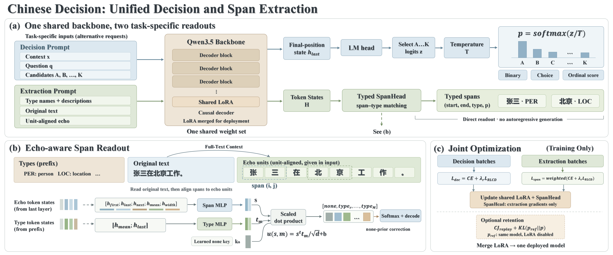

<div align="center">

# Chinese Decision Unified 0.8B

**一份权重，两种读出：中文概率决策 + 类型化信息抽取**

[GitHub 代码](https://github.com/yanqiangmiffy/chinese-decision) ·
[测试平台 Decision Studio](https://github.com/yanqiangmiffy/chinese-decision-studio) ·
[纯决策版 chinese-decision-0.8b](https://huggingface.co/quincyqiang/chinese-decision-0.8b) ·
[2B 统一模型](https://huggingface.co/quincyqiang/chinese-decision-unified-2b) ·
[基础模型 Qwen3.5-0.8B](https://huggingface.co/Qwen/Qwen3.5-0.8B) ·
[训练数据 CJ-Dataset](https://huggingface.co/datasets/bbldCVer-hf/CJ-Dataset) ·
[评测集 CJ-Bench](https://huggingface.co/datasets/bbldCVer-hf/CJ-Bench)

</div>

> A single 0.8B Chinese model with one weight file and two readouts. Given a context and candidates it returns a probability per candidate (`noul` / `choice` / `score` decisions); given a text and a set of entity types (name + description) it returns typed character spans with positions and probabilities. Neither readout generates tokens. Trained from raw Qwen3.5-0.8B on CJ-Dataset (decisions) and CJ-IE (NER, relation and event extraction). On the full CJ-Bench (307,900 items) it keeps the decision accuracy of the decision-only model (83.46% vs 83.11%).



## 模型系列

统一模型有两个尺寸，**训练配方、模型结构和 CJ-IE 数据完全相同**，只有底座大小不同：

| | **0.8B 统一（本模型）** | 2B 统一 |
|---|---|---|
| 仓库 | [HF](https://huggingface.co/quincyqiang/chinese-decision-unified-0.8b) · [ModelScope](https://www.modelscope.cn/models/quincyqiang/chinese-decision-unified-0.8b) | [HF](https://huggingface.co/quincyqiang/chinese-decision-unified-2b) · [ModelScope](https://www.modelscope.cn/models/quincyqiang/chinese-decision-unified-2b) |
| 底座 | Qwen3.5-0.8B | Qwen3.5-2B |
| 权重文件 | 单个 `model.safetensors`，约 1.5 GB | 单个 `model.safetensors`，约 3.8 GB |
| CJ-Bench 全量准确率（T = 1） | 83.46% | **85.00%** |
| CJ-IE 测试集决策准确率 | 90.65% | **91.30%** |
| CJ-IE 测试集抽取 micro F1 | 63.1 | **66.0** |

对延迟和显存敏感时用 0.8B；需要更高的决策和抽取精度时用 2B（[2B 模型卡](MODEL_CARD_UNIFIED_2B.md)）。只做决策、不需要抽取时，还有纯决策版：[chinese-decision-0.8b](MODEL_CARD_0_8B.md)。

## 简介

[chinese-decision-0.8b](MODEL_CARD_0_8B.md) 只做一件事：在固定候选项里给出概率。这个版本在同一份权重里加了第二种读出——**抽取**：给定文本和一组类型，直接返回每个实体的位置和概率。两者共用同一个骨干和同一组 LoRA 参数，只有最后的读出层不同。

- **一份权重**：`model.safetensors` 里是合并后的骨干和约 3M 参数的跨度头（`span_head.*`），不需要另外下载 adapter。
- **读出由请求决定**：请求带 `questions` 走决策，带 `types` 走抽取。不是看哪个输出更可信（两种读出的数值不能互相比较）。
- **不生成文本**：决策读最后位置上候选字母的 logits；抽取把原文逐字回显一遍，在每个字符位置上给跨度分类。
- **从原始底座训练**：不是在决策模型上继续微调，而是从 Qwen3.5-0.8B 一次联合训练出来的。
- **能组合成流水线**：事件抽取 = 先用是/否问题判断事件类型、再抽触发词和论元；关系抽取 = 给定主体、抽客体。

## 模型信息

| 项目 | 内容 |
|---|---|
| 基础模型 | [Qwen3.5-0.8B](https://huggingface.co/Qwen/Qwen3.5-0.8B)（文本主干） |
| 参数量 | 0.8B 骨干 + 约 3M 跨度头，BF16，单个 `model.safetensors`（约 1.5 GB） |
| 微调方式 | LoRA（r = 32）训练后合并；跨度头随机初始化，一起训练 |
| 决策训练数据 | [CJ-Dataset](https://huggingface.co/datasets/bbldCVer-hf/CJ-Dataset) 13,048,000 条 + CJ-IE 决策 611,354 条 |
| 抽取训练数据 | CJ-IE 跨度行 573,294 条（32 个 NER 来源、DuIE / CMeIE 关系、DuEE / FewFC 事件论元），详见 [CJ-IE 数据说明](IE_DATASET.md) |
| 发布检查点 | step 14,504（1 个 epoch 的最后一步），按“决策与抽取联合分数”选出 |
| 校准温度 | T = 1.1326（见 `decision_config.json`，只作用于决策读出） |
| 最大输入 | 决策 16,384 tokens；抽取训练时文本按 ≤ 300 字切窗 |
| 候选项数 | 决策单题 2–26（训练数据覆盖 2–16） |
| 抽取 | 回显布局；跨度最宽 20 个字；none 先验校正 `none_shift = log(1/0.2)` |
| 提示版本 | `hmm-zh-v1` |
| 语言 | 中文 |

**文件说明**

| 文件 | 说明 |
|---|---|
| `model.safetensors` | 合并后的骨干权重 + `span_head.*`，同一份权重 |
| `config.json`、`generation_config.json` | 模型配置 |
| `tokenizer.json`、`tokenizer_config.json`、`chat_template.jinja` | Qwen3.5 分词器与聊天模板 |
| `decision_config.json` | 校准温度、提示版本、最大长度，以及 `extraction`（跨度头结构、`none_shift`、是否回显） |
| `training_summary.json` | 训练配置、选中的检查点及其验证分数 |
| `cj_bench_report.json` | CJ-Bench 全量评测的完整指标（T = 1，分领域、题型、来源） |
| `cj_ie_test_report.json` | CJ-IE 测试集的完整指标：决策逐来源，抽取逐来源和逐类型（含实体 ECE） |
| `LICENSE` | 基础模型 Qwen3.5-0.8B 的 Apache-2.0 许可证原文 |
| `assets/` | 本说明中的架构图 |

## 快速开始

### 安装依赖

决策读出可以直接用 `transformers`；抽取读出需要本项目的 `decision` 包（跨度头的代码在里面）：

```bash
pip install "chinese-decision[torch] @ git+https://github.com/yanqiangmiffy/chinese-decision.git@main"
```

推荐同时安装 `flash-linear-attention`，它为 Qwen3.5 的线性注意力层提供高效 kernel：

```bash
pip install "flash-linear-attention>=0.4"
```

### 下载模型

Hugging Face：

```bash
hf download quincyqiang/chinese-decision-unified-0.8b --local-dir chinese-decision-unified-0.8b
```

ModelScope：

```bash
modelscope download --model quincyqiang/chinese-decision-unified-0.8b --local_dir chinese-decision-unified-0.8b
```

### 决策和抽取

```python
from decision import DecisionPipeline

pipe = DecisionPipeline.from_pretrained("chinese-decision-unified-0.8b", device="cuda")  # 没有 GPU 时用 "cpu"

# 带 questions → 决策
pipe({
    "state": "客户留言：付款后一直没有收到发票，我已经催了三次，今天必须拿到。",
    "questions": {
        "urgent": {"type": "noul", "instructions": "客户是否表达了紧迫性？"},
        "department": {"type": "choice", "instructions": "应该由哪个部门处理？",
                       "criteria": {"billing": "支付、发票及退款", "technical": "故障和系统问题", "sales": "购买咨询与升级"}},
    },
})

# 带 types → 抽取：每个类型是 “名称: 说明”
pipe({
    "text": "收货地址：浙江省杭州市西湖区文三路90号东部软件园科技大厦A座1203室，联系人王小明。",
    "types": {
        "省份": "省级行政区划,省、自治区、直辖市,不含港澳台",
        "城市": "地级行政区划,地级市、地区、自治州等",
        "区县": "县级行政区划,市辖区、县级市、县等",
        "道路": "有正式名称的道路,包括隧道、高架、街、弄、巷等. 步行街、商业街、统一标注为道路,除非地图上明显表明是 兴趣点类别(只有一栋楼);xx 路段、xx 路南段等整体 为道路",
        "门牌号": "路号,如'000号'或'000弄',通常位于道路名称之后",
    },
    "threshold": 0.3,   # 可选：只保留概率不低于它的实体
})
```

输出（CPU 上运行，概率保留 4 位；GPU 上末位会有细微差异）：

```text
{'task': 'decision', 'answers': {
    'urgent':     {'false': 0.1048, 'true': 0.8952},
    'department': {'billing': 0.9663, 'technical': 0.0297, 'sales': 0.0040}}}

{'task': 'extraction', 'entities': [
    {'text': '浙江省', 'label': '省份',   'start': 5,  'end': 8,  'score': 1.0},
    {'text': '杭州市', 'label': '城市',   'start': 8,  'end': 11, 'score': 0.979},
    {'text': '西湖区', 'label': '区县',   'start': 11, 'end': 14, 'score': 0.9772},
    {'text': '文三路', 'label': '道路',   'start': 14, 'end': 17, 'score': 0.9975},
    {'text': '90号',  'label': '门牌号', 'start': 17, 'end': 20, 'score': 0.9967}]}
```

`start` / `end` 是字符下标（左闭右开）。带 `questions` 和 `types` 的请求会报错，两者都没有也会报错。

只做决策时，`AutoModelForCausalLM.from_pretrained(path)` 也能加载本模型，用法与 [chinese-decision-0.8b](MODEL_CARD_0_8B.md#使用-transformers-调用) 完全相同；`span_head.*` 会被报告为未使用的权重，不影响结果。抽取读出不在 GGUF / llama.cpp 里，只能走 PyTorch。

### HTTP 服务

项目仓库的 `scripts/serve_unified.py` 把同一份权重暴露成两个接口，请求形状决定任务：

```bash
python scripts/serve_unified.py --model chinese-decision-unified-0.8b --port 8011
```

| 接口 | 说明 |
|---|---|
| `POST /v1/decide` | 决策，请求格式与 hmm / System One 相同 |
| `POST /v1/extract` | 抽取：`{"text", "types": {名称: 说明}, "threshold"?}`，返回带位置和概率的实体 |
| `GET /v1/info` | 模型名、温度、`can_extract`、GPU、运行统计 |

接入测试平台 [Decision Studio](https://github.com/yanqiangmiffy/chinese-decision-studio)：把服务地址填到平台的 `EXTRACTION_BASE_URL`，决策实验台会出现“抽取”模式，场景库多出信息抽取案例馆、事件抽取流水线和三元组知识图谱三个场景。

## 类型怎么写

**类型的“说明”比类型名重要得多。** 训练时每个类型都带一句来自语料标注规范的定义（例如“地名或地缘政治实体：文本中独立出现的具体地理位置……”），模型学到的是“按定义找”，而不是“按名字猜”。

| 写法 | 实测表现 | 建议 |
|---|---|---|
| 训练时的说明 | 召回最高。Studio 里的 MSRA 新闻案例：同一段文本、同一组类型，训练说明抽出 6 个实体、命中参考答案 5 个里的 4 个；只写类型名抽出 2 个、命中 2 个 | 从 Studio 实验台的“换成训练时的类型组”开始改，名称保持原样 |
| 只写类型名 | 召回最低，相近类型分不开 | 至少写一句话定义，包括边界（什么不算） |
| 训练里没有的新类型 | 基本抽不出来，或很不稳 | 上线前一定在自己的数据上测；能用训练过的类型表达就不要新造 |
| 没有定义的类型 | CJ-IE 里的 `military_ner`（4 个类型，名称和说明相同）测试 F1 为 0，模型一个都没预测 | 同上 |

**关系**：主体固定，类型名写成“{主体}的{关系}”，说明写客体类型，抽出的跨度就是客体。例如 `{"流浪地球的导演": "人物", "流浪地球的主演": "人物"}`。主体由你提供（词典，或上一步的 NER）。

**事件**：先对每个事件类型问一个是/否问题（“这句话是否描述了‘质押’事件（……）？”），再对过门槛的事件，用“触发词 + 角色”作为类型抽取论元。两步用的是同一份权重。

Studio 里的 39 条案例和两个流水线场景，逐条记录了成功和失败（见 [Decision Studio](https://github.com/yanqiangmiffy/chinese-decision-studio)）。大致规律：MSRA 式新闻人地机构、地址、电商标题、医学文本、影视关系三元组、事件类型判断比较稳；社交媒体、细粒度新闻类型、法律文书里的金额和对象、百科人物子类型较弱；事件里“发起方 / 被收购方”这类带方向的角色会串；作词 / 作曲、祖籍、官方语言、饰演这类关系会漏。这些是手工案例的观察，不是基准数字。

## 评测结果

### 决策：CJ-Bench 全量

在 CJ-Bench 全量测试集（307,900 条）上评测本仓库发布的合并权重（Transformers，BF16）。**概率使用 T = 1（不做温度校准）**，候选项保持原始顺序；温度不改变选出的答案，所以准确率不受影响。对照数字是纯决策版 [chinese-decision-0.8b](MODEL_CARD_0_8B.md) 在同一测试集上的结果。

| 切分 | 样本数 | 纯决策版 ACC (%) | **本模型 ACC (%)** | 差 |
|---|---:|---:|---:|---:|
| **整体（micro）** | 307,900 | 83.11 | **83.46** | +0.36 |
| 四领域等权平均（macro） | — | 75.74 | **76.17** | +0.43 |
| 通用 | 100,000 | 72.26 | **73.86** | +1.60 |
| 医疗 | 200,000 | 88.85 | 88.61 | −0.24 |
| 法律 | 4,300 | 67.84 | 67.88 | +0.05 |
| 金融 | 3,600 | 74.00 | 74.31 | +0.31 |
| `noul` | 134,577 | 94.96 | 94.88 | −0.08 |
| `choice` | 134,577 | 78.32 | **79.01** | +0.69 |
| `score` | 38,746 | 56.45 | **57.17** | +0.73 |

校准（T = 1，15 个等宽分箱，ECE 单位 %）。纯决策版一列取自其模型卡里“T = 1 时的 ECE”，两边口径一致：

| 切分 | 纯决策版 ECE | 本模型 ECE | 本模型 hard NLL |
|---|---:|---:|---:|
| 整体 | 1.1 | 1.1 | 0.417 |
| 通用 | 3.0 | 2.8 | 0.638 |
| 医疗 | 0.2 | 0.4 | 0.300 |
| 法律 | 5.7 | 2.3 | 0.715 |
| 金融 | 1.5 | 1.1 | 0.605 |
| `noul` / `choice` / `score` | 0.4 / 1.5 / 2.4 | 0.7 / 1.3 / 2.3 | 0.121 / 0.565 / 0.978 |

> 发布的 T = 1.1326 在 CJ-Dataset 的独立校准划分上拟合（1,984 条硬标签样本）。它在 CJ-Bench 上的整体指标没有重新跑，上面的 ECE 都是 T = 1。ACC 和 ECE 只在硬标签样本上计算。基线之外的对比（Jev、Chinese-Jev 等）见 [纯决策版模型卡](MODEL_CARD_0_8B.md#cj-bench-测试集)，本模型相对纯决策版没有明显差别，不再重复。

### 决策：CJ-IE 测试集（抽取相关的分类任务）

CJ-IE 的测试集由各语料的官方 dev / test 构成，做过去泄漏，**是内部评测集，不是公开基准**。决策任务共 84,894 条，整体准确率 **90.65%**：

| 任务 | 内容 | 样本数 | ACC (%) |
|---|---|---:|---:|
| `doc_event` | 公告是否披露了某类股权事件 | 1,942 | 99.74 |
| `doc_field` | 某事件的某个字段是哪个提及 | 2,756 | 97.13 |
| `ner_typing` | 标出的实体属于哪个类型 | 20,312 | 92.68 |
| `ee_type` | 这句话是否描述了某事件类型 | 13,604 | 92.82 |
| `re_pair` | 给定主体和客体，选关系或“无关系” | 40,417 | 88.77 |
| `ee_category` | 事件大类（DuEE 9 选 1、FewFC 10 类 + 无） | 5,863 | 84.94 |

### 抽取：CJ-IE 测试集

**精确匹配**（起止位置 + 类型都对才算对），35 个来源共 232,291 个标注跨度：

| | 精确率 | 召回率 | F1 |
|---|---:|---:|---:|
| micro | 73.3 | 55.5 | **63.1** |
| 来源宏平均（35 个） | — | — | 62.5 |
| NER（31 个来源）/ 关系（2）/ 事件论元（2）宏平均 | — | — | 64.0 / 47.2 / 54.5 |

模型偏保守：精确率明显高于召回率。各来源差别很大：

| 来源 | 内容 | P | R | F1 |
|---|---|---:|---:|---:|
| Resume | 简历实体 | 92.7 | 83.9 | **88.1** |
| CCKS2021 地址 | 16 种地址要素 | 91.6 | 80.7 | **85.8** |
| IMCS21 | 医患对话医学实体 | 87.4 | 84.1 | **85.7** |
| NLPCC2018 | NER | 82.9 | 82.8 | **82.9** |
| 人民日报 | 人名 / 地名 / 机构名 | 89.1 | 74.0 | 80.8 |
| zh-OntoNotes | NER | 82.0 | 73.0 | 77.3 |
| MSRA | 人名 / 地名 / 机构名 | 88.5 | 66.5 | 76.0 |
| WikiANN | 自动标注人地机构 | 73.4 | 74.3 | 73.8 |
| DuIE | 关系（客体） | 70.5 | 62.4 | 66.2 |
| CMeEE-V2 | 医学实体 | 73.0 | 49.0 | 58.6 |
| CLUENER | 10 类细粒度 | 67.1 | 47.6 | 55.7 |
| DuEE | 事件论元 | 58.6 | 54.3 | 56.3 |
| FewFC | 金融事件论元 | 57.1 | 48.8 | 52.6 |
| Weibo | 社交媒体 | 87.4 | 23.7 | 37.2 |
| MultiCoNER2 | 33 类细粒度 | 47.4 | 27.4 | 34.7 |
| CMeIE | 医学关系（客体） | 59.3 | 18.5 | 28.2 |
| military_ner | 军事领域，类型无说明 | 0.0 | 0.0 | 0.0 |

> 说明：类型名称和定义在不同语料上统一成了 B2NERD 的标准化中文标签，因此与各语料的公开榜单数字不能直接比较；标注规范的差异由定义体现（例如 MSRA 的“组织机构名”与人民日报 2014 的“组织机构名(非标准)”）。完整的逐来源、逐类型指标（含实体 ECE）见 `cj_ie_test_report.json`，数据构成见 [CJ-IE 数据说明](IE_DATASET.md)。

## 训练细节

| 项目 | 设置 |
|---|---|
| 初始化 | 原始 Qwen3.5-0.8B（不是决策模型）；跨度头随机初始化 |
| 微调方式 | LoRA，r = 32；LoRA 学习率 1e-4，跨度头学习率 5e-4，前 100 步预热 |
| 损失函数 | 两个读出都用 CE + RLCD（权重 1.0，4 个采样，σ 从 0.4 降到 0.1）；抽取里 none 跨度的权重为 0.2 |
| 批次 | 每次更新累积 8 个 micro-batch × 4 卡；决策 micro-batch 32 条、抽取 16 行，每个 micro-batch 最多 24,576 tokens |
| 训练量 | 1 个 epoch，14,504 步 |
| 抽取布局 | 回显：文本先按自然分词读一遍，再逐字重复一遍，跨度从重复的那份上取；跨度最宽 20 字 |
| 模型选择 | 每 1,000 步在独立开发集上评估：决策准确率与抽取 F1 的均值；开发集来自 CJ-Dataset validation 和 CJ-IE dev，**从不读取 CJ-Bench** |
| 温度校准 | 在 CJ-Dataset validation 的独立划分上，以硬标签交叉熵拟合单一温度 |
| 导出 | 合并 LoRA，写出单个 `model.safetensors`；导出时记录合并前后 logits 的最大差（0.125，BF16 合并误差） |

**为什么从原始底座训练。** 先试过在决策模型上继续联合训练：只用 CJ-IE、没有回放时，全量 CJ-Bench 准确率从 83.11 掉到 71.02（法律 −27.9、金融 −20.2）。后来的做法是让 CJ-Dataset 的决策数据始终参与训练，并从原始底座开始，结果在抽取之外保住了决策能力（见上表）。完整过程见 [统一模型与遗忘修复](UNIFIED_MODEL.md)。

训练、评测与导出脚本见 [GitHub 仓库](https://github.com/yanqiangmiffy/chinese-decision)。

## 局限性

- **抽取召回偏低**：CJ-IE 测试集上 micro F1 63.1，精确率 73.3、召回率 55.5。边界要求精确匹配，实体边界的细小差异也算错。
- **说明的写法影响很大**：只写类型名、没有定义的类型，或训练里没出现过的新类型，效果会明显下降，甚至一个都抽不出（`military_ner`）。上线前请在自己的数据上用自己的类型测一遍。
- **某些领域和关系较弱**：社交媒体、多类型细粒度语料（MultiCoNER2）、医学关系（CMeIE，召回 18.5%）、法律文书里的金额和对象；事件里带方向的角色会串；作词 / 作曲、祖籍、官方语言、饰演等关系会漏。
- **不支持意图 + 槽位填充**：训练里没有槽位数据。意图用决策读出，槽位用抽取读出，需要自己级联并自己评测。
- **抽取表示能力有限**：跨度最宽 20 个字；边界落在英文单词内部的实体表示不了；文本较长时请自己按句切窗（训练时 ≤ 300 字）。
- **只能用 PyTorch 抽取**：GGUF / llama.cpp 版本没有跨度头，只有决策读出。
- **决策能力基本等同于纯决策版**：法律和金融训练数据仍然很少（各约 24,000 条），`score` 题型最弱（CJ-Bench 57.17%）；只需要决策时，两个版本任选其一。
- **`confidence` 不是准确率**，温度只在 CJ-Dataset 的校准划分上拟合；按概率阈值自动执行前，请先在自己的数据上验证。
- **CJ-IE 测试集是内部评测集**，类型已经标准化，数字不能和各语料的公开榜单直接比较。
- **标签含义来自上游任务**，请勿将输出作为医疗、法律或金融决策的唯一依据；**不用于文本生成**，`generate()` 的输出没有意义；仅支持中文。

## 许可证

- **模型权重**：Apache-2.0，继承自基础模型 Qwen3.5-0.8B（`LICENSE` 为其原文）。
- **训练数据**：CJ-Dataset、CJ-Bench 以及 CJ-IE 所用的 NER / 关系 / 事件语料，许可按数据来源分别适用，其中部分来源为非商业许可或许可不明。本模型不授予任何数据层面的额外权利，商业使用前请自行评估。CJ-IE 本身没有随模型发布，构建方法见 [CJ-IE 数据说明](IE_DATASET.md)。
- **代码**：推理、训练与评测代码以 MIT 许可证发布，见 [GitHub 仓库](https://github.com/yanqiangmiffy/chinese-decision)。

## 致谢

- [Chinese-Jev](https://arxiv.org/abs/2609.36965)：CJ-Dataset、CJ-Bench 与评测口径。
- [n4ze3m/hmm](https://github.com/n4ze3m/hmm)：选项字母决策目标、候选项格式与 System One 响应约定。
- B2NERD 等中文 NER / 关系 / 事件语料：抽取训练数据的来源。
- [Qwen3.5-0.8B](https://huggingface.co/Qwen/Qwen3.5-0.8B)：基础模型。

## 引用

```bibtex
@misc{chinese-decision-2026,
  title        = {Chinese Decision: A Lightweight Chinese Probabilistic Decision Model},
  author       = {yanqiangmiffy},
  year         = {2026},
  howpublished = {\url{https://github.com/yanqiangmiffy/chinese-decision}}
}
```

如果使用了 CJ-Dataset 或 CJ-Bench，请同时引用 Chinese-Jev：

```bibtex
@misc{wang2026chinesejev,
  title         = {Chinese-Jev: Bringing System One Model to Chinese-Language Tasks},
  author        = {Wang, Zexiao and Zhang, Zihao and Wang, Xudong and Wang, Pan and Ye, Ziyi and Zhao, Haoyu and Wu, Zuxuan and Yan, Shuicheng},
  year          = {2026},
  eprint        = {2609.36965},
  archivePrefix = {arXiv},
  primaryClass  = {cs.CL}
}
```
